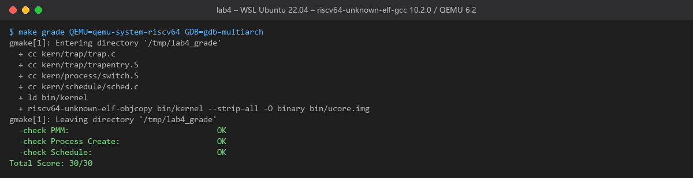
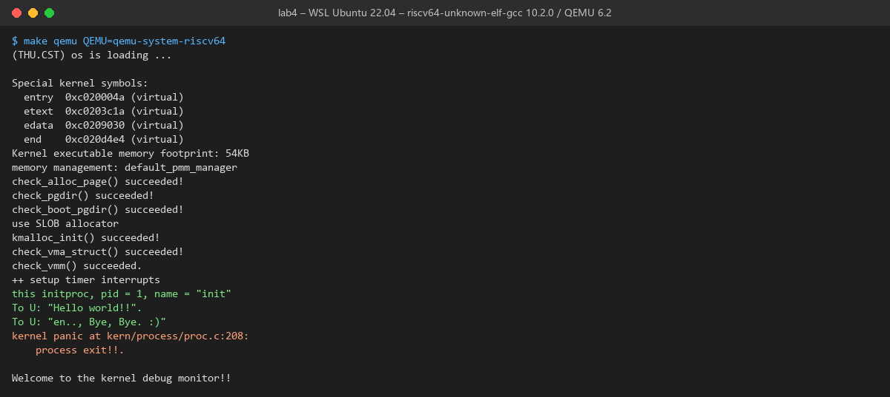

# Lab4 实验报告（C：2412440-王朝阳）

## 实验基本信息

| 项目 | 内容 |
|------|------|
| **实验名称** | Lab 4：进程管理 |
| **小组成员** | 2413541-赖鸿毅（A）、2412386-唐港（B）、2412440-王朝阳（C） |
| **完成日期** | 2026-11-16 |
| **代码分支** | `lab4-c`（基于小组 `lab4` 分支，含 A 的 PMM 与 B 的进程创建代码） |
| **本模块改动文件** | `kern/trap/trapentry.S`、`kern/trap/trap.c`、`kern/process/switch.S`、`kern/schedule/sched.c` |
| **报告文件** | `report/C-report.md`（本文件的模块三、Challenge、未覆盖知识点和测试章节） |
| **测试截图** | `report/images/lab4_make_qemu.png`、`report/images/lab4_make_grade.png` |

### 小组分工

| 成员 | 负责的练习/模块 |
|------|----------------|
| 2413541-赖鸿毅（A） | lab2 PMM 基线、功能模块一（`page_insert`/`page_remove`）、整体逻辑线、`get_pte` Challenge |
| 2412386-唐港（B） | 功能模块二（`alloc_proc`、`copy_mm`、`copy_thread`、`do_fork`、`kernel_thread`、`proc_init`）、功能模块三中的 `cpu_idle`/`proc_run`、分页模式 Challenge |
| 2412440-王朝阳（C） | lab3 Trap 基线迁入 lab4、功能模块三（`schedule`/`switch_to`）、模块三报告正文、`local_intr_save` Challenge、未覆盖知识点、最终测试截图与合并验证 |

> 按小组约定，模块三的报告正文由 C 统一撰写，包含 B 实现的 `cpu_idle`/`proc_run`。
> 模块一、模块二的详细分析见 A、B 各自的报告，本文不重复。

---

## 一、实验目的

1. 理解进程与内核线程的区别，掌握 PCB、内核栈、trapframe 三者的关系；
2. 掌握进程调度的基本流程：选择进程、切换地址空间、切换寄存器上下文；
3. 掌握 `schedule()` 的轮转策略，理解循环链表哨兵对遍历的影响；
4. 掌握 `switch_to()` 只保存 callee-saved 寄存器的原因与上下文布局；
5. 理解 `local_intr_save/restore` 如何保存并恢复中断状态，以及为什么它能正确嵌套；
6. 把 lab3 的 Trap 基线迁移到 lab4，保证被中断的进程能原样恢复。

---

## 二、实验环境

| 项目 | 内容 |
|------|------|
| 运行环境 | WSL2 Ubuntu 22.04（Windows 11） |
| 交叉工具链 | `riscv64-unknown-elf-gcc 10.2.0` |
| 模拟器 | `qemu-system-riscv64 6.2` |
| 调试器 | `gdb-multiarch`（环境中没有 `riscv64-unknown-elf-gdb`） |
| 全量构建 | `make -j4`（在 WSL 的 `/root/lab4-c` 内构建，不在 `/mnt/c` 内编译） |
| 评分 | `make grade QEMU=qemu-system-riscv64 GDB=gdb-multiarch` |

环境里有两个需要显式处理的差异：

- shell 中已经定义了 `QEMU=qemu`，会覆盖 Makefile 的默认值，因此运行时显式指定 `QEMU=qemu-system-riscv64`；
- 评分脚本默认使用 `riscv64-unknown-elf-gdb`，本机改用 `GDB=gdb-multiarch`，其余流程不变。

---

## 三、实验整体逻辑分析（C 视角）

模块三位于整条启动链的最后一段：

```text
kern_init()
  ├─ pmm_init()          A：物理页、页表、get_pte
  ├─ proc_init()         B：idleproc / initproc，initproc 进入 proc_list
  └─ cpu_idle()          C 负责的调度闭环
        └─ schedule()
              └─ proc_run()
                    └─ switch_to()
```

C 的工作可以分成两部分：

1. **把 lab3 的 Trap 基线迁入 lab4**：`trapentry.S` 的 `RESTORE_ALL`/`__alltraps`，
   `trap.c` 的 `interrupt_handler`/`exception_handler`。没有这条基线，
   进程被时钟中断打断后无法正确恢复，调度也就无从谈起。
2. **实现模块三的调度核心**：`schedule()` 负责“选谁”，`switch_to()` 负责“怎么换”。
   `cpu_idle()` 与 `proc_run()` 由 B 实现，本文按调用链一并解释。

本实验的调度是**协作式**的：`cpu_idle()` 在 `need_resched` 为真时调用 `schedule()`，
评分测试也直接调用 `schedule()`。时钟中断只负责续期和 tick 统计，
没有在中断处理里设置 `need_resched`，也没有在 Trap 返回路径上做抢占检查。
这个边界在第六节“未覆盖知识点”中展开。

---

## 四、实验内容与实现

### 4.1 lab3 Trap 基线迁入 lab4

#### 4.1.1 `trapentry.S`：`RESTORE_ALL` 与 `__alltraps`

`SAVE_ALL` 与 `struct trapframe` 的布局是框架给定的：36 个 8 字节槽位，依次为
`x0~x31`、`sstatus`、`sepc`、`badaddr`、`cause`。C 需要补齐恢复侧和传参：

```asm
.macro RESTORE_ALL
#lab3 function1 2412440
    LOAD s1, 32*REGBYTES(sp)
    LOAD s2, 33*REGBYTES(sp)
    csrw sstatus, s1
    csrw sepc, s2

    LOAD x1, 1*REGBYTES(sp)
    LOAD x3, 3*REGBYTES(sp)
    ...
    LOAD x31, 31*REGBYTES(sp)

    addi sp, sp, 36*REGBYTES
.endm

__alltraps:
    SAVE_ALL
    addi a0, sp, 0
    jal trap
```

三个关键点：

- **先恢复 `sstatus` 和 `sepc`，再恢复通用寄存器。** `sret` 依赖这两个 CSR；
  如果先恢复 `sp` 或其它寄存器，后面按偏移取 `sstatus/sepc` 时栈指针已经变了。
- **`x0` 不需要恢复。** 它恒为 0，`SAVE_ALL` 里对应的槽位只是占位。
- **`sp` 最后用 `addi` 加回去。** `SAVE_ALL` 先 `addi sp, sp, -36*REGBYTES`，
  所以 `sp + 36*REGBYTES` 正好等于进入 Trap 前的原始值，等价于恢复被中断代码的栈指针。

`__alltraps` 里 `addi a0, sp, 0` 是按 RISC-V 调用约定把 trapframe 首地址作为第一个参数传给 `trap()`。

#### 4.1.2 `trap.c`：中断与异常处理

```c
//lab3 function2 2412440
void interrupt_handler(struct trapframe *tf)
{
    intptr_t cause = (intptr_t)((tf->cause << 1) >> 1);

    switch (cause)
    {
    case IRQ_S_TIMER:
        clock_set_next_event();          // 必须续期，否则只有一次时钟中断
        ticks++;
        if (ticks % TICK_NUM == 0)
        {
            print_ticks();
            if (ticks >= (size_t)SHUTDOWN_AFTER * TICK_NUM)
                sbi_shutdown();
        }
        break;
    case IRQ_S_SOFT: cprintf("Supervisor software interrupt\n"); break;
    case IRQ_S_EXT:  cprintf("Supervisor external interrupt\n"); break;
    default:         print_trapframe(tf); break;
    }
}

void exception_handler(struct trapframe *tf)
{
    switch (tf->cause)
    {
    case CAUSE_ILLEGAL_INSTRUCTION:
        tf->epc += insn_length(tf->epc);
        break;
    case CAUSE_BREAKPOINT:
        tf->epc += insn_length(tf->epc);
        break;
    default:
        print_trapframe(tf);
        break;
    }
}
```

`cause` 的最高位是“中断/异常”标志，处理前先用移位清掉；剩下的才是原因码。
非法指令和断点异常必须按真实指令长度推进 `epc`：低 2 位为 `0b11` 是 32 位指令，
否则是 16 位压缩指令。若不推进，`sret` 会回到同一条指令，形成死循环。

### 4.2 `schedule()`：轮转选择可运行进程

```c
//LAB4 function3 2412440
void schedule(void)
{
    bool intr_flag;
    list_entry_t *head = &proc_list;
    list_entry_t *le, *start;
    struct proc_struct *next = NULL;

    local_intr_save(intr_flag);
    current->need_resched = 0;

    start = (current == idleproc) ? list_next(head) : list_next(&(current->list_link));
    le = start;

    if (!list_empty(head)) {
        do {
            if (le != head) {
                struct proc_struct *proc = le2proc(le, list_link);
                if (proc->state == PROC_RUNNABLE && proc != current) {
                    next = proc;
                    break;
                }
            }
            le = list_next(le);
        } while (le != start);
    }

    if (next == NULL)
        next = idleproc;

    proc_run(next);
    local_intr_restore(intr_flag);
}
```

设计要点：

1. **关中断 + 清标志。** `schedule()` 与 `proc_run()` 都会 `local_intr_save`，
   形成嵌套；内层读到“已经关中断”后恢复时不会误开中断（见第五节）。
2. **起点。** idleproc 不在 `proc_list` 中，所以当前是 idleproc 时从链表头开始；
   否则从当前进程的下一个节点开始，实现轮转。
3. **整圈遍历。** `proc_list` 是带哨兵头的循环链表。不能写成 `while (le != head)`：
   当前进程是链表尾时，`list_next` 一步就回到 `head`，循环一次都不执行，
   会直接回退 idleproc，链表头的可运行进程反而轮不到。
   正确写法是 `do { ... } while (le != start)`，中途遇到 `head` 只跳过、不终止。
4. **排除 `current`。** 如果当前是唯一可运行进程，选中自己会让 `proc_run` 直接返回，
   看起来调度成功、实际没有进展。排除后，没有别的进程就回退 idleproc。
5. **回退 idleproc。** idleproc 是调度器的兜底，保证 `next` 永远不是 `NULL`。

用评分测试走一遍（链表顺序 `head → t2 → t1 → init → head`）：

| 轮次 | current | 起点 | 选中 | 结果 |
|---|---|---|---|---|
| 1 | init | head → t2 | t2 | t2 第一次运行，置 `thread2_ran` |
| 2 | t2 | t1 | t1 | t1 第一次运行，置 `thread1_ran` |
| 3 | t1 | init | init | 回到 init 的第 1 次循环之后 |
| 4 | init | head → t2 | t2 | t2 继续第 2 次循环 |

8 轮内两个标志都被置 1，`assert(test_thread1_ran && test_thread2_ran)` 通过。

### 4.3 `switch_to()`：保存与恢复上下文

`struct context` 的布局与偏移（RV64，每字段 8 字节）：

| 字段 | 偏移 | 类别 |
|---|---:|---|
| `ra` | 0 | 返回地址 |
| `sp` | 8 | 栈指针 |
| `s0` | 16 | callee-saved |
| `s1` | 24 | callee-saved |
| `s2` | 32 | callee-saved |
| `s3` | 40 | callee-saved |
| `s4` | 48 | callee-saved |
| `s5` | 56 | callee-saved |
| `s6` | 64 | callee-saved |
| `s7` | 72 | callee-saved |
| `s8` | 80 | callee-saved |
| `s9` | 88 | callee-saved |
| `s10` | 96 | callee-saved |
| `s11` | 104 | callee-saved |

```asm
//LAB4 function3 2412440
switch_to:
    # from = a0, to = a1
    sd ra,  0*8(a0)
    sd sp,  1*8(a0)
    sd s0,  2*8(a0)
    ...
    sd s11, 13*8(a0)

    ld ra,  0*8(a1)
    ld sp,  1*8(a1)
    ld s0,  2*8(a1)
    ...
    ld s11, 13*8(a1)
    ret
```

为什么只保存 14 个寄存器：

- RISC-V 把寄存器分为 caller-saved（`t0~t6`、`a0~a7`）和 callee-saved（`s0~s11`、`sp`、`ra`）。
- `switch_to` 是被 C 调用的函数，调用者本来就不能假设 `t*`、`a*` 在调用后保持不变，
  编译器会在需要时自己保存；`switch_to` 只要保证 `s*`、`sp`、`ra` 与进入时一致即可。
- 因此上下文只有 14 个字段，`sizeof(struct context) == 112`，与 B 报告中的编译期断言一致。

对普通进程，`ra` 指向它上次调用 `switch_to` 之后的返回地址；对新进程，
`copy_thread()` 把 `ra` 设为 `forkret`、`sp` 设为 `proc->tf`，所以第一次切换的链路是：

```text
switch_to → ret → forkret → forkrets(current->tf) → RESTORE_ALL → sret
          → kernel_thread_entry → fn(arg)
```

### 4.4 `cpu_idle()` 与 `proc_run()`（B 实现，C 解读）

```c
void cpu_idle(void)
{
    while (1)
    {
        if (current->need_resched)
            schedule();
    }
}

void proc_run(struct proc_struct *proc)
{
    bool intr_flag;
    local_intr_save(intr_flag);

    struct proc_struct *from = current;
    if (from != proc)
    {
        current = proc;
        write_csr(satp, 0x8000000000000000 | (proc->pgdir >> RISCV_PGSHIFT));
        flush_tlb();
        switch_to(&from->context, &proc->context);
    }

    local_intr_restore(intr_flag);
}
```

- `cpu_idle()` 决定“什么时候调度”。idleproc 不在 `proc_list` 中，它是兜底进程；
  第一次调度由 `proc_init()` 把 `idleproc->need_resched` 置 1 触发。
- `proc_run()` 决定“怎么换”。必须先保存 `from = current` 再改 `current`，
  否则 `switch_to` 会把旧进程的上下文写进新进程的 PCB。
- `satp` 的 MODE 是 8，位于 bit 63..60，即 `0x8000000000000000`；PPN 在 bit 43..0。
  不能用 `lsatp()`，因为它表达不了 Sv39 模式。
- 换页表后必须 `flush_tlb()`，否则旧进程的 TLB 项会让新进程访问到错误的物理页。
- `proc_run()` 自己也关中断，因此可以被“已经关中断的 `schedule()`”调用，
  也可以被其它路径单独调用。

### 4.5 模块三的 spec 与 prompt

#### spec

| 项目 | 内容 |
|---|---|
| 输入 | `proc_list`、`current`、`idleproc`、`state`、`need_resched` |
| 输出 | 无返回值；`current` 指向被选中的进程，完成页表/寄存器切换 |
| 选择规则 | 从当前进程的下一个节点轮转；idleproc 从链表头开始；只选 `PROC_RUNNABLE`；跳过哨兵；找不到回退 idleproc |
| 原子性 | 选择 + `proc_run` 全程关中断；`schedule`/`proc_run` 的关中断可嵌套 |
| 上下文 | 只保存 `ra, sp, s0~s11`，偏移 `0, 8, ..., 104` |
| 验收 | `[Test Schedule] PASS`；`make grade` 30/30；initproc 三条输出正确 |

#### prompt（实际使用）

```text
你在 ucore lab4（RISC-V 64，Sv39）中实现进程调度，只改两个文件：
1) kern/schedule/sched.c 的 schedule()：
   - local_intr_save 关中断，current->need_resched = 0；
   - 当前不是 idleproc 时从 current->list_link 的下一个节点开始轮转，
     当前是 idleproc 时从 proc_list 的第一个节点开始；
   - proc_list 是带哨兵头的循环链表，必须跳过 &proc_list；
     当前是链表尾时要继续走到链表头，不能遇到哨兵就停；
   - 只选 state == PROC_RUNNABLE 且不等于 current 的进程；
   - 找不到就回退 idleproc；最后 proc_run(next)，local_intr_restore。
2) kern/process/switch.S 的 switch_to(from=a0, to=a1)：
   - 保存 from 的 ra, sp, s0~s11，共 14 个 8 字节字段，偏移 0,8,...,104；
   - 从 to 恢复同样的字段，最后 ret；
   - 只保存 callee-saved，不要保存 t0~t6、a0~a7。
约束：不要改 proc.c、不要整文件覆盖 lab3 代码；保持 //LAB4 function3 注释；
不要用 lsatp()，satp 由 proc_run 负责。
```

#### 迭代记录

**第一次：遍历在哨兵处提前结束。**
初稿写成 `while (le != head)`。推演测试场景时发现：`current` 是链表尾 `init` 时，
`init->next` 就是 `head`，循环一次都不执行，直接回退 idleproc，t1/t2 永远轮不到。
改为整圈遍历 `do { ... } while (le != start)`，中途跳过 `head`。

**第二次：忘记排除 `current`。**
当前进程是唯一可运行进程时，选中自己会让 `proc_run` 的 `from == proc` 分支直接返回，
`need_resched` 已被清 0，调度器空转。加上 `proc != current` 后语义正确。

**第三次：`switch_to` 的位宽。**
RV64 必须用 `sd/ld`。如果照搬 RV32 的 `sw/lw`，`ra`、`sp` 的高 32 位丢失，
切换后直接跳飞。最终统一 `sd/ld`，偏移按 `0*8 ... 13*8` 书写。

### 4.6 测试结果

```text
  -check PMM:                                OK
  -check Process Create:                     OK
  -check Schedule:                           OK
Total Score: 30/30
```



`make qemu` 输出：

```text
++ setup timer interrupts
this initproc, pid = 1, name = "init"
To U: "Hello world!!".
To U: "en.., Bye, Bye. :)"
kernel panic at kern/process/proc.c:208:
    process exit!!.
```



`process exit!!` 的 panic 是本实验简化 init 流程的预期行为：`init_main` 打印完三条消息后返回，
`kernel_thread_entry` 调用 `do_exit()`，而本实验的 `do_exit()` 直接 panic。

---

## 五、Challenge：`local_intr_save` / `local_intr_restore`

### 5.1 实现

```c
static inline bool __intr_save(void) {
    if (read_csr(sstatus) & SSTATUS_SIE) {
        intr_disable();
        return 1;
    }
    return 0;
}

static inline void __intr_restore(bool flag) {
    if (flag)
        intr_enable();
}

#define local_intr_save(x)    do { x = __intr_save(); } while (0)
#define local_intr_restore(x) __intr_restore(x);
```

它保存的不是“关了几次中断”，而是**进入临界区之前 `SIE` 是否为 1**。

### 5.2 嵌套推演

设初始 `SIE = 1`，A 进入临界区后调用 B：

| 步骤 | 操作 | flag | 当前 SIE |
|---|---|---|---|
| 1 | A: save | `true` | 0 |
| 2 | B: save | `false`（读到的已经是 0） | 0 |
| 3 | B: restore | — | 0（false，不动作） |
| 4 | A: restore | — | 1（true，重新开中断） |

内层 save 读到 0，返回 `false`，所以内层 restore 不会提前开中断；
只有最外层 restore 才恢复到进入前的状态。这就是它能正确嵌套的原因。

### 5.3 在调度中的意义

`schedule()` 关中断后调用 `proc_run()`，`proc_run()` 又关一次：
内层 `flag2 = false`，`switch_to` 返回后内层恢复不动作；
直到回到 `schedule()` 外层才恢复中断。这样“选择进程 + 改 `current` + 切 `satp` + 切寄存器”
构成一个不可分割的临界区。

### 5.4 边界

- 只关 S 模式中断，不影响 M 模式与 NMI；
- 只保护本 hart，多核需要自旋锁；
- 没有内存屏障，弱内存模型下共享数据还需要 `fence`/原子操作；
- flag 是局部变量，`save/restore` 必须成对且不能跨函数丢失；
- 临界区应尽量短，避免恶化中断延迟。

---

## 六、本实验未覆盖的知识点

1. **用户态与系统调用**：本实验所有线程都在 S 模式运行，没有 U 模式、`ecall`、用户栈与
   `copy_from_user/copy_to_user`，也没有真正的地址空间隔离。
2. **抢占式调度**：时钟中断没有设置 `need_resched`，Trap 返回路径也没有检查它；
   本实验只有 `cpu_idle()` 和测试代码两个调度点，不是时间片抢占。
3. **调度策略**：只有最朴素的轮转，没有优先级、CFS、实时调度、睡眠队列与负载均衡。
4. **同步与通信**：只有关中断临界区，没有信号量、互斥锁、条件变量、等待队列、管道、共享内存。
5. **内存管理进阶**：没有缺页异常、按需分页、COW、页面置换、swap、`mmap`、大页与 TLB shootdown。
6. **文件系统与设备**：没有 VFS、inode、页缓存、块设备驱动、PLIC 外部中断与 DMA。
7. **多核**：单 hart，`current` 与 `proc_list` 没有多核保护，没有 per-CPU 变量与 IPI。
8. **上下文完整性**：只保存 14 个整数寄存器，没有浮点/向量上下文、栈保护页与栈溢出检测。
9. **可靠性与安全**：`panic()` 直接死循环，没有崩溃转储、日志、权限模型、KASLR、SMEP/SMAP。
10. **测试局限**：30/30 只验证最小闭环，不验证公平性、顺序、饥饿、长时间运行与多核正确性。

详细讨论见本报告第六节。

---

## 七、测试与验证

| 检查项 | 结果 |
|---|---|
| `make obj/kern/trap/trapentry.o` | 通过 |
| `make obj/kern/trap/trap.o` | 通过 |
| `make obj/kern/process/switch.o` | 通过 |
| `make obj/kern/schedule/sched.o` | 通过 |
| 全量 `make -j4` | 通过 |
| `sizeof(struct context) == 112` | 通过 |
| `[Test PMM]` / `[Test Process Create]` / `[Test Schedule]` | 全部 PASS |
| `make grade` | **30/30** |
| `make qemu` | initproc 三条输出正确，随后按预期 `process exit!!` |

最终验证在合并 A、B、C 三部分代码后进行（`lab4-c` 目录已包含 A 的 PMM 与 B 的进程创建代码），
确保 C 的调度代码与其它模块的接口一致。

---

## 八、C 的个人总结

1. **Trap 是调度能成立的前提。** 调度切换的是“上下文”，而上下文的保存/恢复格式由
   `SAVE_ALL`/`RESTORE_ALL` 和 `struct trapframe` 决定。先确认偏移和恢复顺序，
   再写调度，调试点会少很多。
2. **链表哨兵是模块三最容易踩的坑。** `while (le != head)` 看起来天经地义，
   但在“当前是链表尾”时会把整圈遍历变成零次。把测试场景画成链表图之后，问题一眼就能看出来。
3. **上下文切换只保存 callee-saved 不是偷懒，而是调用约定。** 理解“谁负责保存哪些寄存器”，
   才能解释为什么 14 个字段就够了，也才能发现误用 `sw/lw` 这类位宽错误。
4. **关中断解决的是“本核不被打断”，不是“并发安全”。** 它不能替代锁，
   更不能在多核下保护共享数据；临界区应当尽量短。
5. **测试断言就是需求文档。** `assert(test_thread1_ran && test_thread2_ran)` 直接规定了
   “两个线程都必须被轮到”，比文字描述更能约束实现。

---

## 附：交付文件清单

| 文件 | 说明 |
|---|---|
| `code/kern/trap/trapentry.S` | lab3 Trap 基线：`RESTORE_ALL`、`__alltraps` |
| `code/kern/trap/trap.c` | lab3 Trap 基线：中断/异常处理 |
| `code/kern/process/switch.S` | `switch_to` 上下文切换 |
| `code/kern/schedule/sched.c` | `schedule` 轮转调度 |
| `report/C-report.md` | 本报告（C 独立完整版） |
| `report/images/lab4_make_qemu.png` | `make qemu` 运行截图 |
| `report/images/lab4_make_grade.png` | `make grade` 30/30 截图 |

> 本报告及 C 的代码已提交到 `lab4` 分支；最终总报告见 `report/report.md`。
