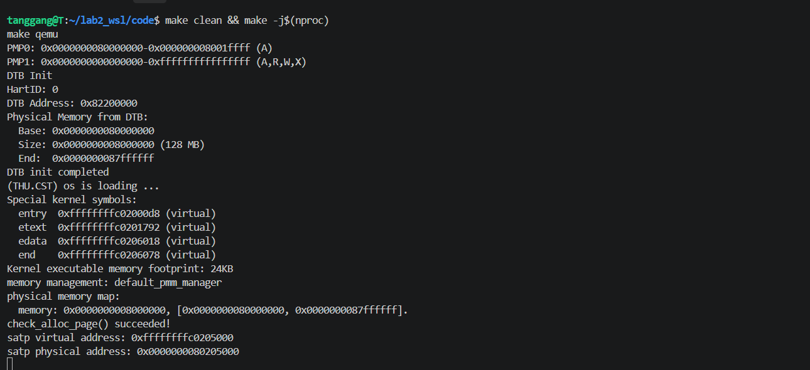
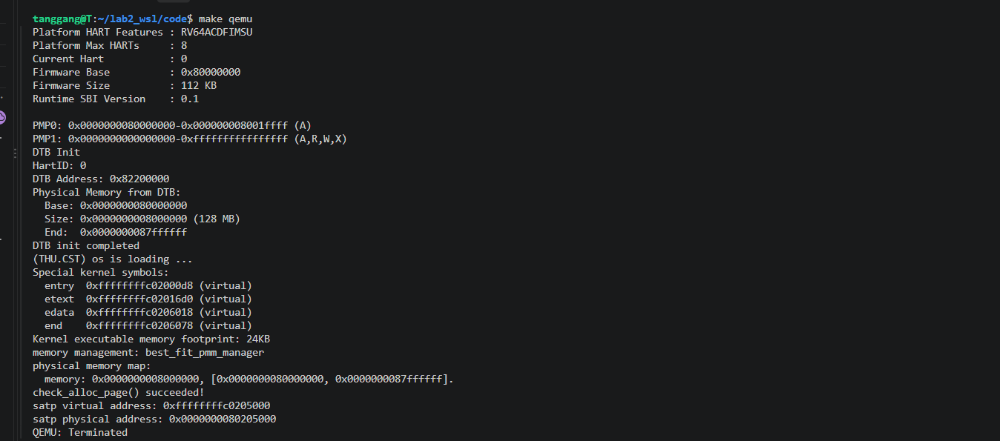
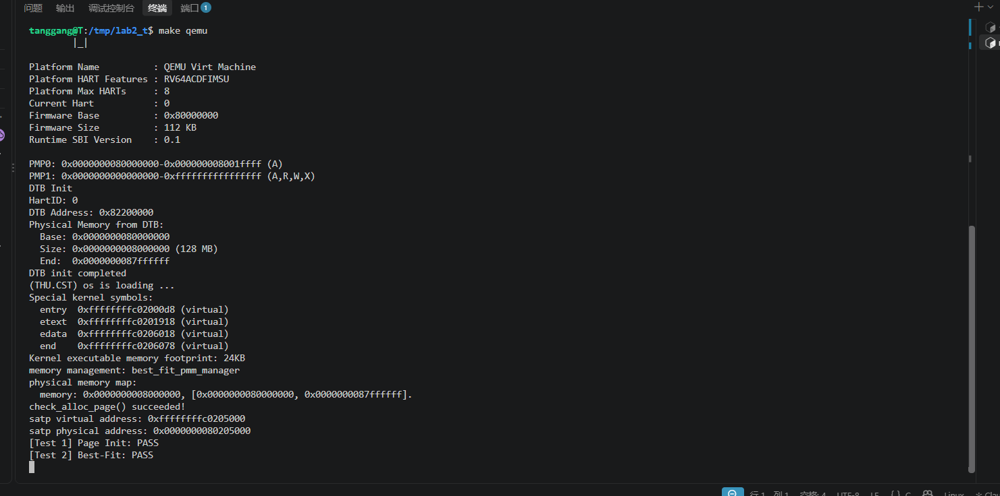
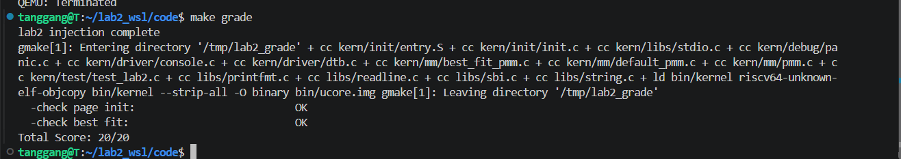
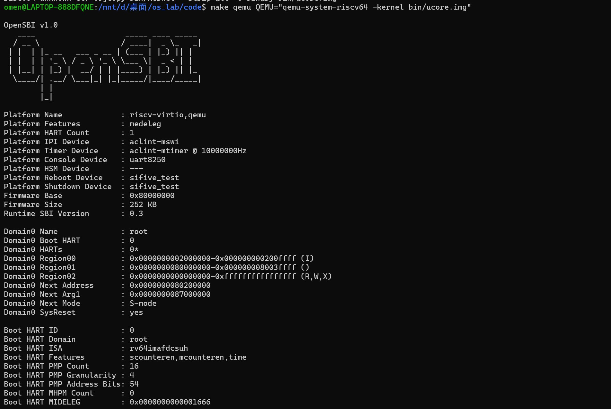
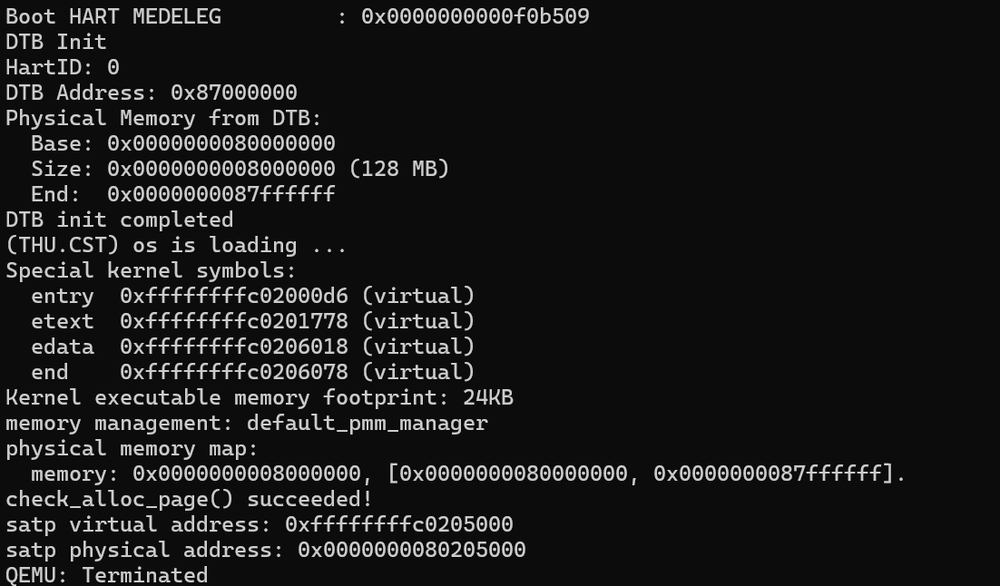
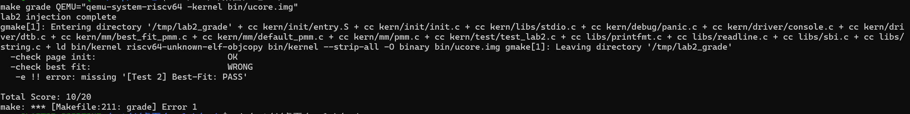

# 操作系统实验报告

## 实验基本信息

|项目|内容|
|---|---|
|**实验名称**|Lab 2: 物理内存和页表|
|**小组成员**|2413541-赖鸿毅、2412386-唐港、2412440-王朝阳|
|**完成日期**|2026-10-22|

### 小组分工

练习如何分工？

三个人按"代码文件不重叠"切成三条可并行的工作线（唯一共享文件是 `kern/mm/pmm.c`：赖鸿毅写 `page_init()`，唐港只改 `init_pmm_manager()` 里切换管理器的一行）：

|成员|负责的练习/模块|主要交付物|
|---|---|---|
|2413541-赖鸿毅|功能模块一 · 任务一 `page_init()`；功能模块一 Challenge 思考题；环境适配（启动页表 / QEMU 版本）；分支任务（gdb 调试 QEMU 的页表查询）|`code/kern/mm/pmm.c`、`code/kern/init/entry.S`、`report/prompt.md` P1|
|2412386-唐港|功能模块二 · 任务一 First-Fit 思考题；任务二 Best-Fit 实现与 `init_pmm_manager()` 切换；测试与验证|`code/kern/mm/best_fit_pmm.c`、`code/kern/mm/pmm.c`（第 37 行）、`prompt.md` P2、`report/images/`|
|2412440-王朝阳|功能模块二 · 任务三 Buddy System（两份 prompt + 测试）；Challenge SLUB（两份 prompt + 测试）|`code/kern/mm/buddy_pmm.*`、`code/kern/mm/slub.*`、`code/kern/init/init.c`、`prompt.md` P3–P6|

**接口约定（开工前定，避免互相阻塞）：**

1. `init_memmap(base, n)` 收到的描述符仍然处于 `PG_reserved`，由 `init_memmap` 内部自己清（它开头就 `assert(PageReserved(p))`）。
2. 空闲区两端按页对齐；末尾不足一页的部分不下发；区间为空时不得调用 `init_memmap()`。
3. 地址换算一律只用 `page2pa / pa2page / PADDR`，不允许把虚拟地址当物理地址。
4. 加分项（Buddy/SLUB）**不切换**活动 `pmm_manager`，改为"借一段私有页自检、测完原样归还"，因此加进来后 `make grade` 仍是 20/20。
5. 谁都不修改 `tools/{test_lab2.c,inject.py,grade.sh}` 与 `basic_check/best_fit_check`。

实验报告如何分工？

|成员|撰写的报告章节|
|---|---|
|2413541-赖鸿毅|一、实验目的；二、实验环境；三、整体逻辑分析；四、功能模块零（QEMU 适配）、功能模块一（含 Challenge）、4.8 分支任务（QEMU 调试）；6.1 对操作系统的理解|
|2412386-唐港|四、功能模块二（First-Fit 思考题）、功能模块三（Best-Fit 与改进空间）；五、测试与验证|
|2412440-王朝阳|四、扩展任务 Buddy System、扩展任务 SLUB；6.2 AI 协作开发的经验|

---

## 一、实验目的

本实验的主要目的是：

1. **理解页表的建立和使用方法**：掌握 Sv39 三级页表的结构、页表项（PTE）各标志位的含义、`satp` 寄存器与 `sfence.vma` 的作用，理解"虚拟地址 → 物理地址"的硬件翻译过程，并亲手把内核从"裸跑物理地址"切换到"运行在虚拟地址空间"。
2. **理解物理内存的管理方法**：学会从设备树（DTB）探测物理内存范围，理解 `struct Page` 描述符数组的布局、`va_pa_offset` 表示的虚实偏移、`npage`/`nbase` 的含义，并理解为什么 OpenSBI、内核镜像和描述符数组占用的页面必须被排除在空闲区之外。
3. **理解页面分配算法**：通过阅读 First-Fit 实现掌握"空闲块链表 + 块头 `property` + 相邻块合并"的连续物理页管理模型，并在此基础上独立实现 Best-Fit；进一步通过 Buddy System 与 SLUB 体会"页级分配"与"任意大小对象分配"的分层思想。
4. **学习用 AI 辅助开发操作系统核心功能**：按四段式提示词框架（`[PROMPT]/[RELY]/[GUARANTEE]/[SPECIFICATION]`）把需求写清楚，通过"生成 → 编译 → 测试 → 优化提示词"的迭代闭环完成内核功能，而不是让 AI 代写代码。

---

## 二、实验环境

**（1）AI 编程工具**

|成员|AI 编程工具|底层模型|
|---|---|---|
|2413541-赖鸿毅|DeepSeek Harness（DSH 桌面版）|DeepSeek-V4-Flash|
|2412386-唐港|DeepSeek Harness|DeepSeek-V4-Pro|
|2412440-王朝阳|DeepSeek|DeepSeek-V4-Pro|

**（2）开发与验证环境（本组实测版本）**

|项目|内容|
|---|---|
|工程|`code/`（`Makefile` 中 `PROJ := lab2`）|
|运行环境|Windows 11 + WSL2，Ubuntu 22.04.5 LTS（内核 6.6.87.2-microsoft-standard-WSL2）|
|交叉工具链|`riscv64-unknown-elf-gcc 15.1.0`、`ld`（GNU Binutils 2.45）、`objcopy`|
|模拟器|`qemu-system-riscv64 7.0.0`，自带 OpenSBI v1.0（`-bios default`）|
|评分脚本|`make grade`（`tools/inject.py` + `tools/grade.sh`，满分 20：Test 1 = 10，Test 2 = 10）|
|代码托管|https://github.com/Cameron195-fly/OS_Lab_Group55|

**（3）一处必须记录的环境适配**

课程推荐的模拟器是 QEMU 4.1.1，而本组用的是 QEMU 7.0.0，这带来两处差异，直接决定了内核能否启动（详见"四、功能模块零"）：

```bash
# QEMU >= 5.x 必须用 -kernel 指定启动地址（否则 OpenSBI 跳到 0x0）
make qemu  QEMU="qemu-system-riscv64 -kernel bin/ucore.img"
make grade QEMU="qemu-system-riscv64 -kernel bin/ucore.img"
```

`Makefile` 与 `tools/grade.sh` 均未修改，只在命令行覆盖 `QEMU` 变量，保证在 QEMU 4.1.1 的评测机上仍按课程原样工作。

另外仓库加了 `.gitattributes`（`* text=auto eol=lf`），统一源码与 `Makefile` 为 LF：本工程在 WSL 里编译，`Makefile` 一旦带 CRLF 会直接报 `*** missing separator`。

---

## 三、实验整体逻辑分析

### 3.1 本章节的逻辑主线

本章围绕**"内核如何认识、组织并分配物理内存，并在此之上建立第一张页表进入虚拟内存访问模式"**这一主题展开。

实验一结束时，内核只是被 OpenSBI 直接放到物理地址 `0x80200000` 上裸跑的代码：CPU 处于 S Mode、`satp` 的 MODE 为 Bare，取指与访存全部直接走物理地址。实验二要解决两个问题：

1. **物理内存归谁管、怎么管。** 内核必须先知道自己能管理哪段物理内存（从 DTB 探测到 `[0x80000000, 0x88000000)` 的 128 MiB DRAM），再为其中每个物理页准备一个 `struct Page` 描述符，把"已被 OpenSBI / 内核镜像 / 描述符数组自己占用"的页面标记为保留，剩下的完整页面才交给物理内存管理器（`pmm_manager`）。这条链是 `pmm_init() → init_pmm_manager() → page_init() → init_memmap() → alloc_pages()/free_pages()`。
2. **地址空间怎么翻译。** 链接脚本把内核起始地址改到高地址 `0xffffffffc0200000` 后，内核里的符号全部变成虚拟地址，而 CPU 还处在 Bare 模式。于是 `entry.S` 在进入 `kern_init()` 之前先放好一张"启动页表"（`boot_page_table_sv39`），用 1 GiB 大页把 `[0xffffffffc0000000, 0xffffffffffffffff]` 映射到 `[0x80000000, 0xc0000000)`，写入 `satp` 并执行 `sfence.vma` 刷新 TLB，从此内核运行在虚拟地址空间，虚实偏移量为 `PHYSICAL_MEMORY_OFFSET = 0xFFFFFFFF40000000`。

两条线的关系是：**"管理物理内存"是"建立页表映射"的物质基础**（页表本身要占物理页，PTE 里的 PPN 也是物理页号），而 **`va_pa_offset`（`PADDR`/`page2page` 系列）是两条线之间的桥梁**——只有先定下虚实偏移，`page_init()` 才能把描述符数组的虚拟地址翻译成物理地址，从而算出真正可分配的内存起点。

### 3.2 功能的逐步实现

1. **先让内核跑在高地址虚拟空间里**（`entry.S` + `tools/kernel.ld`）。这是后续一切的前提：要通过页表访问内存，就必须先有一张能用的页表并打开分页，否则连 `kern_init()` 都跳不过去。这里用 1 GiB 大页"偷懒"，换来的是极低的实现复杂度。
2. **再让内核知道自己有多少内存**（`dtb_init()`）。打开分页之后，内核下一步要确定"我能管哪块内存"。RISC-V 的物理内存布局由 OpenSBI 扫描后以 DTB 形式给出，地址经 `a1` 寄存器传给内核，`kern_init()` 一开始就 `dtb_init()` 解析出 `memory_base`/`memory_size`，并通过 `get_memory_base()`/`get_memory_size()` 暴露。**为什么必须放在最前面**：`page_init()` 的全部计算都以这两个值为基础。
3. **然后建立 Page 描述符数组并注册空闲页**（`page_init()`，本实验核心）。有了内存范围才能算 `npage`、算出描述符数组多大、放在 `end` 之后并页对齐，然后把 `[nbase, npage)` 的描述符全部置保留，再把描述符数组之后的完整空闲页面通过 `pa2page()` 交给 `init_memmap()`。**为什么必须在分配之前做**：分配器的所有断言（`assert(PageReserved(p))`、`nr_free` 统计）都建立在"布局已正确"这一前提上。
4. **再实现并替换页面分配算法**（`default_pmm.c` 阅读 + `best_fit_pmm.c` 实现 + `init_pmm_manager()` 切换）。`pmm_manager` 只是一组函数指针（`init/init_memmap/alloc_pages/free_pages/nr_free_pages/check`），框架给了 First-Fit 作为参照。先读懂 First-Fit（它定义了"块头 + `property` + 有序链表 + 相邻合并"的状态约定），再按同一约定实现 Best-Fit，就得到可替换、可比较的分配器。**为什么切换要在 `page_init()` 之后生效**：`init_pmm_manager()` 先于 `page_init()` 调用，`page_init()` 里的 `init_memmap()` 会转调当前管理器的实现，所以"切换"与"用哪个管理器建空闲区"是同一件事。
5. **最后用 Buddy/SLUB 与 QEMU 源码调试把机制打通**。页级分配只能给出 2^n 个连续页，回答不了"内核想要一个 96 字节对象怎么办"：Buddy 展示按阶分裂/合并的页级分配，SLUB 展示"页分配器之上再切分对象"的两层架构。而"功能模块零"里的启动页表排错，则把 `satp`/PTE/地址翻译这些抽象落到了具体的寄存器和 C 代码上。

---

## 四、实验内容与实现

### 4.1 功能模块零：启动页表在 QEMU ≥ 5.x 上的适配（环境适配，非练习内容）

**负责人：** 2413541-赖鸿毅

**问题现象**：按指导书原样编译后 `make qemu`，OpenSBI 打印完横幅后**内核一个字符都不输出**。用 `-d int` 看异常日志：

```text
riscv_cpu_do_interrupt: hart:0, async:0, cause:000000000000000c,
  epc:0x0000000080200038, tval:0x0000000080200038, desc=exec_page_fault
...（此后一直重复 epc:0x80200000，即 trap 到 stvec 的死循环）
```

即 `csrw satp`（`0x80200034`）之后，取的下一条指令 `sfence.vma`（`0x80200038`）就发生了**指令页错误**。

**定位过程**：

1. `riscv64-unknown-elf-gdb` attach 到 QEMU，读寄存器：`satp = 0x8000000000080207`、`stvec = 0x80200000`、`pc = 0x80200000`，说明 `entry.S` 已经执行过（`satp` 写进去了），随后陷入 trap 死循环。
2. 在复位状态（Bare 模式、物理寻址）用 gdb 直接读 RAM：页表在 `0x80207000`，`[511] = 0x200000cf`，**页表本身是对的**——"页表没进镜像"被排除。
3. 用 `-d int` 拿到出错 `epc`，再对 `QEMU` 源码（`target/riscv/cpu_helper.c` 的 `get_physical_address()`）插桩打印，确认走表时读到了合法叶子 PTE 却仍失败，最终定位到**缺低地址映射**。

**根本原因**：`csrw satp` 之后 MMU 立刻开始翻译"当前 PC"，而此刻 PC 还是物理地址 `0x80200038`（`sfence.vma` 那一条）。指导书的页表只映射了 `0xffffffffc0000000` 以上的高地址，所以取下一条指令就缺页。QEMU 4.1.1 里写 `satp` 不打断当前 translation block，靠"一条 TB 直接跑到 `jr t0`"侥幸通过；QEMU ≥ 5.x 修正了 TB 刷新，就必须让 `0x80xxxxxx` 这段在过渡期也可取指。

**修改**（`code/kern/init/entry.S`，只改页表内容，指令序列未动）：

```asm
    .zero 8 * 2                          # [0], [1] : unmapped
    .quad (0x80000 << 10) | 0xcf         # [2]   : 低 1GiB 恒等映射（过渡用）
    .zero 8 * (511 - 3)                  # [3] .. [510] : unmapped
    .quad (0x80000 << 10) | 0xcf         # [511] : 0xffffffff_c0000000 -> 0x80000000
```

* `[2]` 新增：低 1 GiB 恒等映射，只为覆盖 `csrw satp` 到 `jr t0` 之间的过渡取指；
* `[511]` 保持指导书语义：`0xffffffff_c0000000 → 0x80000000`（1 GiB 大页）；
* 标志位两处都用 `0xcf = 0b1100_1111 = V|R|W|X|A|D`，**U 必须为 0**。

> 附带踩坑：第一次修改时我把 `0xcf & ~0x10` 算成了 `0xbf`，其实 `0xcf` 的 bit4 本来就是 0，`0xbf` 反而把 U 置 1 了。新版 QEMU 按 RISC-V 特权规范实现了"S 模式不允许从 U=1 的页面取指"，于是又立刻 `exec_page_fault`。教训是 PTE 标志位要逐位核对，不要用"看起来对"的位运算去凑。

**验证**：修改后内核正常启动，输出见"五、测试与验证"里的启动日志/截图；该修改对 QEMU 4.1.1 同样安全（多一条合法映射，且不涉及用户态）。

---

### 4.2 功能模块一：物理内存初始化（`page_init()`）

**负责人：** 2413541-赖鸿毅

#### 4.2.1 模块功能描述

**需要实现/修改的函数：**

```c
// kern/mm/pmm.c
static void page_init(void);
```

**依赖但不修改的接口：**

```c
// kern/driver/dtb.c
uint64_t get_memory_base(void);
uint64_t get_memory_size(void);
// kern/mm/pmm.c
static void init_memmap(struct Page *base, size_t n);
// kern/mm/pmm.h
static inline ppn_t page2ppn(struct Page *page);
static inline uintptr_t page2pa(struct Page *page);
static inline struct Page *pa2page(uintptr_t pa);
static inline int page_ref(struct Page *page);
static inline void set_page_ref(struct Page *page, int val);
```

**功能说明：**

`page_init()` 是"物理内存探测结果"与"物理页分配器"之间的连接点：根据设备树提供的物理内存信息建立可管理物理页的描述符布局，并把排除 OpenSBI、内核镜像和描述符数组占用空间后的完整空闲页面交给当前 `pmm_manager`。它在整个系统里的位置是 `pmm_init()` 的第二步：

```text
pmm_init()
├── init_pmm_manager()    选一个管理器，调它的 init()
├── page_init()           ← 本模块：建描述符数组 + 注册空闲区
│     └── init_memmap() → pmm_manager->init_memmap()
└── check_alloc_page()    调 pmm_manager->check() 自检
```

它需要处理的主要场景：

* **物理内存探测**：`get_memory_base()`/`get_memory_size()` 得到 `[mem_base, mem_base+mem_size)`；信息无效（任一为 0）时 `panic()` 终止；
* **可管理上界**：不能超过框架给出的 `PHYSICAL_MEMORY_END`，即 `mem_end = min(mem_base + mem_size, PHYSICAL_MEMORY_END)`，而 `npage = PPN(mem_end)` 是**页号上界**（描述符覆盖 `[nbase, npage)`）；
* **描述符布局**：`va_pa_offset = PHYSICAL_MEMORY_OFFSET`；`pages = ROUNDUP((uintptr_t)end, PGSIZE)`；必须区分"描述符地址（虚拟）"和"物理地址"，数组末尾的物理地址要经 `PADDR` 转换；
* **已用空间排除**：先把 `[nbase, npage)` 的描述符全部 `SetPageReserved`，再把"描述符数组之后（页对齐）~ 内存末端（页向下对齐）"之间非空的完整页面区间，用 `pa2page()` 转成描述符起点交给 `init_memmap()`；
* **边界处理**：内存末尾不足一页的部分不下发；区间为空时不调用 `init_memmap()`。

#### 4.2.2 最终提示词

完整版本见 `report/prompt.md` 的 P1，此处摘录结构：

````markdown
[PROMPT]
**任务**：修改 kern/mm/pmm.c，在标有 `//lab2 function1 YOUR CODE` 的位置实现 page_init()，
完成物理内存探测与 Page 描述符初始化。

**操作要求**：你必须在项目中修改实际文件，而不是仅展示代码；保留现有代码，只在标记位置补全，
不得修改 pmm_init()、check_alloc_page()、init_pmm_manager() 等已有函数的逻辑。

**输出要求**：直接进行文件操作，使用下面 [RELY]、[GUARANTEE]、[SPECIFICATION] 的信息，
以工程真实代码为准，不要引入无关功能。

[RELY]
（宏）PGSIZE/PGSHIFT/PPN/ROUNDUP/ROUNDDOWN、KERNBASE、PHYSICAL_MEMORY_OFFSET、
PHYSICAL_MEMORY_END、PG_reserved/PG_property 及其配套宏、
（结构）struct Page { int ref; uint64_t flags; unsigned int property; list_entry_t page_link; }、
struct pmm_manager、
（全局量）pages、npage、nbase、va_pa_offset、链接符号 end、
（可用函数）get_memory_base()、get_memory_size()、panic()、cprintf()、init_memmap()、pa2page()、PADDR()

[GUARANTEE]
```c
static void page_init(void);
```
可以添加：static 辅助函数、内部宏、模块内静态变量。

[SPECIFICATION]
## page_init
**Pre-Condition**：分页已开启（satp 指向 boot_page_table_sv39，Sv39 大页映射）；
dtb_init() 已执行；pmm_manager 已由 init_pmm_manager() 初始化完毕。
**Post-Condition**：va_pa_offset == PHYSICAL_MEMORY_OFFSET；npage 是可管理物理页号上界；
pages 指向 end 之后页对齐的描述符数组；[nbase, npage) 内描述符全部保留；
当前 pmm_manager 已接管排除已用空间后、页对齐的完整空闲页面；打印探测到的内存范围。
  **Case 1**：DTB 有效且存在完整空闲页面 → 正确设置三个全局量，保留全部已用页，调用 init_memmap()。
  **Case 2**：DTB 信息无效（base 或 size 为 0）→ panic() 终止。
  **Case 3**：描述符数组之后没有完整页面 → 不调用 init_memmap()，不得误注册任何页面。
**Requirements**：可管理上界限制在 PHYSICAL_MEMORY_END 内；OpenSBI/内核镜像/描述符数组自身
占用的页面绝不能进入空闲区；内存末尾不足一页不下发。
````

#### 4.2.3 实现迭代过程

本模块的实现经历了 3 次迭代，过程如下（对应 git 记录）：

---

##### 第一次迭代：先解决"工程根本编不过"

**遇到的问题：** 原始骨架 `make` 直接失败，是**编译错误**而不是链接错误：

```text
kern/mm/best_fit_pmm.c:24:36: error: 'free_list' undeclared (first use in this function)
kern/mm/best_fit_pmm.c:28:34: error: 'nr_free' undeclared (first use in this function)
kern/mm/pmm.c:77:5: error: implicit declaration of function 'page_init'; did you mean 'pmm_init'?
```

原因：`best_fit_pmm.c` 里两个测试函数直接引用了还不存在的 `free_list`/`nr_free`；`pmm.c` 调用了没定义的 `page_init`。这两个错误分别属于两个人。

**解决策略：** 各放一个"最小桩"（`page_init()` 空实现；`best_fit_pmm.c` 里先定义 `free_area`+两个宏+5 个空接口+管理器注册），只为让编译通过。这一步单独成一个 commit（`feat(pmm): 解锁编译`），既让三个人能并行开工，也让后面的 diff 干净。

**结果**：`make -j` 通过、0 warning；内核启动到 `memory management: default_pmm_manager` 后 panic 在 `default_pmm.c:134: assertion failed: (p0 = alloc_page()) != NULL` —— 这是预期的中间态（空闲页数为 0）。

---

##### 第二次迭代：实现到一半发现"启动完全没输出"

**遇到的问题：** 实现 `page_init()` 之前先修 QEMU 适配时，`make qemu` 一个字符都不打（详见"功能模块零"）。这不是 `page_init` 的 bug，但完全挡住了验证。

**解决策略：** 用 `-d int` 拿到 `epc=0x80200038 / exec_page_fault`，用 gdb 读 `satp/stvec/pc` 与 RAM 里的页表，最终给启动页表补了一条低 1 GiB 恒等映射（`[2]` 项）。期间还踩了 PTE 的 U 位陷阱。

**结果**：内核能打印 DTB 信息和 `(THU.CST) os is loading ...`，之后的 panic 落点变成 `page_init` 相关的空闲页数为 0。

---

##### 第三次迭代：补全 `page_init()` 并让 `[Test 1]` 通过

**遇到的问题：**

1. 第一版只做了"探测 + 建数组 + 全保留"，没调 `init_memmap()` → `check_alloc_page()` 里 `alloc_page()` 拿不到页，panic；
2. 描述符数组长度如果用 `npage` 而不是 `npage - nbase`，数组会偏大、越过内存末端；
3. 空闲区起点若直接用虚拟地址 `pages_end`，会得到完全错误的物理起点。

**解决策略：** 在 `[RELY]` 里补全"OpenSBI 占 `[0x80000000,0x80200000)`、内核镜像占 `[0x80200000,end)`、描述符数组紧接 `end`"这三段事实，并在 `[SPECIFICATION]` 里写死"只有描述符数组之后的完整页面才下发""空区间不得调用 `init_memmap()`"。代码里对应：`pages_end = (uintptr_t)pages + (npage - nbase) * sizeof(struct Page)`、`free_start_pa = ROUNDUP(PADDR(pages_end), PGSIZE)`、`free_end_pa = ROUNDDOWN(mem_end, PGSIZE)`，并且**描述符保持 reserved**（由 `init_memmap` 自己清）。

**最终结果：**

* ✅ 编译通过（0 warning）
* ✅ `make qemu` 打印 `physical memory map:  memory: 0x8000000, [0x80000000, 0x87ffffff].` 与 `check_alloc_page() succeeded!`
* ✅ 注入测试输出 `[Test 1] Page Init: PASS`，`make grade` 为 `check page init: OK`（10/20，Test 2 待 Best-Fit 切换）

**关键改进点总结：**

1. 在 `[RELY]` 中给出 `PHYSICAL_MEMORY_END`、`va_pa_offset`、`PADDR` 的真实定义，避免 AI 把虚拟地址当物理地址；
2. 在 `[SPECIFICATION]` 中写出三种执行路径（正常 / DTB 无效 / 无完整页面），异常处理不再被省略；
3. 明确"描述符保持 `PG_reserved`"，因为 `init_memmap()` 开头就断言它。

---

### 4.3 功能模块一 · 扩展任务 Challenge：硬件的可用物理内存范围的获取方法

**负责人：** 2413541-赖鸿毅

**问题**：如果 OS 无法提前知道当前硬件的可用物理内存范围，有何办法让 OS 获取可用物理内存范围？

**思路一：让固件 / bootloader 告知（工程上的标准做法）。** 这正是本实验的做法：OpenSBI 扫描设备后把结果以 DTB 形式放在内存里，地址经 `a1` 传给内核，`dtb_init()` 解析出 `memory_base`/`memory_size`。对应地，x86 上由 BIOS/UEFI 通过 e820/ACPI 给出内存映射，ARM 上通过 ATAGS 或 DTB，虚拟机由 hypervisor 提供。**优点**：信息准确，能区分"可用 RAM / 保留区 / MMIO 空洞"；**缺点**：依赖固件，纯裸机不适用。

**思路二：主动探测（probing）——对候选地址做"写—读回"测试。** 保存原值 → 写特征值 → 读回比较 → 恢复原值；能稳定读回且不影响系统的判为 RAM。要点与风险：

* 必须先把候选范围缩小，否则会写到 MMIO 寄存器上产生副作用（往 UART 数据寄存器"写测试值"会真的输出字符，往中断控制器写会改变系统状态）；
* 必须避开自身：内核代码、启动栈、DTB 所在页不能参与探测；
* 注意 cache 一致性（先 flush/invalidate）与访存顺序（`fence`）；
* 不可访问的地址会触发 load/store access fault，需要在陷阱处理里捕获并跳过；RISC-V 上还可以用 PMP 把探测限制在安全区间。

**思路三：读内存控制器 / SPD。** 内存容量往往记录在内存控制器寄存器（SoC 手册公开）或 DIMM 上的 SPD EEPROM（经 SMBus/I2C 读取）。**优点**：不用冒险写内存；**缺点**：强依赖平台、要写驱动，而且拿到的是"物理容量"，不等于"当前可用范围"（还要扣保留区）。

**思路四：架构 / 平台约定的固定布局。** 例如 QEMU virt 机器 DRAM 固定在 `[0x80000000, 0x80000000+RAM_SIZE)`（`-m` 可配），也就是本实验的情况；也可结合设备树中的 `memory` 节点、UEFI 内存描述符表等。

**思路五：二分 / 逐级边界探测缩小范围。** 在已知"DRAM 大致范围"的前提下，从高端向下或对边界二分探测，找到最后一个可访问页来确定内存末端，代价远低于全扫。

**结论**：实际 OS 几乎总是走"固件告知"，因为探测法有两条无法回避的风险——**写 MMIO 有副作用**、**写内存可能破坏自身或固件数据**。纯探测只适合作为兜底（例如对固件声明的范围做可用性复核），且必须配合异常捕获、范围排除与缓存一致性处理。

---

### 4.4 功能模块二：First-Fit 连续物理内存分配算法（思考题）

**负责人：** 2412386-唐港

#### 4.4.1 模块功能描述

`default_pmm.c` 是框架自带的 First-Fit（首次适应）物理内存管理器，也是理解后续
Best-Fit / Buddy / SLUB 的基线。它用一条按物理地址升序排列的双向链表 `free_list`
和一个空闲页总数 `nr_free`，把一段段连续空闲内存组织起来，向上提供
`alloc_pages(n)` / `free_pages(base, n)` 两个接口。

它的核心约定是**空闲块只看头页**：只有每个空闲块的第一页带 `PG_property` 标志，
其 `property` 字段记录本块总页数，块内其余页的 `property` 无意义。链表按物理地址
有序，是为了让"回收时与物理相邻块合并"只需检查前驱、后继两个节点。

#### 4.4.2 四个核心函数

|函数|职责|关键点|
|---|---|---|
|`default_init()`|初始化管理器状态|只做两件事：`list_init(&free_list)`、`nr_free = 0`，此时还没有任何可用页|
|`default_init_memmap(base, n)`|把 `[base, base+n)` 登记为一个空闲块|断言保留位 → 清状态 → 只给块头标 `property=n`+`PG_property` → `nr_free += n` → 按地址升序插入|
|`default_alloc_pages(n)`|分配 n 个连续页|预检 → 取**第一个** `property>=n` 的块 → 摘链、尾巴切块插回 → `nr_free-=n`、清 `PG_property`|
|`default_free_pages(base, n)`|回收 n 页并合并|断言非保留非空闲 → 重标块头 → 有序插回 → 向前/向后双向合并|

##### default_init_memmap(base, n) —— 空闲块注册

1. **校验与清理**：遍历 `[base, base+n)`，`assert(PageReserved(p))` 后把
`flags/property/ref` 清零，表示这些页已准备好被分配。
2. **标记块头**：仅把首地址 `base` 的 `property` 设为总页数 `n` 并置 `PG_property`，
体现"空闲块只看头页"的管理思想。
3. **有序插入**：`nr_free += n` 后按物理地址升序插回 `free_list`，保证后续分配与合并高效。

##### default_alloc_pages(n) —— First-Fit 分配

1. **容量预检**：`n > nr_free` 直接返回 `NULL`。
2. **首次适应查找**：遍历 `free_list`，命中第一个 `property >= n` 的块即停止——
这是 First-Fit 区别于 Best-Fit 的核心。
3. **切分与剥离**：先记前驱 `prev`（为了把切下的尾巴插回原位）、摘链；若
`property > n`（严格大于，等于时整块拿走、不产生尾巴），把 `page + n` 置为新块头、
`property` 减掉 n、插回原位。
4. **状态更新**：`nr_free -= n`，清除被分配块的 `PG_property`。

##### default_free_pages(base, n) —— 释放与双向合并

1. **重设块头**：`assert(!PageReserved(p) && !PageProperty(p))` 防双重释放/误释保留页；
清状态后把 `base` 标为大小 n 的新空闲块头，`nr_free += n`。
2. **有序归位**：按物理地址升序插回 `free_list`。
3. **双向合并**：

   * 向前：若前驱 `p` 满足 `p + p->property == base`，则并入左邻
（`p->property += base->property`）、删当前节点、`base` 前移；
   * 向后：若后继 `p` 满足 `base + base->property == p`，则并入右邻、删右邻节点。

#### 4.4.3 三个关键设计点

1. **`p + p->property == base` 为何能判"物理相邻"**：`pages` 是按物理页号连续排布的
`struct Page` 数组，`p + k` 就是"物理上再往后 k 页"的页描述符，因此指针算术等价于
物理地址算术——描述符的连续性 ⟺ 物理内存的连续性。
2. **`assert(PageReserved(p))` 是交接契约**：`page_init()` 先把不要的页全部
`SetPageReserved`，`init_memmap` 再逐个断言并自己清除保留位，证明"这段页是刚从
内核手里完整交过来、没被别人动过"。
3. **切分条件是 `property > n`（严格大于）**：恰好相等时整块拿走、不产生尾巴节点，
链表规模不膨胀。

#### 4.4.4 思考题：First-Fit 是否有进一步改进空间？

有，主要在以下几处：

1. **查找 O(n) 且每次从头扫**：空闲块多时线性扫描开销大。可按大小分档（分离空闲链表）
或按大小建索引，降低"找到能装下的块"的成本。
2. **低地址被反复切碎**：每次都从低地址取，小块聚集在低地址、大块沉到高地址。
可改 Next-Fit（记录上次扫描位置）或直接用 Best-Fit。
3. **只有 `nr_free`，不知道"最大连续块多大"**：无法 O(1) 判断大请求是否必然失败。
可加 `max_free` 统计。
4. **释放的有序插入 + 两次合并都是 O(n)**：在 `page_init` 这种"只有一个空闲区"的场景
本可尾插；更彻底可改用 Buddy（合并 O(1)）。
5. **没有任何并发保护**：多核下 `free_list`/`nr_free` 会被并发破坏，需要加锁或关中断，
进一步可做 per-CPU 页缓存。
6. **只支持页粒度（4 KiB）**：分配小对象会造成内部碎片，需要 SLUB 那样"页之上的第二层"来补。

---

### 4.5 功能模块三：Best-Fit 连续物理内存分配算法

**负责人：** 2412386-唐港

#### 4.5.1 模块功能描述

`best_fit_pmm.c` 是本实验需要自行实现的 Best-Fit（最佳适应）物理内存管理器。它复用
First-Fit（`default_pmm.c`）的全部内部状态约定——`free_list` 按物理地址升序、`nr_free`
记录空闲页总数、空闲块"只看头页"（`PG_property` + `property`）——唯一的差别在**选块策略**：
First-Fit 取第一个能装下的块，Best-Fit 取**所有能装下的块里最小**的那个，从而尽量少产生
切分后的剩余碎片。

模块对外暴露 5 个函数和 1 个 `best_fit_pmm_manager` 注册结构体；把 `pmm.c` 里
`init_pmm_manager()` 的活动管理器从 `default_pmm_manager` 切换为 `best_fit_pmm_manager`
之后，内核运行与 `check_alloc_page()` 自检走的就是 Best-Fit。

#### 4.5.2 核心函数

|函数|职责|与 First-Fit 的差异|
|---|---|---|
|`best_fit_init()`|`list_init(&free_list)`、`nr_free = 0`|无|
|`best_fit_init_memmap(base, n)`|断言保留位、清状态、标块头、`nr_free += n`、升序插入|无|
|`best_fit_alloc_pages(n)`|分配 n 页|**扫全链表取最小块**（核心差异）|
|`best_fit_free_pages(base, n)`|释放 + 向前/向后双侧合并|无|
|`best_fit_nr_free_pages()`|返回 `nr_free`|无|

`best_fit_alloc_pages` 的选块逻辑是 Best-Fit 的灵魂：

```c
struct Page *page = NULL;
list_entry_t *le = &free_list;
while ((le = list_next(le)) != &free_list) {
    struct Page *p = le2page(le, page_link);
    if (p->property >= n) {
        if (page == NULL || p->property < page->property) {
            page = p;
            if (page->property == n) {
                break;   // 正好装下，不可能更优
            }
        }
    }
}
```

* 比较条件用 `p->property < page->property`（严格小于）替换候选，保证"等长块取链表里
第一个（物理地址最低）的"。
* `property == n` 时 `break` 提前结束，是"正好装下"的优化，不影响正确性。
* 找到后先记 `prev` 再 `list_del`；若 `property > n`（严格大于），把尾巴 `page + n`
做成新块头、`list_add(prev, ...)` 插回原位，链表仍有序。

#### 4.5.3 与 First-Fit 的差别（一句话）

只有选块策略：First-Fit 找第一个 `property >= n` 即停；Best-Fit 找所有 `property >= n`
中 `property` 最小者。其余（有序链表、块头约定、切分、双侧合并、`nr_free` 维护）完全一致。

#### 4.5.4 思考题：Best-Fit 是否有进一步改进空间？

1. **查找仍是 O(n)**：要确定最小块必须扫完整条链表。可按大小分档（分离空闲链表）或建索引。
2. **等长块选择策略**：现在取链表里第一个最小的（即物理地址最低），可改成按局部性或地址策略挑选。
3. **碎片阈值**：切分总是把剩余部分当新块，可能产生碎到几乎不可用的小块，可设阈值少切。
4. **缺 `max_free` 统计**：无法 O(1) 判断大请求是否必然失败。
5. **无并发保护**：多核下需加锁/关中断，进一步可做 per-CPU 页缓存。
6. **与 SLUB 配合**：页级 Best-Fit + 对象级 SLUB 分层，减少页级调用。

#### 4.5.5 实现提示词与迭代过程（P2）

**最终提示词（四段式）**：

```text
[PROMPT]
请修改 kern/mm/best_fit_pmm.c 文件，将当前 //lab2 function2-2 YOUR CODE 下方的内部
状态以及空的接口函数 best_fit_init、best_fit_init_memmap、best_fit_alloc_pages、
best_fit_free_pages、best_fit_nr_free_pages 补全为完整的 Best-Fit 物理内存管理器实现，
不要修改 basic_check 和 best_fit_check 两个测试函数，也不要修改文件末尾的
best_fit_pmm_manager 注册结构体。

[RELY]
1. 依赖 pmm.h 和 list.h 的数据结构：Page、free_area_t、list_entry_t 等。
2. free_list 被测试函数当作结构体整体赋值，必须使用当前的宏定义：
   #define free_list (free_area.free_list)   #define nr_free (free_area.nr_free)
3. 内存块的 property 字段表示该空闲块的总页数，只有空闲块头才拥有 PG_property 标志，
   通过 SetPageProperty 设置。
4. 依赖 list.h 的链表宏（list_init/list_add/list_add_before/list_next/list_prev/
   list_del/list_empty/le2page）和 memlayout.h 的 Page 结构体与标志位宏
   （SetPageProperty/ClearPageProperty/PageReserved/PageProperty）。
5. 其他规范可以参考 kern/mm/default_pmm.c 中 First-Fit 的实现。

[GUARANTEE]
必须实现以下 5 个函数，且保证原有测试函数通过：
1. best_fit_init：初始化空闲链表和计数器。
2. best_fit_init_memmap：将一段连续的空闲物理内存按物理地址升序插入链表。
3. best_fit_alloc_pages：核心分配函数。
4. best_fit_free_pages：释放并合并函数。
5. best_fit_nr_free_pages：返回总空闲页数。

[SPECIFICATION]
1. best_fit_init：使用 list_init(&free_list) 初始化链表，并将 nr_free 设为 0。
2. best_fit_init_memmap：断言 n>0；用 assert(PageReserved(p)) 验证传入页是保留状态；
   遍历 n 页清除 flags 和 property、引用计数设为 0；base->property 设为 n 并调用
   SetPageProperty(base) 标记块头；nr_free += n；然后将该块升序插入 free_list。
3. best_fit_alloc_pages：断言 n>0；若 n>nr_free 返回 NULL；遍历整个 free_list，寻找
   p->property >= n 的块中**最小**的块 page；若找到，记录前驱节点并将其 list_del；
   如果 page->property > n（需要切分），将剩余部分设为新块头、重新设置 property、
   调用 SetPageProperty，然后保持有序地插入链表（即 prev 之后）；更新 nr_free -= n；
   调用 ClearPageProperty(page)；返回 page。
4. best_fit_free_pages：断言 n>0；遍历 n 页，断言它们非保留且非空闲
   （!PageReserved(p) && !PageProperty(p)）；清除 flags 和 ref；设置 base->property=n、
   调用 SetPageProperty(base)、nr_free += n；将 base 按物理地址升序插入链表；
   向前合并：检查前驱 p，若 p + p->property == base，则 p->property += base->property、
   ClearPageProperty(base)、list_del(&(base->page_link))、base 更新为 p；
   向后合并：检查后继 p，若 base + base->property == p，则 base->property += p->property、
   ClearPageProperty(p)、list_del(&(p->page_link))。
5. best_fit_nr_free_pages：返回 nr_free。
```

**迭代过程（v1 → v2）**：

本次生成没有出现运行期 bug——实现一次通过 `best_fit_check()`，`make grade` 直接
`Total Score: 20/20`。迭代主要体现在提示词的精确化上，共 3 处：

|版本|问题|修正|
|---|---|---|
|v1|RELY 第 4 条写"依赖 page2pa 等地址转换宏以及 ROUNDUP"|实际 Best-Fit 的有序插入靠 `struct Page *` 指针比较 `base < page`（pages 数组连续 ⇒ 指针序=物理地址序），用不到 page2pa/ROUNDUP（那是 `page_init` 和测试函数用的）。改为"依赖 list.h 链表宏 + memlayout.h 标志位宏"|
|v1|`alloc` 未提"正好装下"的提前退出|SPECIFICATION 第 3 条补充 `property == n` 时 `break`（纯优化，不影响正确性）|
|v1|`free_pages` 只说"清除状态"、措辞模糊|SPECIFICATION 第 4 条明确为"清除 flags 和 ref"（`property` 由 `base` 之后统一设为 n）|

---

### 4.6 扩展任务：Buddy System（伙伴系统）分配算法

**负责人：** 2412440-王朝阳

#### 4.6.1 设计

Buddy 的全部状态只有三样：**每阶一条空闲链表**、**块头标记**、**空闲页计数**。

```c
#define BUDDY_MAX_ORDER 11                  /* 最大块 2^11 页 = 8 MiB */
#define BUDDY_NR_ORDERS (BUDDY_MAX_ORDER + 1)

static list_entry_t buddy_free_list[BUDDY_NR_ORDERS];
static size_t buddy_nr_free = 0;
```

三条不变量（也是后面所有断言的依据）：

1. 链表 `buddy_free_list[order]` 上的每个块，起始页下标都满足 `idx & (2^order - 1) == 0`，
长度正好 `2^order` 页；
2. 块首页带 `PG_property`，`property` 存**页数**；块内其余页都不带这个位
（否则会被误认成另一个块的块头，出现"两个空闲块重叠"）；
3. 所有块长度之和恒等于 `buddy_nr_free`。

"下标对齐"之所以等于"物理地址对齐"：`page2ppn = page - pages + nbase`，而
`nbase = DRAM_BASE / PGSIZE = 0x80000 = 2^19`，是 2 的幂，所以低位的对齐关系在"下标"和
"物理页号"之间是一一对应的。这也是伙伴公式 `idx ^ (1 << order)` 能直接用的前提。

#### 4.6.2 三个核心函数

**`buddy_init_memmap(base, n)`：贪心切成阶对齐块。**

`page_init()` 交给分配器的空闲区只保证"页对齐"，长度也不保证是 2 的幂（要扣掉内核镜像和
描述符数组占的页）。如果整段直接挂到某个阶上，后续合并就会把不属于同一伙伴的两块强行合并。
所以这里做贪心切分：

```c
while (done < n) {
    struct Page *blk = base + done;
    size_t idx = buddy_page_index(blk);
    int order = BUDDY_MAX_ORDER;
    while (order > 0) {                      /* 找"放得下且阶对齐"的最大阶 */
        size_t size = buddy_block_size(order);
        if (size <= n - done && (idx & (size - 1)) == 0) break;
        order--;
    }
    ...                                      /* 挂到 buddy_free_list[order] */
    done += buddy_block_size(order);
}
```

这样无论输入区间怎么歪，落到链表上的块一定满足不变量 1。

**`buddy_alloc_pages(n)`：向上取阶 + 逐级分裂。**

* `order = ceil(log2(n))`：请求 3 页实际按 4 页扣，`buddy_nr_free` 也按 4 页减；
* 从 `order` 阶往上找第一个非空链表 `cur`，摘下这块；
* `cur → order` 逐级分裂：下半块留着自己用，上半块（`page + 2^cur`）挂回低一阶链表；
* 返回的块头必须 `ClearPageProperty`，它已经不是空闲块了。

**`buddy_free_pages(base, n)`：伙伴合并。**

```c
while (order < BUDDY_MAX_ORDER) {
    size_t bsize = buddy_block_size(order);
    size_t buddy_idx = buddy_page_index(base) ^ bsize;
    if (buddy_idx >= npage - nbase) break;                 /* 伙伴在物理内存范围外 */
    struct Page *buddy = pages + buddy_idx;
    if (buddy < buddy_begin || buddy >= buddy_begin + buddy_pages) break;  /* 不归我管 */
    if (!PageProperty(buddy) || buddy->property != bsize) break;  /* 不是同阶空闲块 */
    list_del(&buddy->page_link);
    ClearPageProperty(buddy);
    if (buddy < base) base = buddy;                        /* 合并后取较小者 */
    order++;
}
```

四个易错点：

1. `released = 2^(最初的 order)` 必须在合并**之前**存好，计数只能 += 它；
写成 `+= 2^合并后的 order` 会多算；
2. 合并条件是"伙伴是**同阶**空闲块"，只判 `PageProperty` 会把不同阶的块并进来；
3. 合并后 `base` 要取两者中地址较小的那个，否则块头会指到后半块；
4. 伙伴还必须落在**本管理器托管的区间**内。区间外的描述符归活动管理器（best_fit）管，
它们的块头同样带 `PG_property`，只判"同阶 + property 相等"就可能并到别人的块里，
把 best_fit 的空闲链表拆坏（这一步在自检第 6 组暴露过）。

#### 4.6.3 spec 与 prompt 是怎么写的

P3 负责"模块实现"、P4 负责"自检"，都按四段式写（完整内容见 `report/prompt.md`）：

* `[PROMPT]`：一句话说清要做什么（Buddy 物理页分配器，接口对齐 `struct pmm_manager`）；
* `[RELY]`：把 AI 必须依赖的既有事实列全——`struct Page` 的字段、`PG_property` 语义、
`page2ppn` 与 `nbase`、`le2page/list_add/list_del` 的用法、`npage - nbase` 是可管理页数；
* `[GUARANTEE]`：把不变量写成"必须始终成立"的约束（阶对齐、块内只有块头带 property、
长度和等于计数、不切换活动管理器）；
* `[SPECIFICATION]`：逐条列出函数签名、边界条件（`n` 不是 2 的幂、区间不对齐、空链表返回
`NULL`）和自检的 7 组场景。

三次迭代（真实发生过的偏差）：

|版本|偏差|修正|
|---|---|---|
|P3 v1|没写"区间可能不对齐、长度可能不是 2 的幂"，AI 生成的 `init_memmap` 是整段 `list_add` 到某一阶|第 6 组自检（未对齐起点 + 2 页）必然挂；在 `[SPECIFICATION]` 补上"必须贪心切出阶对齐块"后重生成|
|P4 v1|自检只做了"分配—释放—计数复原"的冒烟测试，抓不到分裂/合并的错误|`[SPECIFICATION]` 里改成 7 组场景，并要求每组都调用 `buddy_check_consistent()` 做全结构校验|
|P3 v2|释放时用合并后的 `order` 累加计数|增加 `released` 常量，并在 `[GUARANTEE]` 里写明"计数增量只与请求长度有关"|

#### 4.6.4 测试覆盖了哪些核心行为与边界

`buddy_check()` 从活动管理器借 512 页，裁出 256 页阶对齐区域（`order 8`）做测试，共 7 组：

|测试组|覆盖的行为|抓什么 bug|
|---|---|---|
|1|对齐区间初始化成一整块（`blocks == 1`，`nr_free == 256`）|切块逻辑把连续区间切碎|
|2|1/2/4/3 页分配 + 阶对齐 + 互不重叠（`nr_free == 245`）|分裂时上下半块搞反、对齐算错、3 页没按 4 页扣|
|3|乱序释放（d→b→a→c）后合并回单块|合并条件写成"只要邻居空闲就并"|
|4|整段 256 页分配 + 空时返回 `NULL`|失败路径漏判、`nr_free` 算错|
|5|256 次单页分配再全释放|反复分裂合并下的计数漂移|
|6|奇数下标起点、长度 2 页的区间（起点不对齐，2 页凑不成 order-1 块），再分配/释放一次|`init_memmap` 只会处理"整段对齐"的输入|
|7|借出/归还后 `nr_free_pages()` 复原|测试自身泄漏页面（会污染 Test 1/2）|

每组除了"结果对不对"，还都调用 `buddy_check_consistent()` 做**全结构校验**：遍历所有阶的链表，
检查块头带 `PG_property`、`property == 2^order`、起始下标阶对齐、块内其余页不带 property、
所有块长度求和等于 `buddy_nr_free`。

#### 4.6.5 为什么这 7 组能有效检验

Buddy 的语义只有三件事：**分裂、合并、计数守恒**。

* 第 2 组管分裂：请求 1/2/4/3 页，正好覆盖"不分裂 / 一层分裂 / 两层分裂 / 向上取整"四种路径，
并检查每个返回块的阶对齐与互不重叠；
* 第 3、5 组管合并，且用两种极端顺序：第 3 组是**乱序、部分释放**（只有等伙伴也空了才允许合并），
第 5 组是**穷举式**的全分配再全释放，能暴露"顺序敏感"的合并错误；
* 第 1、4、7 组管守恒与隔离：初始一块、整段分配后归零、最后整段归还；
* 第 6 组专门打"现实中不会给你对齐区间"这个边界，这正是 `page_init()` 真实输入的样子。

这些断言全部是**内部不变量**（阶对齐、块头标志、页面归属互斥、长度求和等于计数），
不依赖具体物理地址，也不依赖 `31926` 这类环境相关的数字，所以换 QEMU 版本、换内核大小都不会误报；
反过来，只要实现里有一处把"伙伴"和"邻居"混为一谈，第 3 组就一定挂。

#### 4.6.6 生成代码过程中出现的 bug 与解决

1. **`init_memmap` 整段挂链表**：第一版没有处理"起点不对齐"，第 6 组断言 `blocks == 2` 失败。
改成贪心切"能放下的最大阶对齐块"后通过。
2. **释放计数偏大**：`buddy_nr_free += buddy_block_size(order)` 写在合并循环之后，`order` 已经被
提升，257 页的区间释放后计数会超过区间长度。改为先存 `released` 再合并。
3. **块头没有 `ClearPageProperty`**：分配出去的块头仍带 `PG_property`，`buddy_check_consistent()`
遍历时把它当成空闲块，出现"同一页属于两个块"。在 `alloc` 摘链后立刻清除。
4. **自检位置放错**：一开始把 `buddy_check()` 写在 `pmm_init()` 里面，结果 `make grade` 注入的
`test_page_init()` 还没执行就先跑了自检；改到 `kern_init()` 中 `pmm_init();` **之后**，
两条 PASS 行先打印，加分项再打印。
5. **合并越界到别人的块**：只判"同阶 + property 相等"时，测试区边界外的页也满足条件（那些页正在
best_fit 的空闲链表里），释放最后一个块会把它并进不属于自己的区域，表现为后续 `make grade`
的 `check best fit` 偶发失败。加 `buddy_begin / buddy_pages` 记录托管区间，合并前先判
`buddy ∈ [begin, begin+pages)`。

#### 4.6.7 运行输出（本机实测）

实测环境与第二章一致：WSL2 + Ubuntu 22.04.5，`riscv64-unknown-elf-gcc 15.1.0`，`qemu-system-riscv64 7.0.0`。

```text
memory management: best_fit_pmm_manager
...
check_alloc_page() succeeded!
satp virtual address: 0xffffffffc0206000
satp physical address: 0x0000000080206000
[Test] Buddy: test area = 256 pages at index 1024
[Test] Buddy: alloc(1/2/4/3) ok, nr_free = 245
[Test] Buddy: split/merge round trip ok, blocks = 1
[Test] Buddy: 256 single page allocations and releases ok
[Test] Buddy: PASS (free pages restored to 31926)
```

三个关键数字：`index 1024` 说明借到的私有区间位置（不同环境会变）；`nr_free = 245`
= 256 − (1+2+4+4)，证明 3 页请求按 4 页扣；`blocks = 1` 说明乱序释放后合并回一整块。

---

### 4.7 扩展任务 Challenge：任意大小的内存单元 SLUB 分配算法

**负责人：** 2412440-王朝阳

#### 4.7.1 两层架构

SLUB 把"页"和"对象"分开：

```text
kmem_cache_alloc/free          ← 对象层：固定大小、O(1) 取还
        ↓
slub_new_slab / free_pages     ← 页层：直接复用活动 pmm_manager
```

* **页层**：完全复用 `alloc_pages(1)` / `free_pages(page, 1)`，不重复实现物理页管理；
* **对象层**：一个 `kmem_cache` 把自己的页切成 `objs_per_slab` 个等长对象，
空闲对象用**自身前 8 字节**串成单链表（freelist），不额外占内存。

`struct slab` 放在页首，因此"由对象地址反推 slab"只需一次掩码：

```c
static inline struct slab *slub_slab_of(void *obj) {
    return (struct slab *)((uintptr_t)obj & ~(uintptr_t)(PGSIZE - 1));
}
```

#### 4.7.2 三个接口的语义

|接口|行为|
|---|---|
|`kmem_cache_create(name, size)`|对象大小按 8 字节向上对齐；**同尺寸复用同一个 cache**；`sizeof(slab)+obj_size > PGSIZE` 返回 `NULL`；池满返回 `NULL`|
|`kmem_cache_alloc(cache)`|优先从 `partial` 取 slab，没有就 `slub_new_slab()` 向页层要一页；取 freelist 头，取空后把该 slab 从 `partial` 挪到 `full`；页层无页时返回 `NULL`|
|`kmem_cache_free(cache, obj)`|`obj == NULL` 直接返回；把对象头插回 freelist；`inuse` 归零则整页还给页层；原本是满的则从 `full` 挪回 `partial`|

`kmem_cache_create` 里的 `objs_per_slab = (PGSIZE - SLUB_OBJ_OFFSET) / obj_size`，
其中 `SLUB_OBJ_OFFSET = ROUNDUP(sizeof(struct slab), 8)`，保证对象区不会压到 slab 头。

#### 4.7.3 spec 与 prompt 是怎么写的（P5/P6）

SLUB 与 Buddy 一样没有现成框架，所以也写了两份四段式 prompt：**P5 生成模块**、**P6 生成自检**
（完整内容见 `report/prompt.md` 的 P5、P6）。

* `[PROMPT]`：P5 说清"新增 `kern/mm/slub.c`/`slub.h`，实现 `kmem_cache_create/alloc/free` 三个接口，
  底层只用 `alloc_pages(1)`/`free_pages(p,1)`"；P6 说清"`slub_check()` 覆盖四组：多尺寸跨 slab、
  多 cache 交错、边界、页数复原"。
* `[RELY]`：把 AI 看不到的本地事实写成清单——页层来自**当前活动管理器**；内核可访问的页内容地址
  是 `page2pa(page) + va_pa_offset`；`PADDR(kva)` 要求 `kva >= KERNBASE`，而低端物理页的直接映射
  地址落在 `KERNBASE` 以下，**不能拿 `PADDR` 去反查对象所属页**。
* `[GUARANTEE]`：写成"禁止项"——对象区起点必须
  `#define SLUB_OBJ_OFFSET (ROUNDUP(sizeof(struct slab), SLUB_ALIGN))`；页内容地址统一走
  `slub_page_to_kva()`；`kmem_cache_free` 里 `bool was_full = (slab->inuse == slab->total);`
  **必须在 `inuse--` 之前取**；不新增 `pmm_manager`、不改活动管理器；失败一律返回 `NULL` 不 `panic`。
* `[SPECIFICATION]`：逐条给结构布局与流程——`struct slab` 放页首、对象区从 `SLUB_OBJ_OFFSET` 开始、
  空闲对象前 8 字节内嵌 freelist、`obj & ~(PGSIZE-1)` 由对象反推 slab、`partial/full` 两条链表、
  分配取 partial 头、`inuse` 归零整页归还。

**v1 → v2 的三处修正**（都是 `[GUARANTEE]` 里补"禁止项"补出来的）：

| 版本 | 偏差 | 修正 |
|---|---|---|
| P5 v1 | 对象区起点写成 `sizeof(struct slab)`，没 `ROUNDUP` | 加 `SLUB_OBJ_OFFSET`，按 `sizeof(void*)` 对齐，避免 freelist 指针非对齐访问 |
| P5 v1 | 用 `PADDR(obj)` 求"对象 → 页"，方向就错了，且对低于 `KERNBASE` 的地址直接 `panic` | 统一用 `page2pa(page) + va_pa_offset`（`slub_page_to_kva`），并禁止对对象地址用 `PADDR` |
| P5 v1 | `kmem_cache_free` 先 `inuse--` 再判 `was_full`，导致"从满变不满"的 slab 永久卡在 `full` | `was_full` 提前到自减之前 |
| P6 v1 | 只测一个尺寸、"不崩溃即通过" | 改成 4 组：五档尺寸跨 slab + 对象地址合法性校验、3 cache 交错 + 确定性洗牌释放、边界（`free(NULL)`/同尺寸复用/超页返回 `NULL`）、`nr_free_pages()` 复原 |

这样写的体会：**四段式里真正起作用的是 `[GUARANTEE]` 中"不许……"那几句**，因为
"我不知道自己不知道什么"的部分，只能靠把 v1 暴露出来的错误写成禁止项来堵住。

#### 4.7.4 我的简化点

1. **不做 per-CPU 缓存**：真实 SLUB 每个 CPU 有一份 current slab 以减少锁竞争，本实验是单核
无并发，直接用 `partial/full` 两条链表；
2. **不做对象构造/析构回调**：接口只有 create/alloc/free，没有 `ctor/dtor`；
3. **slab 全空立即整页归还**：不做"保留空 slab 以复用"的策略，这样 `slabs == 0` 可以当作
"页层资源已归还"的强断言；
4. **固定 cache 池**（8 个）而不是动态 `kmalloc` 元数据：内核里还没有堆，用静态池最省事。

#### 4.7.5 测试覆盖了哪些行为、为什么有效

|测试组|覆盖的行为|抓什么 bug|
|---|---|---|
|1|5 个尺寸档（16/40/96/256/1024）各自批量分配到**跨 slab**，再全部释放|对象区起点算错、`objs_per_slab` 算错、slab 满了不挪链表|
|1 的偏移断言|每个对象 `off >= SLUB_OBJ_OFFSET` 且 `off + obj_size <= PGSIZE`|对象压到 slab 头 / 越过页尾|
|2|3 个 cache 交错分配 24 个对象，**确定性洗牌**后按随机顺序释放，并且用 `slub_slab_of(obj)->cache` 反推属主|由对象反推 slab 算错、free 到错误的 cache、partial/full 归位错|
|3|`free(NULL)`、同尺寸 create 复用、超页 create 返回 `NULL`、alloc/free 往返|边界与失败路径|
|4|结束时 `nr_free_pages() == free_before`|slab 页没还干净（被 `full` 挂着没取下、`inuse` 判 0 的分支没进）|

为什么有效：

* 第 1 组的对象数刻意取 `objs_per_slab * 3 + 1`（上限 256），保证**至少跨 3 个 slab**，
这样"分配顺序 = 填满一个 slab 再填下一个"这条逻辑才被真正走到；
* 第 2 组是这套测试的核心：交错分配让 3 个 cache 的 slab 交替增长，洗牌释放则打乱
"后进先出"，任何"按分配顺序回收"的错误假设都会暴露；用 `slab->cache` 反推属主还顺带验证了
"对象地址 → 页首 → slab"这条链路；
* 第 3、4 组把"边界"和"资源守恒"分开断言，泄漏时会精确停在 `nr_free_pages() != free_before`
这一行，而不是在主线的 Test 1 里莫名失败。

#### 4.7.6 生成代码过程中出现的 bug 与解决

1. **`slub_page_to_kva` 忘加 `va_pa_offset`**：第一版写成 `(void *)page`，直接把**描述符数组**
的地址当成了页的内容地址，一写 freelist 就把描述符改坏。正确写法是
`page2pa(page) + va_pa_offset`。
2. **`was_full` 判断顺序**：写在 `slab->inuse--` 之后，条件永远为假，导致满 slab 释放一个对象后
停留在 `full` 链表里，下次分配再也拿不到它（表现为"能分配但 page 越用越多"）。
改为自减**之前**判断。
3. **对象区起点**：用 `sizeof(struct Page)` 算偏移会越过页尾（`struct Page` 比 `struct slab` 大），
改成 `ROUNDUP(sizeof(struct slab), 8)`。
4. **`inuse == 0` 分支顺序**：先判断 `was_full` 再做归零判断，空 slab 会被挪回 `partial`
而不归还页层，`cache->slabs` 永远不归零，第 4 组断言失败。

#### 4.7.7 运行输出（本机实测）

```text
[Test] SLUB: size 16 -> 256 objects, 2 slab(s), all distinct
[Test] SLUB: size 40 -> 256 objects, 3 slab(s), all distinct
[Test] SLUB: size 96 -> 127 objects, 4 slab(s), all distinct
[Test] SLUB: size 256 -> 46 objects, 4 slab(s), all distinct
[Test] SLUB: size 1024 -> 10 objects, 4 slab(s), all distinct
[Test] SLUB: 24 interleaved objects from 3 caches released
[Test] SLUB: PASS (free pages restored to 31926)
```

每个档位的 `slab(s)` 至少是 2，说明真的跨了 slab；最后一行的数字与 Buddy 自检前后一致，
说明 SLUB 没有留下任何未归还的页。

---

### 4.8 分支任务：用 gdb 调试 QEMU 的页表查询过程

**负责人：** 2413541-赖鸿毅

**目标**：ucore 已经运行在虚拟地址空间，此时一条访存/取指指令产生的是虚拟地址，它要经过 QEMU 模拟的 MMU
（先查 TLB，未命中再走 Sv39 三级页表）才能变成物理地址。本任务就是**用 gdb 分别调试"模拟器"和"被模拟的内核"两个层面**，
把这条翻译链路一步步看清楚。指导书也说明了它的两个目的：一是对比模拟器的实现、真正理解地址翻译过程；二是练习在大模型
帮助下自己捋出一条调试流程 —— 本节按这个思路展开，操作细节以**本机实测可复现**为准（指导书也写明"助教的思路仅供参考，
操作合理即可"）。

#### 4.8.1 准备：指导书的两步 + 我们的实测处理

| 指导书要求 | 我们的处理 | 依据 |
|---|---|---|
| ① 重编带调试信息的 QEMU：`./configure --target-list=riscv32-softmmu,riscv64-softmmu --enable-debug && make -j$(nproc)`，**不要 `make install`**（系统里保留两个 QEMU） | **省略重编**：本机 `/opt/qemu/bin/qemu-system-riscv64` 已经带调试信息 | `readelf -S` 有 8 个 `.debug_*` 段；`DW_AT_comp_dir=/home/omen/qemu-7.0.0/build`，源码树就在该路径，gdb 能直接显示 `cpu_helper.c` 源码行 |
| ② 改 Makefile 的 `QEMU := /path/…/qemu-system-riscv64` 指向调试版 | 不改文件，用命令行覆盖 `QEMU="…"`，效果等价（Makefile 保持课程原样） | `make debug QEMU="qemu-system-riscv64 -kernel bin/ucore.img"` 实测可用 |

两个 gdb 的分工（指导书的"双重 GDB"）：

| 会话 | 用什么 | 调什么 | 怎么连 |
|---|---|---|---|
| 终端 1 | `make debug`（自带 `-s -S`） | 启动 QEMU 并停在复位态 | `-s` 开 stub `:1234`，`-S` 让 vCPU 不跑 |
| 终端 2 | 宿主 `gdb`（x86 的普通 gdb） | **QEMU 的 C 源码**（模拟器侧） | `attach <qemu pid>` |
| 终端 3 | `make gdb`（`riscv64-unknown-elf-gdb`） | **guest 内核 ucore**（guest 侧） | `target remote localhost:1234` |

> 本机 WSL 里默认没有宿主 `gdb`，所以先 `sudo apt install -y gdb`。

#### 4.8.2 主线：双 gdb 三终端，停在地址翻译函数里单步

**终端 1**：`cd code && make debug QEMU="qemu-system-riscv64 -kernel bin/ucore.img"`（QEMU 停在复位态）。

**终端 2**（宿主 gdb）：

```text
$ pidof qemu-system-riscv64          # 取 PID（只应有一个，先 pkill 旧 QEMU）
$ sudo gdb
(gdb) file /opt/qemu/bin/qemu-system-riscv64     # 先加载符号，否则 attach 后没有源码/栈
(gdb) set pagination off
(gdb) handle SIGPIPE nostop noprint pass         # 关键：否则后台写串口会被 SIGPIPE 停住
(gdb) attach <qemu pid>
(gdb) b get_physical_address if addr == 0xffffffffc02000d6      # 函数入口
(gdb) b cpu_helper.c:941 if addr == 0xffffffffc02000d6          # 走表循环里（pte 已读出）
(gdb) continue
```

**终端 3**（guest gdb）：`make gdb` 后

```text
(gdb) info registers pc satp          # pc=0x1000、satp=0（复位态，还没开分页）
(gdb) p/x (unsigned long)&boot_page_table_sv39   # 0xffffffffc0207000（页表虚拟地址）
(gdb) x/4gx 0x80207000                # 用物理地址直接读页表：第 0、1 项为 0（unmapped）
(gdb) x/1gx 0x80207010                # [2]   = 0x00000000200000cf（低 1 GiB 恒等映射，本项目补的）
(gdb) x/1gx 0x80207ff8                # [511] = 0x00000000200000cf（内核 1 GiB 大页）
(gdb) b kern_init
(gdb) c                               # 只有这一步让 vCPU 真正开跑
```

**触发点**：guest 从 OpenSBI 跳到 `0xffffffffc02000d6`（`kern_init`）时需要取指，必须做一次地址翻译 →
终端 2 自动停在 `get_physical_address`。实测输出（本机 QEMU 7.0.0）：

```text
# 终端2：命中函数入口（cpu_helper.c:750 是函数体第一行）
Thread 3 "qemu-system-ris" hit Breakpoint 1, get_physical_address (
    env=…, physical=…, prot=…, addr=addr@entry=18446744072637907158,
    fault_pte_addr=0x0, access_type=access_type@entry=2, mmu_idx=1,
    first_stage=true, two_stage=false, is_debug=false) at ../target/riscv/cpu_helper.c:750
(gdb) bt 4
#0  get_physical_address (…)      at ../target/riscv/cpu_helper.c:750
#1  riscv_cpu_tlb_fill (…)        at ../target/riscv/cpu_helper.c:1278
#2  tlb_fill (…)                  at ../accel/tcg/cputlb.c:1313
#3  get_page_addr_code_hostp (…)  at include/exec/cpu-all.h:467
(gdb) p/x addr
$1 = 0xffffffffc02000d6

# 终端2：continue 后命中走表循环（cpu_helper.c:941  if (!(pte & PTE_V))），此时局部变量都有值
(gdb) p levels      → 3
(gdb) p ptidxbits   → 9
(gdb) p/x ptshift   → 0x12        （18 = (3-1)*9，本轮取 addr>>30）
(gdb) p/x base      → 0x80207000  （根页表物理地址 = satp.PPN<<12）
(gdb) p/x pte       → 0x200000cf  （读到的 PTE，就是 [511]）
(gdb) p i           → 0           （第 0 轮就是叶子 → 1 GiB 大页一轮出结果）
(gdb) p/x ppn       → 0x80000     （0x80000<<12 = 0x80000000）
(gdb) finish        → Value returned is $9 = 0   （TRANSLATE_SUCCESS）

# 终端3：命中 kern_init 后
pc             0xffffffffc02000d6   0xffffffffc02000d6 <kern_init>
satp           0x8000000000080207   -9223372036854251001   （MODE=8 即 Sv39，PPN=0x80207）
sp             0xffffffffc0207000   0xffffffffc0207000
```

三点结论：

1. `satp` 从 `0` 变成 `0x8000000000080207` → `entry.S` 已经建好启动页表并打开分页；
2. 取指 `0xffffffffc02000d6` 触发 TLB 未命中，QEMU 依次经过 `tlb_fill → riscv_cpu_tlb_fill → get_physical_address`；
3. 三级循环第 0 轮就命中叶子（`i=0`、`pte=0x200000cf`、`ppn=0x80000`），物理地址 `0x802000d6`，
   与虚拟地址相差 `0xFFFFFFFF40000000`，正好是本工程的 `PHYSICAL_MEMORY_OFFSET`。

#### 4.8.3 补充观察：用 `-d mmu` 日志交叉验证（我们在指导书基础上加的手段）

gdb 单步能看到寄存器与变量，但看不到"整条翻译流水账"。QEMU 的 `-d mmu` 会把每次 TLB 填充打印出来
（来源：`target/riscv/cpu_helper.c` 里 `riscv_cpu_tlb_fill()` 的 `qemu_log_mask(CPU_LOG_MMU, …)`），正好用来对照：

```bash
qemu-system-riscv64 -machine virt -nographic -bios default \
    -kernel bin/ucore.img -d mmu -D /tmp/mmu.log >/dev/null 2>&1   # 几秒后 Ctrl-C
grep -B1 -A2 -m1 c02000d6 /tmp/mmu.log
```

```text
riscv_cpu_tlb_fill ad ffffffffc02000d6 rw 2 mmu_idx 1
riscv_cpu_tlb_fill address=ffffffffc02000d6 ret 0 physical 00000000802000d6 prot 7
riscv_cpu_tlb_fill PMP address=00000000802000d6 ret 0 prot 7 tlb_size 4096
```

| 字段 | 含义 |
|---|---|
| `ad ffffffffc02000d6` | 触发翻译的虚拟地址（与 gdb 里 `addr` 完全一致） |
| `rw 2` | 访问类型：0=load、1=store、2=取指（这里 `kern_init` 是取指） |
| `mmu_idx 1` | 特权级（`riscv_cpu_mmu_index()` 返回 `env->priv`）：0=U、1=S、3=M，所以 1 是内核；OpenSBI 的日志是 3 |
| `physical 00000000802000d6` | 翻译结果：`0xffffffffc02000d6 - 0xffffffff40000000 = 0x802000d6` |
| `prot 7` / `tlb_size 4096` | `prot = PAGE_READ + PAGE_WRITE + PAGE_EXEC = 1 + 2 + 4`，即 RWX；页粒度 4 KiB（命中 1 GiB 大页时 `tlb_size` 会是 `0x40000000`） |

#### 4.8.4 QEMU 源码的关键调用路径与关键分支（QEMU 7.0.0 实测行号）

| 阶段 | 函数 | 位置 | 关键动作 |
|---|---|---|---|
| guest 访存/取指 | TCG 生成的 softmmu 内联代码 | — | 先查 TLB |
| 命中判定 | `tlb_hit()` / `tlb_hit_page()` | `include/exec/cpu-all.h:405,416` | `addr == (tlb_addr & (TARGET_PAGE_MASK \| TLB_INVALID_MASK))` |
| 未命中入口 | `tlb_fill()` | `accel/tcg/cputlb.c:1303` | 调 `cc->tcg_ops->tlb_fill`，随后 `assert(ok)` |
| 架构相关 | `riscv_cpu_tlb_fill()` | `target/riscv/cpu_helper.c:1181`（实测命中在 1278） | 判两阶段/MPRV，`mode = mmu_idx` |
| 走表 | `get_physical_address()` | `target/riscv/cpu_helper.c:744`（函数体第一行 750；循环 876；PTE 检查 941） | 三级页表遍历 |
| 成功 | `tlb_set_page()` | `accel/tcg/cputlb.c:1278` | 写入 "vpn → ppn + prot" |
| 失败 | `raise_mmu_exception()` → `riscv_raise_exception()` | `cpu_helper.c:1056` / `riscv_cpu_do_interrupt()` `1327` | 按访问类型选 `INST_PAGE_FAULT`（`exec_page_fault`，cause=`0xc`）等 |
| 刷新 TLB | `sfence.vma` → `helper_tlb_flush()` → `tlb_flush()` | `target/riscv/op_helper.c:239`、`cputlb.c:395` | S 模式且 `mstatus.TVM=1` 时先抛非法指令 |

走表循环的关键分支（`get_physical_address`）：

```c
for (i = 0; i < levels; i++, ptshift -= ptidxbits) {
    idx = (addr >> (PGSHIFT + ptshift)) & ((1 << ptidxbits) - 1);   /* 9 位索引 */
    hwaddr pte_addr = base + idx * ptesize;                         /* PTE 物理地址 */
    target_ulong pte = address_space_ldq(cs->as, pte_addr, attrs, &res);
    if (!(pte & PTE_V)) {                       /* V=0 → FAIL */
        return TRANSLATE_FAIL;
    } else if (!(pte & (PTE_R | PTE_W | PTE_X))) {   /* R/W/X 全 0 → 内部节点，继续下一级 */
        base = ppn << PGSHIFT;
    } else if ((pte & (PTE_R|PTE_W|PTE_X)) == PTE_W ||
               (pte & (PTE_R|PTE_W|PTE_X)) == (PTE_W|PTE_X)) {   /* 保留组合 → FAIL */
        return TRANSLATE_FAIL;
    } else if ((pte & PTE_U) && (mode != PRV_U) && (!sum || access_type == MMU_INST_FETCH)) {
        return TRANSLATE_FAIL;                  /* U=1 的页，S 模式不能取指 ← 我们踩过的坑 */
    } else if (ppn & ((1ULL << ptshift) - 1)) {
        return TRANSLATE_FAIL;                  /* 大页 PPN 未对齐 → FAIL */
    } else if (access_type == MMU_INST_FETCH && !(pte & PTE_X)) {
        return TRANSLATE_FAIL;                  /* 取指权限：exec_page_fault 正出自这里 */
    } else {
        target_ulong updated_pte = pte | PTE_A | (access_type == MMU_DATA_STORE ? PTE_D : 0);
        /* 与内存中的 PTE 做 qatomic_cmpxchg 回写 A/D 位 */
    }
}
```

**一句话总结**：`tlb_hit → tlb_fill → riscv_cpu_tlb_fill → get_physical_address → tlb_set_page`；
失败则 `raise_mmu_exception → riscv_cpu_do_interrupt`。我们的 1 GiB 大页在第一轮循环就是叶子，
所以 Sv39 名义三级、实际"一轮出结果"。

#### 4.8.5 QEMU 模拟的 TLB 与真实 CPU 的 TLB 的区别

| 维度 | 真实 CPU | QEMU（TCG/softmmu） |
|---|---|---|
| 形态 | 全相联/组相联 CAM，几十~几千项 | 软件哈希表 `CPUTLB`（`env->tlb`），按 vaddr 低位索引，另有 victim TLB 做二次机会 |
| 匹配 | 页号 + ASID + 全局位 | `tlb_hit_page()` 位比较（`TARGET_PAGE_MASK`，另带 `TLB_INVALID_MASK`） |
| 填表者 | 硬件页表遍历器 | 软件：`riscv_cpu_tlb_fill()` → `get_physical_address()` → `tlb_set_page()` |
| 失效 | `sfence.vma` 直接清硬件结构 | `helper_tlb_flush()` → `tlb_flush()` 清软件表 |
| 一致性 | 硬件保证 | TCG 用 `qatomic_cmpxchg` 回写 A/D；另有 `TLB_NOTDIRTY`、`TLB_WATCHPOINT`、`TLB_MMIO` 等标记 |
| 观察 | 不可观察 | 可 gdb 单步、可 `-d mmu` 打日志 —— 这正是本分支任务的价值 |

#### 4.8.6 生成/调试过程中踩的坑与大模型协作

1. **`[2]` 缺失导致 `exec_page_fault`**：`csrw satp` 之后 PC 仍是物理地址 `0x80200038`，只映射高地址就取指缺页。为把这条 fault 变成可复现的证据，我们**不动主仓库**，把工程拷到 `/tmp/lab2_no2`，只在副本里把 `entry.S` 的页表前两项改成"前三项全 0"：

   ```asm
   ; 修改前
       .zero 8 * 2                          # [0], [1] : unmapped
       .quad (0x80000 << 10) | 0xcf         # [2]   : 低 1GiB 恒等映射（过渡用）
   ; 修改后
       .zero 8 * 3                          # [0], [1], [2] : unmapped
   ```

   重编后 `-d int` 立刻给出 `cause:000000000000000c, epc:0x80200038, tval:0x80200038, desc=exec_page_fault`，之后一直在 `epc=0x80200000` 上循环（trap 到 `stvec` 的死循环）；恢复 `[2]` 后一切正常。抓日志用
   `timeout 8 qemu-system-riscv64 -machine virt -nographic -bios default -kernel bin/ucore.img -d int -D /dev/stdout 2>/dev/null | grep -m2 exec_page_fault`（fault 会死循环、日志量极大，所以现抓现停）。
2. **PTE 的 U 位**：把 `0xcf & ~0x10` 误算成 `0xbf`，反而把 U 置 1，新版 QEMU 严格按规范拒绝 S 模式从 U=1 页取指，又 fault 一次。教训是标志位要逐位核对。
3. **`attach` 后 QEMU 卡死**：原因是没执行 `handle SIGPIPE nostop noprint`；这一点由大模型定位（把 gdb 输出贴给模型后得到的原因）。
4. **`sudo gdb` 直接 `attach` 会没有符号**：第一次只敲 `attach`，之后 `bt` 报 `No stack` / `No symbol table is loaded`，`continue` 变成空操作，看起来像"断点不命中"。解决办法是先 `file /opt/qemu/bin/qemu-system-riscv64` 再 `attach`。
5. **条件断点的必要性**：`get_physical_address()` 每次 TLB miss 都会调用（实测 `-d mmu` 一次启动近 6000 行日志），无条件断点根本没法调试；用 `if addr == 0xffffffffc02000d6` 把断点钉在"必定被取指的地址"上。这也正是指导书"思考"一题的标准答案 —— 不必先调 guest，只要在 QEMU 里打好条件断点、让 ucore 自己跑，就会在合适的位置停下来。
6. **靠大模型解决的问题**：两个 gdb 分别调什么、`handle SIGPIPE nostop noprint` 的作用、`riscv_cpu_tlb_fill`/`get_physical_address`/`tlb_hit` 三个关键函数的位置、条件断点与"有符号/无符号"的排查思路。

---

## 五、测试与验证

**负责人：** 2412386-唐港

### 5.1 测试截图

|#|截图|文件名|必须包含的关键行|
|---|---|---|---|
|①|切换前（First-Fit）|`images/make_qemu_default.png`|`memory management: default_pmm_manager` + `physical memory map` + `check_alloc_page() succeeded!`|
|②|切换后（Best-Fit）|`images/make_qemu_best_fit.png`|`memory management: best_fit_pmm_manager` + 上面几行|
|③|注入测试|`images/injected_tests.png`|`[Test 1] Page Init: PASS` + `[Test 2] Best-Fit: PASS`|
|④|make grade|`images/test_result.png`|`check page init: OK` + `check best fit: OK` + `Total Score: 20/20`|

> 分支任务（4.8）不贴截图：它的证据是 `-d int`、`-d mmu` 的原始日志与双 gdb 会话记录，
> 已经以代码块形式逐字贴在第 4.8 节里（日志比截图更可核对，也避免终端截图糊成一片）。

**唐港（2412386）提供的 4 张截图：**









### 5.2 结果说明

* **Test 1（Page Init，覆盖 8 项，赖鸿毅的实现）**：`va_pa_offset` 是否为
`PHYSICAL_MEMORY_OFFSET`；DTB 是否报告了有效内存范围；`npage` 是否等于
`PPN(mem_base + mem_size)` 且大于 `nbase`；`pages` 是否非空、页对齐、位于内核 `end`
之后；`nr_free` 是否在合理区间；内核镜像尾页是否仍保留；描述符数组所在页是否仍保留；
`pa2page`/`page2pa` 往返是否正确。→ `[Test 1] Page Init: PASS`。
* **Test 2（Best-Fit 切换）**：直接比较 `pmm_manager == &best_fit_pmm_manager`，
验证 `init_pmm_manager()` 已把活动管理器切到 Best-Fit。→ `[Test 2] Best-Fit: PASS`。
* **`best_fit_check()` 的 6 个计分点**：

  1. `basic_check()` 之后空闲块链表自洽（各块 `property` 之和 == `nr_free_pages()`）；
  2. `alloc_pages(5)` 成功且返回块不再是块头（`!PageProperty(p0)`）；
  3. 清空链表后 `alloc_page() == NULL`（正确判空）；
  4. 释放 2 页 + 1 页两个小块后，`alloc_pages(4)==NULL`、`p0[1].property==2`，
且 **`alloc_pages(1) == p0+4`**（Best-Fit 选最小块）；
  5. `free_pages(p0, 5)` 后能整取 5 页、且 `alloc_page()==NULL`（合并正确）；
  6. 结尾遍历链表 `count==0`、`total==0`（无泄漏）。
* **`assert(p0 + 4 == p1)` 为什么能区分 Best-Fit 与 First-Fit**：此时空闲链表里有两个
不相邻的块——2 页块在 `p0+1`（低地址）、1 页块在 `p0+4`（高地址）。申请 1 页时，
First-Fit 会取第一个装得下的 2 页块（返回 `p0+1`，还要切分）；Best-Fit 会取最小的
1 页块（返回 `p0+4`，正好装下不切分）。所以这一条断言能把两种算法区分开，是
`best_fit_check` 比 `default_check` 多出来的关键一测。

**赖鸿毅（2413541）提供的启动与评分证据（`page_init()` 完成、Best-Fit 尚未切换时）：**







---

## 六、实验总结与收获

### 6.1 对操作系统的理解

**1. 本实验中的重要知识点与 OS 原理对应关系**

|本实验中的知识点|对应的 OS 原理知识点|含义、关系与差异|
|---|---|---|
|Sv39 三级页表、PTE 的 V/R/W/X/U/D/A/G 标志位、`satp`、`sfence.vma`|分页存储管理、页表与地址变换机构、TLB|原理课讲"页号映射为物理块号、硬件逐级查表"；实验里亲手构造 `boot_page_table_sv39`，用 1 GiB 大页覆盖整个内核空间，是**最简化的落地形式**（单张大页映射、无多进程地址空间）。|
|启动页表与虚实偏移 `PHYSICAL_MEMORY_OFFSET`、`PADDR`|逻辑地址/物理地址、重定位、直接映射|原理课把地址变换抽象成一张表；实验里内核整体偏移 `0xFFFFFFFF40000000`，属于典型的内核直接映射，`PADDR` 是编译期与运行期约定结合的产物。|
|从 DTB 探测物理内存|内存资源管理、系统初始化|原理课通常假设"内存大小已知"；实验里必须由 OpenSBI 通过设备树告知，对应 x86 的 e820/ACPI，体现"OS 要在裸机上自己发现硬件"的现实约束。|
|`struct Page` 描述符数组、`npage`/`nbase`、保留已用页面（`page_init()`）|内存分配与回收、内存保护、作业装入|原理课用"空闲分区表/位示图"；实验里每个物理页一个描述符，`PG_reserved` 标记不可分配，也体现了**内核要占用并保护自己的内存**。|
|`free_area_t` + 块头 `property` + 有序链表 + 相邻合并（First-Fit/Best-Fit）|连续分配算法（首次适应/最佳适应）、外部碎片与紧凑|原理课的分区分配对应到"页框的连续分配"；差异是分配单位固定为 4 KiB 页，只做相邻合并、不移动页面（不做紧凑）。|
|Buddy System（按阶分裂/合并）|伙伴系统、内部/外部碎片|实验是页粒度的简化伙伴系统；与原理一致的核心是"伙伴 = 地址异或块大小"，通过分裂与合并平衡碎片与开销。|
|SLUB（`kmem_cache` + freelist）两层架构|slab/slub 分配、内核对象缓存、内部碎片|原理课讲"小对象用 slab 减少内部碎片、复用已分配内存"；实验简化为"页分配器 + 按档位切分对象"，体现两层分工。|
|读 QEMU 源码 + `-d int` + gdb 观察页表遍历|地址变换的硬件实现、TLB 命中与缺失|原理课把 MMU 当黑盒；实验在"功能模块零"里通过异常日志与插桩，把"satp 生效后取指如何被翻译"变成可观察的 C 代码步骤。|

**2. OS 原理中很重要、但本实验没有对应上的知识点**

* **按需调页与页面置换**（FIFO/LRU/Clock、工作集、Belady 异常）：本实验的映射是启动时一次建好，没有缺页异常处理，也没有换入换出；
* **段式/段页式中的"段"**：实验直接用 Sv39 分页，没有段表、没有"逻辑地址→线性地址"的段变换；
* **进程地址空间隔离与共享**：没有用户进程、没有每进程独立页表，也没有 `fork`/`execve` 的地址空间复制、写时复制、`mmap`、共享内存；
* **虚拟内存容量扩展**：没有磁盘交换区，"虚拟内存 > 物理内存"的机制未体现；
* **多核与并发内存管理**：本实验是单 hart 顺序执行，`free_list`/`nr_free` 没有任何锁或关中断保护；
* **内存回收与统计机制**：没有水位线、LRU 链表、`/proc/meminfo` 之类的回收与统计，只有 `nr_free_pages()` 一个计数。

### 6.2 AI 协作开发的经验

#### 6.2.1 赖鸿毅（2413541）：把定位工具用起来

这次最大的体会是：**大模型能写出对的代码，但"哪里错了"必须自己用工具定位。** 第 3 次迭代时我卡在"内核一个字都不输出"，把现象丢给 AI 得到的五条建议里有四条是错的（加 `fence.i`、清 ASID、补 A/D 位、改 PPN），真正的问题（缺低地址映射 + PTE 的 U 位）是靠 `-d int` 的 `epc`、gdb 读 `satp`、以及给 QEMU 的 `get_physical_address()` 插桩打印才定位到的。第二个体会是**提示词里的"事实清单"决定成败**：`[RELY]` 里把 `PHYSICAL_MEMORY_END`、`va_pa_offset`、`PADDR` 的真实定义抄全之后，`page_init()` 一次就过；反过来，只要少写一句"描述符数组自身的页面也要排除"，生成的代码就会踩断言。第三个体会是**分工要按"文件不重叠"切**：三个人只有 `pmm.c` 一处共享，把 `page_init()` 和"切换一行"分开写在文件的两头，git 自动合并，没有被冲突拖过一天。

#### 6.2.2 王朝阳（2412440）：把本地事实和不变量写进提示词

##### 有效的做法

1. **四段式 prompt 比"帮我写个 buddy 分配器"有效一个数量级**。
`[RELY]` 把 `struct Page`、`page2ppn`、`nbase`、`le2page` 这些"AI 看不到的本地事实"写清楚，
能把大部分"编出来的 API"挡在第一步。
2. **先要"不变量"，再要"代码"**。让 AI 先把不变量用 3 条话写出来（阶对齐 / 块头唯一 /
长度和等于计数），再让它在这些约束下写函数，比直接要代码更容易 review。
3. **让 AI 写自检，且要求"内部不变量"而不是"打印看看"**。7 组断言里有 5 组是结构性检查
（`buddy_check_consistent`），这类断言与具体地址无关，换环境不会误报，也不会被"正好蒙对"。
4. **一次只要一个函数**。Buddy 分 init/alloc/free 三次要，SLUB 分 create+new_slab / alloc+free /
check 三次要，每次都能编译、能跑，问题定位范围小。
5. **把"禁止事项"写进 `[GUARANTEE]`**：例如"不得修改 `pmm_manager` 指向"、"不得改
`default_pmm.c`"。AI 很自然会想"把它设成活动管理器更方便测试"，这条约束省了一次返工。

##### 踩过的坑

1. **AI 会假设"输入是理想的"**：第一版 `init_memmap` 默认区间阶对齐、长度是 2 的幂；
而 `page_init()` 给的区间两头都不满足。这类问题必须在 prompt 里显式写明，不能靠 AI 猜。
2. **AI 生成的注释比代码更"正确"**：注释写着"与伙伴合并"，代码却是"与链表前一个块合并"。
review 时要以代码为准，用自检断言去证伪。
3. **"看起来对"的计数错误最难发现**：`nr_free += 2^order` 在大多数路径下是对的，
只有"释放 3 页（按 4 页算）并发生合并"时才错。最后是第 2 组的 `nr_free == 245`
和第 5 组的穷举才把它逼出来。
4. **跨层假设最危险**：SLUB 的 `page2pa(page) + va_pa_offset`，AI 一开始写的是
`(void *)page`。这类"描述符地址 vs 页内容地址"的混淆不会编译报错，只会在运行时把
`struct Page` 数组写坏，症状离现场很远。所以我在 `[RELY]` 里专门写了一条
"`alloc_pages()` 返回的是 `struct Page *`，不是可写内存"。

##### 结论

AI 在我们这个任务里更像"打字很快、但完全没有上下文的新同事"：算法骨架（分裂/合并、
freelist、partial/full）一次就能给对，**但对本地约定（页描述符布局、活动管理器不能换、
`PG_property` 的语义）一无所知**。人能提供的价值集中在三件事上：把本地事实写进 prompt、
把不变量写成断言、把"看起来对"的实现用边界用例打穿。这三件事恰好也是本实验真正想训练的东西。

