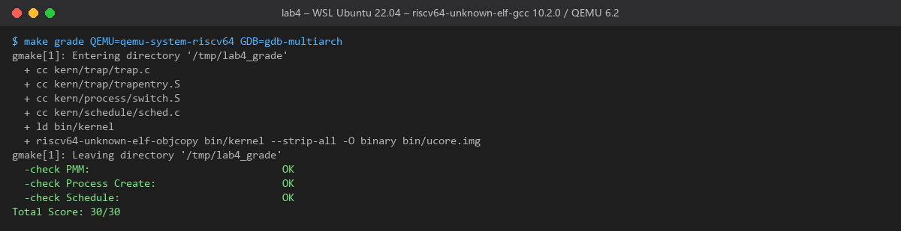
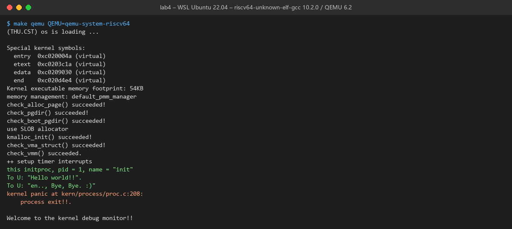

# 操作系统实验报告

## 实验基本信息

| 项目 | 内容 |
|------|------|
| **实验名称** | Lab 4：进程管理 |
| **小组成员** | 2413541-赖鸿毅（A）、2412386-唐港（B）、2412440-王朝阳（C） |
| **完成日期** | 2026-11-16 |
| **代码分支** | `lab4` |
| **最终测试** | `make grade`：30/30；`make qemu`：initproc 正常输出 |

### 小组分工

| 成员 | 负责的练习/模块 |
|------|----------------|
| 2413541-赖鸿毅（A） | lab2 PMM 基线（best-fit、`page_init`）、功能模块一（`page_insert`/`page_remove`）、整体逻辑线、`get_pte` Challenge |
| 2412386-唐港（B） | 功能模块二（`alloc_proc`、`copy_mm`、`copy_thread`、`do_fork`、`kernel_thread`、`proc_init`）、`cpu_idle`/`proc_run`、分页模式 Challenge、知识点对照 |
| 2412440-王朝阳（C） | lab3 Trap 基线、功能模块三（`schedule`/`switch_to`）、模块三报告、`local_intr_save` Challenge、未覆盖知识点、测试截图 |

实验报告协作方式：每人完成自己的代码与章节，最终由 B 机械拼接；不安排交叉复核，以“编译通过、`make grade` 通过”为客观门禁。

## 一、实验目的

本实验的主要目的是：

1. 在 lab2/lab3 的物理内存管理和中断基础上，补齐多级页表的映射建立、撤销和 TLB 维护，使内核能够可靠地管理虚拟地址空间。
2. 理解进程控制块、内核线程、内核栈、上下文和中断帧之间的关系，能够创建 `idleproc` 与 `initproc`，并让新线程第一次正确运行。
3. 理解 `cpu_idle -> schedule -> proc_run -> switch_to` 的调度和上下文切换链路，掌握临界区、就绪队列和首次运行恢复路径。
4. 通过 spec + prompt 的方式使用 AI 辅助生成代码，记录 AI 生成代码中的问题、定位过程和修正方法。

---


## 二、实验环境

### 2.1 AI 编程工具

| 成员 | AI 工具 | 底层模型 |
|------|---------|---------|
| 2413541-赖鸿毅（A） | DeepSeek Harness | DeepSeek-V4.1-Flash |
| 2412386-唐港（B） | Claude Code | DeepSeek-v4-pro |
| 2412440-王朝阳（C） | DeepSeek | DeepSeek-v4-pro |

### 2.2 构建与运行环境


| 项目 | 内容 |
|------|------|
| 运行环境 | WSL2 Ubuntu 22.04（Windows 11） |
| 交叉工具链 | `riscv64-unknown-elf-gcc 10.2.0` |
| 模拟器 | `qemu-system-riscv64 6.2` |
| 调试器 | `gdb-multiarch`（环境中没有 `riscv64-unknown-elf-gdb`） |
| 全量构建 | `make -j4`（在 WSL 的 `/root/lab4-c` 内构建，不在 `/mnt/c` 内编译） |
| 评分 | `make grade QEMU=qemu-system-riscv64 GDB=gdb-multiarch` |

环境里有两个需要显式处理的差异：

- shell 中已经定义了 `QEMU=qemu`，会覆盖 Makefile 的默认值，因此运行时显式指定 `QEMU=qemu-system-riscv64`；
- 评分脚本默认使用 `riscv64-unknown-elf-gdb`，本机改用 `GDB=gdb-multiarch`，其余流程不变。

---


## 三、实验整体逻辑分析

### 3.1 本章节的逻辑主线

Lab4 的核心问题不再是“怎样管理物理页”，而是“怎样让一个执行实体拥有自己的地址空间，并且能够被内核创建、登记、调度和切换”。

因此，本章可以概括为三条递进的主线：

1. **虚拟内存页操作**：在 lab2 已有多级页表的基础上，实现 `page_insert` 和 `page_remove`，让“线性地址 ↔ 物理页”的映射可以建立、更新和撤销，并保证页表项、引用计数和 TLB 三者一致。
2. **进程创建与初始化**：引入 `struct proc_struct` 和内核栈，把当前执行现场包装成 `idleproc`，再通过 `kernel_thread`/`do_fork` 创建 `initproc`。
3. **进程调度与切换**：通过 `cpu_idle -> schedule -> proc_run -> switch_to`，把已经准备好的 `initproc` 真正交给 CPU 执行。

对应的执行链可以写成：

```text
kern_init
  -> pmm_init
       -> page_init
       -> check_alloc_page
       -> check_pgdir          // 依赖 page_insert/page_remove
       -> check_boot_pgdir
       -> kmalloc_init
  -> pic_init / idt_init
  -> vmm_init
  -> proc_init
       -> idleproc             // 复用当前执行现场
       -> kernel_thread(init_main)
            -> do_fork
                 -> alloc_proc
                 -> setup_kstack
                 -> copy_mm
                 -> copy_thread
       -> initproc
  -> clock_init / intr_enable
  -> cpu_idle
       -> schedule
            -> proc_run
                 -> switch_to
                      -> forkret
                           -> forkrets
                                -> __trapret
                                     -> kernel_thread_entry
                                          -> init_main
```

这条链的前半段负责“把地址空间和线程对象准备好”，后半段负责“让第一个可运行线程真正跑起来”。两者不能颠倒：没有页表映射，`check_pgdir` 就过不了；没有 PCB 和内核栈，调度器就没有可调度的对象；没有 `context.ra` 和 `trapframe` 的预先组织，`switch_to` 即使完成寄存器恢复，也回不到正确入口。

### 3.2 功能的逐步实现

本章按“先地址空间、再线程对象、最后调度切换”的顺序实现：

1. **先补 lab2/lab3 基线。**
   - lab2 的 best-fit PMM 和 `page_init` 决定物理页描述符、空闲链表和 `alloc_page/free_page` 是否可用；
   - lab3 的 `trapentry.S`、`trap.c` 决定内核能否保存/恢复中断现场、能否响应时钟中断。
   - 这两部分是 lab4 的运行前提，不是可选内容。

2. **再实现功能模块一：页表映射维护。**
   - `get_pte` 负责定位叶子页表项，必要时创建中间级页表；
   - `page_insert` 负责建立或更新映射；
   - `page_remove` 负责撤销映射。
   - 这一层完成后，`check_pgdir()`、`check_boot_pgdir()` 以及后续线程地址空间相关逻辑才有可靠基础。

3. **然后实现功能模块二：进程创建与初始化。**
   - `alloc_proc` 得到干净的 PCB；
   - `proc_init` 把当前执行现场包装成 `idleproc`，并创建 `initproc`；
   - `kernel_thread` 把函数入口和参数整理成临时 `trapframe`；
   - `do_fork` 组合 PCB、内核栈、PID、链表和状态；
   - `copy_thread` 把 `trapframe` 和 `context` 放到新线程自己的内核栈上；
   - `copy_mm` 在当前阶段只承担地址空间接口的占位作用。
   - 完成后系统中至少存在 `idleproc` 和 `initproc`，且 `initproc` 已经处于 `PROC_RUNNABLE`。

4. **最后实现功能模块三：调度与上下文切换。**
   - `cpu_idle` 作为 idle 线程的执行主体，发现 `need_resched` 后调用 `schedule`；
   - `schedule` 从 `proc_list` 中选择下一个 `PROC_RUNNABLE`，找不到时回退 `idleproc`；
   - `proc_run` 更新 `current`、切换 `satp`、刷新 TLB，并调用 `switch_to`；
   - `switch_to` 只保存/恢复 `ra、sp、s0~s11`，不参与调度策略。
   - 由于 `copy_thread` 已经把 `context.ra` 设为 `forkret`，新线程第一次被切换时会沿 `forkret -> forkrets -> __trapret -> kernel_thread_entry` 走到 `init_main`。


## 四、实验内容与实现

### 功能模块一：虚拟内存页操作

**负责人：** 2413541-赖鸿毅（A）

#### 模块功能描述

**需要实现/修改的函数：**

```c
/* lab2 基线 */
static void page_init(void);
static void best_fit_init(void);
static void best_fit_init_memmap(struct Page *base, size_t n);
static struct Page *best_fit_alloc_pages(size_t n);
static void best_fit_free_pages(struct Page *base, size_t n);
static size_t best_fit_nr_free_pages(void);

/* lab4 功能模块一 */
int page_insert(pde_t *pgdir, struct Page *page, uintptr_t la, uint32_t perm);
void page_remove(pde_t *pgdir, uintptr_t la);

/* page_insert 使用的内部辅助函数 */
static void page_remove_pte(pde_t *pgdir, uintptr_t la, pte_t *ptep);
```

**功能说明：**

本模块负责在现有多级页表上维护“线性地址到物理页”的映射：

- `page_insert` 把一个物理页挂到指定线性地址上，并设置权限；
- `page_remove` 撤销指定线性地址上的映射；
- `page_remove_pte` 是二者共用的叶子页表项清理逻辑。

模块完成后，`pmm_init` 中的 `check_pgdir()`、`check_boot_pgdir()` 才能正常运行，后续线程共享内核地址空间、`proc_run` 切换 `satp` 也才有可靠基础。

本模块还包含 lab2 的两个前提：

1. best-fit 物理页管理器：维护按物理地址排序的空闲块链表，分配时选择“能装下 n 页的最小空闲块”，释放时与前后相邻空闲块合并；
2. `page_init`：从 DTB 读取物理内存范围，建立 `pages` 描述符数组，把内核镜像和描述符数组占用的页标记为 reserved，把剩余连续物理页交给 PMM。

#### 关键实现

**1. `page_insert` 的三种情况**

`page_insert` 不能简单覆盖 PTE，必须先检查原 PTE：

```c
pte_t *ptep = get_pte(pgdir, la, 1);
if (ptep == NULL) {
    return -E_NO_MEM;
}

page_ref_inc(page);
if (*ptep & PTE_V) {
    struct Page *old_page = pte2page(*ptep);
    if (old_page == page) {
        page_ref_dec(page);       // 同一页：抵消刚才的 inc
    } else {
        page_remove_pte(...);     // 不同页：先撤销旧映射
    }
}

*ptep = pte_create(page2ppn(page), perm | PTE_V);
tlb_invalidate(pgdir, la);
return 0;
```

三种情况分别是：

| 原 PTE | 处理 |
|---|---|
| 无效 | 直接写入新 PTE，新页引用 +1 |
| 有效且指向同一页 | 只更新权限，引用计数净变化为 0 |
| 有效但指向其他页 | 先清旧 PTE、旧页引用 −1，再写入新 PTE、新页引用 +1 |

其中“同一页”情况如果也走 `page_remove_pte`，会把旧页引用减到 0，甚至释放正在使用的页；如果只 `page_ref_inc` 不 `dec`，又会让同一页的引用虚高。因此必须单独处理。

`get_pte(..., 1)` 可能分配中间级页表页；如果返回 `NULL`，说明内存不足，`page_insert` 直接返回 `-E_NO_MEM`，不写入叶子 PTE，避免留下半完成映射。

**2. `page_remove` 的幂等性**

```c
void page_remove(pde_t *pgdir, uintptr_t la) {
    pte_t *ptep = get_pte(pgdir, la, 0);
    if (ptep == NULL) {
        return;
    }
    page_remove_pte(pgdir, la, ptep);
}
```

`get_pte(..., 0)` 只查找、不分配。即使返回了页表项指针，PTE 也可能是无效的；`page_remove_pte` 内部会再判断 `PTE_V`。因此：

- 地址没有页表：安静返回；
- 地址有页表但 PTE 无效：安静返回；
- 地址有有效映射：叶子页减引用、必要时 `free_page`、清 PTE、刷新 TLB；
- 重复调用：第二次看到无效 PTE，不会再释放。

**3. 引用计数与页表页**

- `page_insert` 只对**叶子物理页**加引用；
- `page_remove_pte` 只对**叶子物理页**减引用；
- 中间级页表页的引用计数由 `get_pte` 在创建时设置，不在 `page_remove` 中回收；
- `check_pgdir()` 最后会断言 `page_ref(pde2page(boot_pgdir_va[0])) == 1`，如果 `page_remove` 顺手把空页表页释放了，这个断言会失败。

**4. TLB 同步**

修改 PTE 后必须调用：

```c
tlb_invalidate(pgdir, la);
```

否则 CPU 可能继续使用旧翻译。`page_insert` 在更新权限/替换页之后刷新，`page_remove_pte` 在清除 PTE 之后刷新。

#### 最终提示词

完整提示词见 `report/prompt.md` 的 A-1～A-4。最终版的核心约束是：

```text
[CONTEXT]
kern/mm/pmm.c 已有 get_pte、pte_create、pte2page、page_ref_inc/dec、
free_page、tlb_invalidate；default_pmm.c 需要补 lab2 的 best-fit PMM。

[SPEC]
page_insert(pgdir, page, la, perm)：
  - get_pte(pgdir, la, 1) 失败返回 -E_NO_MEM；
  - 原 PTE 无效、同一页、不同页三种情况分别处理；
  - 成功返回 0，权限由 perm 决定；
  - 更新后刷新 TLB。
page_remove(pgdir, la)：
  - get_pte(pgdir, la, 0)，无页表或 PTE 无效时安静返回；
  - 叶子页减引用、归零时 free_page，再清 PTE；
  - 幂等，不回收中间页表页。

[CONSTRAINTS]
只改 default_pmm.c 和 pmm.c 的 lab2/function1 标记；
保留 basic_check/best_fit_check；
不改 vmm.c、proc.c、test_lab4.c；
不使用 lab3 分支整文件覆盖。

[OUTPUT]
只给函数实现和必要注释，不重写整个文件。

[SELF-CHECK]
单文件编译；检查同一页重复映射、不同页替换、重复 remove、
check_pgdir 的页表引用计数、TLB 失效。
```

#### 实现迭代过程

本模块经历过 4 次主要迭代。

##### 第一次迭代：best-fit PMM 和缺失头文件

**遇到的问题：**

- 框架里的 `default_pmm.c` 仍然 `#include <best_fit_pmm.h>`，但目录中没有这个文件；
- `pmm.c` 的 `init_pmm_manager()` 使用 `default_pmm_manager`，而 lab2 的 best-fit 代码可能注册为 `best_fit_pmm_manager`；
- 如果另建 `best_fit_pmm.c`，`free_area` 若设为 `static`，`default_pmm.c` 里的 `best_fit_check()` 就看不到 `free_list/nr_free`。

**问题解决策略：**

- 不新增文件，直接把 best-fit 实现放回 `default_pmm.c`；
- 在同一个文件中定义 `free_area`、`free_list`、`nr_free`；
- 注册 `default_pmm_manager`，与 `pmm.c` 对齐；
- 删除缺失的 `best_fit_pmm.h` 引用，保留 `basic_check()`/`best_fit_check()` 原样。

**结果：**

`default_pmm.c` 可以单独生成 `.o`，best-fit 的空闲块分配、拆分和合并逻辑完整。

##### 第二次迭代：`page_insert` 的引用计数错误

**遇到的问题：**

最初的思路是“先 `page_ref_inc(page)`，再判断原 PTE”。如果原 PTE 已经映射到同一个 `page`，就会变成“inc 一次，然后 remove 旧映射又 dec 一次”；如果 `page_remove_pte` 发现引用归零，还可能把正在使用的页释放掉。

**问题解决策略：**

- 先 `page_ref_inc(page)`；
- 如果原 PTE 有效且 `old_page == page`，只 `page_ref_dec(page)` 抵消，不调用 `page_remove_pte`；
- 只有 `old_page != page` 时才撤销旧映射。

这样同一页重复映射的引用计数净变化为 0，页不会被误释放。

##### 第三次迭代：`page_remove` 误回收页表页

**遇到的问题：**

如果只考虑“删除映射后清空页表”，很容易在 PTE 清空后把空的中间页表页也 `free_page`。但 `check_pgdir()` 期望：

```c
assert(page_ref(pde2page(boot_pgdir_va[0])) == 1);
```

页表页被提前回收会让这个断言失败。

**问题解决策略：**

- `page_remove` 只处理叶子 PTE；
- 中间页表页的生命周期由 `get_pte` 管理，本实验不回收；
- `page_remove_pte` 只对 `pte2page(*ptep)` 的叶子页做 `page_ref_dec`/`free_page`。

##### 第四次迭代：TLB 和 `page_init` 边界

**遇到的问题：**

- 修改 PTE 后没有刷新 TLB，测试可能出现“页表已改、CPU 仍用旧翻译”；
- `page_init` 如果没有把 `mem_end` 截断到 `KERNTOP` 对应的物理上限，`pages` 描述符数组可能越界；
- `pages` 数组和空闲区起点没有按页对齐，会把描述符数组尾部当成可用页。

**问题解决策略：**

- `page_insert` 和 `page_remove_pte` 更新 PTE 后都调用 `tlb_invalidate`；
- `page_init` 先计算 `manageable_end = KERNTOP - PHYSICAL_MEMORY_OFFSET`，必要时截断 `mem_end`；
- `pages` 用 `ROUNDUP((uintptr_t)end, PGSIZE)`，空闲区起点用 `ROUNDUP(PADDR(pages_end), PGSIZE)`，终点用 `ROUNDDOWN(mem_end, PGSIZE)`；
- 所有 `struct Page` 先 `SetPageReserved`，再把描述符数组之后的连续区间交给 `init_memmap`。

#### 关键改进点总结

1. 把 best-fit 实现收回 `default_pmm.c`，避免缺失头文件和 manager 命名不一致；
2. `page_insert` 单独处理“同一页重复映射”，保证引用计数净变化为 0；
3. `page_remove` 只回收叶子页，不回收中间页表页，保证 `check_pgdir()` 的页表引用计数；
4. PTE 修改后统一 `tlb_invalidate`，并在 `page_init` 中处理内存上限和页对齐。


### 功能模块二：进程创建与初始化

#### 模块功能描述

模块二要把内核从“只能以单一执行流运行”推进到“已有多个内核线程对象、并能登记和初次运行”。完成后系统中至少存在：

- `idleproc`：0 号线程，复用 `kern_init` 的当前执行现场；
- `initproc`：1 号线程，由 `kernel_thread` + `do_fork` 正常创建。

#### 核心函数理解

##### 1. `alloc_proc`

```c
static struct proc_struct *
alloc_proc(void)
{
    struct proc_struct *proc = kmalloc(sizeof(struct proc_struct));
    if (proc != NULL)
    {
        memset(proc, 0, sizeof(struct proc_struct));
        proc->state = PROC_UNINIT;
        proc->pid = -1;
        proc->pgdir = boot_pgdir_pa;
    }
    return proc;
}
```

要点：

- PCB 用 `kmalloc`（SLOB 堆）而不是 `alloc_pages`：PCB 约 232 字节，用整页存放太浪费，而 `MAX_PROCESS` 为 4096；
- `kmalloc` 复用块**不保证清零**，所以必须 `memset`。测试断言了 `runs == 0`、`flags == 0`、`context.ra == 0`、`tf == NULL`，逐字段初始化容易漏；
- 三个“正确初值不是 0”的字段必须显式设置：
  - `state = PROC_UNINIT`：状态机起点，且 `wakeup_proc` 的断言要求它不是 `PROC_RUNNABLE`；
  - `pid = -1`：0 保留给 idleproc，正数由 `get_pid()` 分配；
  - `pgdir = boot_pgdir_pa`：**物理地址**，因为 `proc_run` 要把它右移 12 位写进 `satp`。写成 `boot_pgdir_va` 会在首次切换时把虚拟地址当物理地址，导致页表基址错误。

##### 2. `copy_mm`

```c
static int
copy_mm(uint32_t clone_flags, struct proc_struct *proc)
{
    if (clone_flags & CLONE_VM)
        proc->mm = current->mm;
    else
        proc->mm = NULL;
    return 0;
}
```

本实验只创建内核线程，`current->mm` 恒为 NULL，因此两条路径结果都是 NULL。保留 `CLONE_VM` 分支是为了保持函数语义完整，供 lab5 用户进程扩展。测试断言 `initproc->mm == NULL`。

##### 3. `copy_thread`

```c
static void
copy_thread(struct proc_struct *proc, uintptr_t esp, struct trapframe *tf)
{
    proc->tf = (struct trapframe *)(proc->kstack + KSTACKSIZE) - 1;
    *(proc->tf) = *tf;

    proc->tf->gpr.a0 = 0;
    proc->tf->gpr.sp = (esp == 0) ? (uintptr_t)proc->tf : esp;

    proc->context.ra = (uintptr_t)forkret;
    proc->context.sp = (uintptr_t)proc->tf;
}
```

关键点：

- `kstack` 是内核栈**低地址端**，`kstack + KSTACKSIZE` 是栈顶。栈向下增长，所以 trapframe 放在最高的 288 字节处：`(trapframe *)... - 1`；
- `*(proc->tf) = *tf` 必须是**深拷贝**。模板 `tf` 在 `kernel_thread` 的栈帧上，`do_fork` 返回后即失效；
- `gpr.a0 = 0`：子线程返回值；
- `esp == 0` 时栈指针指向自己的 trapframe 顶部；
- `context.ra = forkret`、`context.sp = proc->tf` 是“第一次调度入口契约”。

编译期已核对：`sizeof(struct trapframe) == 288`（36 × 8），`sizeof(struct context) == 112`（14 × 8）。

##### 4. `do_fork`

```c
int
do_fork(uint32_t clone_flags, uintptr_t stack, struct trapframe *tf)
{
    int ret = -E_NO_FREE_PROC;
    struct proc_struct *proc;

    if (nr_process >= MAX_PROCESS)
        goto fork_out;
    ret = -E_NO_MEM;

    if ((proc = alloc_proc()) == NULL)
        goto fork_out;
    proc->parent = current;

    if (setup_kstack(proc) != 0)
        goto bad_fork_cleanup_proc;
    if (copy_mm(clone_flags, proc) != 0)
        goto bad_fork_cleanup_kstack;
    copy_thread(proc, stack, tf);

    bool intr_flag;
    local_intr_save(intr_flag);
    {
        proc->pid = get_pid();
        hash_proc(proc);
        list_add(&proc_list, &(proc->list_link));
        nr_process++;
    }
    local_intr_restore(intr_flag);

    wakeup_proc(proc);
    ret = proc->pid;

fork_out:
    return ret;

bad_fork_cleanup_kstack:
    put_kstack(proc);
bad_fork_cleanup_proc:
    kfree(proc);
    goto fork_out;
}
```

要点：

- `proc->parent = current` 不能漏：测试断言 `initproc->parent == idleproc`；
- 顺序约束：`setup_kstack` 必须早于 `copy_thread`，否则 `proc->tf` 会落在 `kstack = 0` 的地址上；
- 临界区必须包含 `get_pid`、`hash_proc`、`list_add`、`nr_process++` 四步：`get_pid` 会遍历 `proc_list`，并发 fork 可能拿到重复 PID 或撕裂链表；
- `get_pid` 必须在 `list_add` 之前：此时新 PCB 还不在链表里；
- `wakeup_proc` 放在临界区外：它把 `PROC_UNINIT` 改成 `PROC_RUNNABLE`，若提前改状态会触发它内部的断言；
- 失败标签顺序贯穿：从 `bad_fork_cleanup_kstack` 进入会先 `put_kstack` 再落入 `kfree`，顺序反了就是 use-after-free。

##### 5. `kernel_thread`

```c
int
kernel_thread(int (*fn)(void *), void *arg, uint32_t clone_flags)
{
    struct trapframe tf;

    memset(&tf, 0, sizeof(struct trapframe));

    tf.gpr.s0 = (uintptr_t)fn;
    tf.gpr.s1 = (uintptr_t)arg;
    tf.gpr.a0 = 0;

    tf.epc = (uintptr_t)kernel_thread_entry;

    tf.status = read_csr(sstatus);
    tf.status &= ~SSTATUS_SIE;
    tf.status |= SSTATUS_SPIE;
    tf.status |= SSTATUS_SPP;

    return do_fork(clone_flags, 0, &tf);
}
```

要点：

- `kernel_thread_entry` 是 `move a0, s1; jalr s0`，所以函数指针必须在 `s0`、参数在 `s1`；
- `epc` 决定 `sret` 的目标；
- `status` 三个位：
  - 清 `SIE`：从恢复 `sstatus` 到执行 `sret` 之间不能被中断打断；
  - 置 `SPIE`：`sret` 时 `SIE ← SPIE`，保证线程跑起来后开中断；
  - 置 `SPP`：`sret` 后回到 S 态；若为 0 会“返回”到 U 态执行内核代码；
- `gpr.sp` 保持 0，由 `copy_thread` 回退到 `proc->tf`。

##### 6. `proc_init`

```c
void
proc_init(void)
{
    int i, pid;

    list_init(&proc_list);
    for (i = 0; i < HASH_LIST_SIZE; i++)
        list_init(&hash_list[i]);

    if ((idleproc = alloc_proc()) == NULL)
        panic("cannot alloc idleproc.\n");

    idleproc->pid = 0;
    idleproc->state = PROC_RUNNABLE;
    idleproc->kstack = (uintptr_t)bootstack;
    idleproc->need_resched = 1;
    current = idleproc;
    set_proc_name(idleproc, "idle");
    nr_process++;

    pid = kernel_thread(init_main, "Hello world!!", 0);
    if (pid <= 0)
        panic("create init_main failed.\n");
    initproc = find_proc(pid);
    set_proc_name(initproc, "init");
}
```

要点：

- `idleproc` **不能挂进 `proc_list` / `hash_list`**。它是调度器的兜底指针，不是可调度节点。挂进去后 `schedule()` 可能选中它，`proc_run` 里 `from == proc` 直接返回，测试会卡死；
- `idleproc` 的 `kstack = bootstack`：它没有经过 `setup_kstack`，一直使用启动栈；
- `need_resched = 1`：让 `cpu_idle` 第一次检查就调度到 initproc；
- `kernel_thread` 返回的是 **int pid**，必须用 `find_proc(pid)` 取回 PCB；
- 测试注入在 `proc_init` 末尾，所有初始化必须在返回前完成。

#### 完整首次运行链路

```text
proc_init
  └─ kernel_thread(init_main, "Hello world!!", 0)
       └─ 造模板 tf: s0=init_main, s1=arg, a0=0, epc=kernel_thread_entry
            status: 清 SIE / 置 SPIE / 置 SPP
       └─ do_fork(..., 0, &tf)
            ├─ alloc_proc      (parent=idleproc)
            ├─ setup_kstack    (2 页)
            ├─ copy_mm         (NULL)
            ├─ copy_thread     (tf 放到新栈顶, context.ra=forkret)
            └─ pid/hash/list/wakeup
...
cpu_idle → schedule → proc_run → switch_to
  └─ ret 到 forkret
       └─ forkrets(current->tf)
            └─ move sp, a0; j __trapret
                 └─ RESTORE_ALL; sret → epc = kernel_thread_entry
                      └─ move a0, s1; jalr s0
                           └─ init_main("Hello world!!")
```

`a0` 在这条链上有三种含义：`forkrets` 里是 tf 指针；`__trapret` 恢复后是 0（子线程返回值）；`kernel_thread_entry` 里被 `move a0, s1` 覆盖成参数。

#### 最终提示词

每个任务使用课程的四段式框架：

```text
[PROMPT]        做什么、改哪个文件、输出要求
[RELY]          真实的结构体/宏/可用函数
[GUARANTEE]     必须实现的函数签名
[SPECIFICATION] Pre-Condition / Post-Condition / Case / Requirements
```

模块二按“一个可独立验证的功能”拆成五轮提示词（`alloc_proc`；`copy_mm`+`copy_thread`；`do_fork`；`kernel_thread`；`proc_init`），模块三接口一轮（`cpu_idle`+`proc_run`）。完整提示词见 `report/prompt.md` 的 B 部分。

#### 实现迭代过程

六轮中 AI 首次生成的代码均通过编译。但在生成前的提示词审查和生成后的逐行核对中，发现并修正了以下会直接导致失败的规格缺口。这里如实记录，作为提示词迭代的依据。

##### 第一次：`alloc_proc` 的页目录地址

提示词初版只说了“指向内核页表”，没有区分 `boot_pgdir_va` 与 `boot_pgdir_pa`。若按字面实现成虚拟地址，`proc_run` 写 `satp` 时会把虚拟地址当物理页号，首次切换 page fault。

修正：在 `[RELY]` 中并列两个符号并注明用途，在 `[SPECIFICATION]` 明确“`pgdir` 是物理地址，`satp` 直接使用”。

##### 第二次：`copy_thread` 的深拷贝与栈顶定位

初版规格只说“复制中断帧”，没有说明模板的生命周期。AI 很容易写成 `proc->tf = tf`（只存指针）。该指针在 `do_fork` 返回后失效，首次 `sret` 会跳到一个垃圾 `epc`。

修正：补充“模板在调用者栈帧上，必须深拷贝”，并明确 `(trapframe *)(kstack + KSTACKSIZE) - 1` 的栈顶定位。

##### 第三次：`do_fork` 的 parent 与回滚顺序

初版漏了 `proc->parent = current`。测试断言 `initproc->parent == idleproc`，漏掉会直接挂。另外没有写失败标签的贯穿顺序。

修正：`[SPECIFICATION]` 增加 `parent` 赋值，并画出“`bad_fork_cleanup_kstack` → `put_kstack` → 落入 `bad_fork_cleanup_proc` → `kfree`”的路径。

##### 第四次：`kernel_thread` 的寄存器约定

初版只说要“设置函数和参数”，没有绑定 `kernel_thread_entry` 的 `s0/s1` 约定。写反后 `jalr` 会跳到参数地址。

修正：`[RELY]` 直接给出汇编实现，`[SPECIFICATION]` 明确 `s0 = fn`、`s1 = arg`、`epc = kernel_thread_entry`。

##### 第五次：`proc_init` 的 idleproc 入链陷阱

初版没有说明 idleproc 不能挂链表，只说“初始化为可调度线程”。AI 若按常规 `list_add`，会触发调度器死锁。

修正：`[SPECIFICATION]` 明确“idleproc 留在所有链表之外，是兜底指针”。

##### 第六次：`proc_run` 的 satp 写法

`SATP_MODE_SV39` 的定义是 `8`（int），写成 `SATP_MODE_SV39 << 60` 在 32 位整数上是未定义行为。初版提示词没有提醒。

修正：直接采用 `enable_paging()` 的写法 `0x8000000000000000 | (proc->pgdir >> RISCV_PGSHIFT)`，并把“不得使用 `lsatp()`”写进约束。

#### 关键改进点总结

1. **提示词要写“状态”，不要写“步骤”**：`[SPECIFICATION]` 用 Pre/Post/Case 描述结果，AI 才能在所有异常路径上保持一致；
2. **真实语义必须显式保留**：物理地址 vs 虚拟地址、模板生命周期、首次运行的寄存器约定，这些都不能靠“常识”；
3. **边界和失败路径要单独成 Case**：`alloc_proc` 失败、`setup_kstack` 失败、`copy_mm` 失败的回滚顺序，写清楚才能避免 use-after-free；
4. **测试断言是最好的需求文档**：`initproc->parent == idleproc`、`context.ra != 0` 等断言直接反推出规格。


### 功能模块三：进程调度与上下文切换

#### 4.1 lab3 Trap 基线迁入 lab4

##### 4.1.1 `trapentry.S`：`RESTORE_ALL` 与 `__alltraps`

`SAVE_ALL` 与 `struct trapframe` 的布局是框架给定的：36 个 8 字节槽位，依次为
`x0~x31`、`sstatus`、`sepc`、`badaddr`、`cause`。C 需要补齐恢复侧和传参：

```asm
.macro RESTORE_ALL
#lab3 function1 2412440
    LOAD s1, 32*REGBYTES(sp)
    LOAD s2, 33*REGBYTES(sp)
    csrw sstatus, s1
    csrw sepc, s2

    LOAD x1, 1*REGBYTES(sp)
    LOAD x3, 3*REGBYTES(sp)
    ...
    LOAD x31, 31*REGBYTES(sp)

    addi sp, sp, 36*REGBYTES
.endm

__alltraps:
    SAVE_ALL
    addi a0, sp, 0
    jal trap
```

三个关键点：

- **先恢复 `sstatus` 和 `sepc`，再恢复通用寄存器。** `sret` 依赖这两个 CSR；
  如果先恢复 `sp` 或其它寄存器，后面按偏移取 `sstatus/sepc` 时栈指针已经变了。
- **`x0` 不需要恢复。** 它恒为 0，`SAVE_ALL` 里对应的槽位只是占位。
- **`sp` 最后用 `addi` 加回去。** `SAVE_ALL` 先 `addi sp, sp, -36*REGBYTES`，
  所以 `sp + 36*REGBYTES` 正好等于进入 Trap 前的原始值，等价于恢复被中断代码的栈指针。

`__alltraps` 里 `addi a0, sp, 0` 是按 RISC-V 调用约定把 trapframe 首地址作为第一个参数传给 `trap()`。

##### 4.1.2 `trap.c`：中断与异常处理

```c
//lab3 function2 2412440
void interrupt_handler(struct trapframe *tf)
{
    intptr_t cause = (intptr_t)((tf->cause << 1) >> 1);

    switch (cause)
    {
    case IRQ_S_TIMER:
        clock_set_next_event();          // 必须续期，否则只有一次时钟中断
        ticks++;
        if (ticks % TICK_NUM == 0)
        {
            print_ticks();
            if (ticks >= (size_t)SHUTDOWN_AFTER * TICK_NUM)
                sbi_shutdown();
        }
        break;
    case IRQ_S_SOFT: cprintf("Supervisor software interrupt\n"); break;
    case IRQ_S_EXT:  cprintf("Supervisor external interrupt\n"); break;
    default:         print_trapframe(tf); break;
    }
}

void exception_handler(struct trapframe *tf)
{
    switch (tf->cause)
    {
    case CAUSE_ILLEGAL_INSTRUCTION:
        tf->epc += insn_length(tf->epc);
        break;
    case CAUSE_BREAKPOINT:
        tf->epc += insn_length(tf->epc);
        break;
    default:
        print_trapframe(tf);
        break;
    }
}
```

`cause` 的最高位是“中断/异常”标志，处理前先用移位清掉；剩下的才是原因码。
非法指令和断点异常必须按真实指令长度推进 `epc`：低 2 位为 `0b11` 是 32 位指令，
否则是 16 位压缩指令。若不推进，`sret` 会回到同一条指令，形成死循环。

#### 4.2 `schedule()`：轮转选择可运行进程

```c
//LAB4 function3 2412440
void schedule(void)
{
    bool intr_flag;
    list_entry_t *head = &proc_list;
    list_entry_t *le, *start;
    struct proc_struct *next = NULL;

    local_intr_save(intr_flag);
    current->need_resched = 0;

    start = (current == idleproc) ? list_next(head) : list_next(&(current->list_link));
    le = start;

    if (!list_empty(head)) {
        do {
            if (le != head) {
                struct proc_struct *proc = le2proc(le, list_link);
                if (proc->state == PROC_RUNNABLE && proc != current) {
                    next = proc;
                    break;
                }
            }
            le = list_next(le);
        } while (le != start);
    }

    if (next == NULL)
        next = idleproc;

    proc_run(next);
    local_intr_restore(intr_flag);
}
```

设计要点：

1. **关中断 + 清标志。** `schedule()` 与 `proc_run()` 都会 `local_intr_save`，
   形成嵌套；内层读到“已经关中断”后恢复时不会误开中断（见第五节）。
2. **起点。** idleproc 不在 `proc_list` 中，所以当前是 idleproc 时从链表头开始；
   否则从当前进程的下一个节点开始，实现轮转。
3. **整圈遍历。** `proc_list` 是带哨兵头的循环链表。不能写成 `while (le != head)`：
   当前进程是链表尾时，`list_next` 一步就回到 `head`，循环一次都不执行，
   会直接回退 idleproc，链表头的可运行进程反而轮不到。
   正确写法是 `do { ... } while (le != start)`，中途遇到 `head` 只跳过、不终止。
4. **排除 `current`。** 如果当前是唯一可运行进程，选中自己会让 `proc_run` 直接返回，
   看起来调度成功、实际没有进展。排除后，没有别的进程就回退 idleproc。
5. **回退 idleproc。** idleproc 是调度器的兜底，保证 `next` 永远不是 `NULL`。

用评分测试走一遍（链表顺序 `head → t2 → t1 → init → head`）：

| 轮次 | current | 起点 | 选中 | 结果 |
|---|---|---|---|---|
| 1 | init | head → t2 | t2 | t2 第一次运行，置 `thread2_ran` |
| 2 | t2 | t1 | t1 | t1 第一次运行，置 `thread1_ran` |
| 3 | t1 | init | init | 回到 init 的第 1 次循环之后 |
| 4 | init | head → t2 | t2 | t2 继续第 2 次循环 |

8 轮内两个标志都被置 1，`assert(test_thread1_ran && test_thread2_ran)` 通过。

#### 4.3 `switch_to()`：保存与恢复上下文

`struct context` 的布局与偏移（RV64，每字段 8 字节）：

| 字段 | 偏移 | 类别 |
|---|---:|---|
| `ra` | 0 | 返回地址 |
| `sp` | 8 | 栈指针 |
| `s0` | 16 | callee-saved |
| `s1` | 24 | callee-saved |
| `s2` | 32 | callee-saved |
| `s3` | 40 | callee-saved |
| `s4` | 48 | callee-saved |
| `s5` | 56 | callee-saved |
| `s6` | 64 | callee-saved |
| `s7` | 72 | callee-saved |
| `s8` | 80 | callee-saved |
| `s9` | 88 | callee-saved |
| `s10` | 96 | callee-saved |
| `s11` | 104 | callee-saved |

```asm
//LAB4 function3 2412440
switch_to:
    # from = a0, to = a1
    sd ra,  0*8(a0)
    sd sp,  1*8(a0)
    sd s0,  2*8(a0)
    ...
    sd s11, 13*8(a0)

    ld ra,  0*8(a1)
    ld sp,  1*8(a1)
    ld s0,  2*8(a1)
    ...
    ld s11, 13*8(a1)
    ret
```

为什么只保存 14 个寄存器：

- RISC-V 把寄存器分为 caller-saved（`t0~t6`、`a0~a7`）和 callee-saved（`s0~s11`、`sp`、`ra`）。
- `switch_to` 是被 C 调用的函数，调用者本来就不能假设 `t*`、`a*` 在调用后保持不变，
  编译器会在需要时自己保存；`switch_to` 只要保证 `s*`、`sp`、`ra` 与进入时一致即可。
- 因此上下文只有 14 个字段，`sizeof(struct context) == 112`，与 B 报告中的编译期断言一致。

对普通进程，`ra` 指向它上次调用 `switch_to` 之后的返回地址；对新进程，
`copy_thread()` 把 `ra` 设为 `forkret`、`sp` 设为 `proc->tf`，所以第一次切换的链路是：

```text
switch_to → ret → forkret → forkrets(current->tf) → RESTORE_ALL → sret
          → kernel_thread_entry → fn(arg)
```

#### 4.4 `cpu_idle()` 与 `proc_run()`（B 实现，C 解读）

```c
void cpu_idle(void)
{
    while (1)
    {
        if (current->need_resched)
            schedule();
    }
}

void proc_run(struct proc_struct *proc)
{
    bool intr_flag;
    local_intr_save(intr_flag);

    struct proc_struct *from = current;
    if (from != proc)
    {
        current = proc;
        write_csr(satp, 0x8000000000000000 | (proc->pgdir >> RISCV_PGSHIFT));
        flush_tlb();
        switch_to(&from->context, &proc->context);
    }

    local_intr_restore(intr_flag);
}
```

- `cpu_idle()` 决定“什么时候调度”。idleproc 不在 `proc_list` 中，它是兜底进程；
  第一次调度由 `proc_init()` 把 `idleproc->need_resched` 置 1 触发。
- `proc_run()` 决定“怎么换”。必须先保存 `from = current` 再改 `current`，
  否则 `switch_to` 会把旧进程的上下文写进新进程的 PCB。
- `satp` 的 MODE 是 8，位于 bit 63..60，即 `0x8000000000000000`；PPN 在 bit 43..0。
  不能用 `lsatp()`，因为它表达不了 Sv39 模式。
- 换页表后必须 `flush_tlb()`，否则旧进程的 TLB 项会让新进程访问到错误的物理页。
- `proc_run()` 自己也关中断，因此可以被“已经关中断的 `schedule()`”调用，
  也可以被其它路径单独调用。

#### 4.5 模块三的 spec 与 prompt

##### spec

| 项目 | 内容 |
|---|---|
| 输入 | `proc_list`、`current`、`idleproc`、`state`、`need_resched` |
| 输出 | 无返回值；`current` 指向被选中的进程，完成页表/寄存器切换 |
| 选择规则 | 从当前进程的下一个节点轮转；idleproc 从链表头开始；只选 `PROC_RUNNABLE`；跳过哨兵；找不到回退 idleproc |
| 原子性 | 选择 + `proc_run` 全程关中断；`schedule`/`proc_run` 的关中断可嵌套 |
| 上下文 | 只保存 `ra, sp, s0~s11`，偏移 `0, 8, ..., 104` |
| 验收 | `[Test Schedule] PASS`；`make grade` 30/30；initproc 三条输出正确 |

##### prompt（实际使用）

```text
你在 ucore lab4（RISC-V 64，Sv39）中实现进程调度，只改两个文件：
1) kern/schedule/sched.c 的 schedule()：
   - local_intr_save 关中断，current->need_resched = 0；
   - 当前不是 idleproc 时从 current->list_link 的下一个节点开始轮转，
     当前是 idleproc 时从 proc_list 的第一个节点开始；
   - proc_list 是带哨兵头的循环链表，必须跳过 &proc_list；
     当前是链表尾时要继续走到链表头，不能遇到哨兵就停；
   - 只选 state == PROC_RUNNABLE 且不等于 current 的进程；
   - 找不到就回退 idleproc；最后 proc_run(next)，local_intr_restore。
2) kern/process/switch.S 的 switch_to(from=a0, to=a1)：
   - 保存 from 的 ra, sp, s0~s11，共 14 个 8 字节字段，偏移 0,8,...,104；
   - 从 to 恢复同样的字段，最后 ret；
   - 只保存 callee-saved，不要保存 t0~t6、a0~a7。
约束：不要改 proc.c、不要整文件覆盖 lab3 代码；保持 //LAB4 function3 注释；
不要用 lsatp()，satp 由 proc_run 负责。
```

##### 迭代记录

**第一次：遍历在哨兵处提前结束。**
初稿写成 `while (le != head)`。推演测试场景时发现：`current` 是链表尾 `init` 时，
`init->next` 就是 `head`，循环一次都不执行，直接回退 idleproc，t1/t2 永远轮不到。
改为整圈遍历 `do { ... } while (le != start)`，中途跳过 `head`。

**第二次：忘记排除 `current`。**
当前进程是唯一可运行进程时，选中自己会让 `proc_run` 的 `from == proc` 分支直接返回，
`need_resched` 已被清 0，调度器空转。加上 `proc != current` 后语义正确。

**第三次：`switch_to` 的位宽。**
RV64 必须用 `sd/ld`。如果照搬 RV32 的 `sw/lw`，`ra`、`sp` 的高 32 位丢失，
切换后直接跳飞。最终统一 `sd/ld`，偏移按 `0*8 ... 13*8` 书写。


### Challenge：`get_pte()` 与不同分页模式

**负责人：** 2413541-赖鸿毅（A）

#### 1. `get_pte()` 在做什么

`get_pte(pgdir, la, create)` 的目标是：给定页表根地址 `pgdir` 和线性地址 `la`，返回 `la` 对应的**叶子页表项**的内核虚拟地址；如果中间级页表不存在且 `create == 1`，则先分配并初始化中间级页表页。

在 Sv39 下，一个线性地址被分成四段：

```text
+--------9-------+-------9--------+-------9--------+---------12----------+
| VPN[2] / PDX1  | VPN[1] / PDX0  | VPN[0] / PTX   |    page offset      |
+----------------+----------------+----------------+---------------------+
```

`get_pte()` 的代码结构正好对应这三层：

1. `pdep1 = &pgdir[PDX1(la)]`：根页表项；
2. 如果根项无效，分配一个页表页，清零，写 `PTE_U | PTE_V`；
3. `pdep0 = &((pte_t *)KADDR(PDE_ADDR(*pdep1)))[PDX0(la)]`：中间页表项；
4. 如果中间项无效，再分配一个页表页，清零，写 `PTE_U | PTE_V`；
5. 返回 `&((pte_t *)KADDR(PDE_ADDR(*pdep0)))[PTX(la)]`：叶子页表项。

注意：**叶子页表项本身不需要再分配页表页**，它直接由调用者（例如 `page_insert`）写入物理页号和权限。

#### 2. 为什么两段代码看起来几乎一样

两段代码都在做同一件事：

```text
检查当前级 PTE 的 V 位
  -> 无效且 create=1：alloc_page
  -> set_page_ref(page, 1)
  -> memset(KADDR(page2pa(page)), 0, PGSIZE)
  -> *pdep = pte_create(page2ppn(page), PTE_U | PTE_V)
  -> 继续下一级
```

它们相似的根本原因是：**RISC-V 的每一级页表格式是统一的**。Sv39 的根页表、中间页表、叶子页表都使用相同的 512 项数组、相同的 8 字节 PTE 布局和相同的 V/R/W/X/U 权限位；不同之处只有：

- 取哪 9 位作为索引（`PDX1`、`PDX0`、`PTX`）；
- 当前是第几级；
- 最后一级返回的是叶子 PTE，不再继续分配。

因此代码可以把“检查 V、分配页表页、清零、写非叶子 PTE”这套动作重复两次。Sv32 只有两级，所以只需要一段这样的代码；Sv48 有四级，所以理论上需要三段这样的代码。形式相似不是巧合，而是分页模式“每级结构同构”的直接体现。

#### 3. Sv32、Sv39、Sv48 的异同

| 项目 | Sv32 | Sv39 | Sv48 |
|---|---|---|---|
| 虚拟地址位数 | 32 | 39 | 48 |
| 页表级数 | 2 | 3 | 4 |
| 每级索引位数 | 10 | 9 | 9 |
| 每级页表项数 | 1024 | 512 | 512 |
| PTE 大小 | 4 字节 | 8 字节 | 8 字节 |
| 物理地址位数 | 34 | 56 | 56 |
| `satp` MODE | 1 | 8 | 9 |
| 页大小 | 4 KiB | 4 KiB | 4 KiB |

共同点：

- 都采用多级页表；
- 页内偏移都是 12 位，所以页大小都是 4 KiB；
- PTE 都有 V/R/W/X/U/G/A/D 等权限/状态位；
- 非叶子 PTE 只需要 `V`（以及需要时的 `U`），叶子 PTE 才设置 `R/W/X/U`；
- 地址翻译都是从根页表开始，逐级用 VPN 索引，最后加页内偏移。

差异点：

- Sv32 的 PTE 是 4 字节，PPN 字段较窄；Sv39/Sv48 的 PTE 是 8 字节；
- Sv32 两级，Sv39 三级，Sv48 四级；
- Sv39/Sv48 的虚拟地址需要符号扩展/规范地址检查，Sv32 的地址空间更小；
- `satp` 的 MODE 字段不同，切换页表时必须写对应的模式。

`get_pte()` 当前实现是 **Sv39 专用**的：它只展开 `PDX1` 和 `PDX0` 两级，然后返回 `PTX` 叶子项；它使用的 `PTE_ADDR`、`PTE_PPN_SHIFT` 也是按 8 字节 PTE 设计的。如果要支持 Sv32，PTE 宽度、索引位数和 `PTE_ADDR` 都要改；如果要支持 Sv48，则还要再加一层同样的页表遍历代码。

#### 4. 把“查找”和“分配”合在一个函数里好不好

当前 `get_pte(pgdir, la, create)` 同时承担两件事：

1. 查找页表项；
2. 在 `create == 1` 时分配缺失的中间级页表页。

**优点：**

- 调用者接口简单：`page_insert` 只需要一次 `get_pte(..., 1)`；
- 查找和建立路径集中在一个函数里，页表遍历逻辑不需要重复；
- `create == 0` 时可以直接复用于只读查找（例如 `get_page`）。

**缺点：**

- “查找”是只读语义，“分配”有副作用，两者混在一起后，调用者不容易判断失败时到底改了哪些状态；
- 如果分配了第一级页表页、第二级分配失败，函数返回 `NULL`，中间页表页会留在页表中，失败回滚不完整；
- 不利于单独测试“只查找”路径；
- 如果未来要加锁、按需分页或并发页表修改，查找和分配的生命周期不同，混在一起会更难处理；
- `create` 参数让函数内部出现分支，调用者必须理解这个布尔值的语义。

**是否有必要拆开：**

从操作系统设计角度，拆分更清晰，例如：

```c
pte_t *walk_pte(pde_t *pgdir, uintptr_t la);              // 只查找，不分配
pte_t *get_pte_create(pde_t *pgdir, uintptr_t la);        // 查找，缺失时分配
```

`page_insert` 调 `get_pte_create`，`get_page`/只读查询调 `walk_pte`。这样失败语义、回滚策略和测试边界都更明确。

但在本实验的规模下，页表层级固定、没有并发修改、没有按需分页，保留 `get_pte(..., create)` 这种合并写法是可以接受的：代码短、调用方便，实验测试也能覆盖主要路径。更合理的结论是：

> **教学实验里可以保留合并写法；如果要把这段代码扩展成真正的虚拟内存子系统，应该把“遍历查找”和“页表页分配”拆开，至少把失败回滚独立出来。**

#### 5. 小结

- 两段代码相似，是因为 Sv39 的根级和中间级页表结构完全同构，执行的都是“检查 V → 分配页表页 → 清零 → 写非叶子 PTE”；
- Sv32 少一级，Sv48 多一级，所以相似代码的段数会变化；
- 当前 `get_pte` 是 Sv39 专用实现，不能直接用于 Sv32/Sv48；
- 查找与分配合并写法在实验中可接受，但工程上拆分更利于错误处理、测试和后续扩展。

---


### Challenge：Sv32 / Sv39 / Sv48 分页模式

> 这一部分从 `satp`、PTE 位域和地址翻译细节补充 A 的 `get_pte` 分析。

#### 1. 三种模式的总体参数

| 项目 | Sv32 | Sv39 | Sv48 |
|------|------|------|------|
| 虚拟地址宽度 | 32 | 39 | 48 |
| 页表级数 | 2 | 3 | 4 |
| 每级索引位数 | 10 | 9 | 9 |
| 每级页表项数 | 1024 | 512 | 512 |
| 页内偏移 | 12 | 12 | 12 |
| 基页大小 | 4 KiB | 4 KiB | 4 KiB |
| 大页 | 4 MiB（level 1） | 2 MiB / 1 GiB | 2 MiB / 1 GiB / 512 GiB |
| PTE 大小 | 4 字节 | 8 字节 | 8 字节 |
| 物理地址宽度 | 34 | 56 | 56 |
| `satp` MODE | 1 | 8 | 9 |
| 规范地址要求 | 无（RV32 全 32 位可用） | bit 63:39 = bit 38 符号扩展 | bit 63:48 = bit 47 符号扩展 |

#### 2. `satp` 寄存器布局

RV64（Sv39/Sv48 共用）：

```text
 63      60 59        44 43                              0
+----------+------------+---------------------------------+
|   MODE   |    ASID    |              PPN                |
|  4 bits  |  16 bits   |            44 bits              |
+----------+------------+---------------------------------+
```

RV32（Sv32）：

```text
 31 | 30        22 | 21                              0
+---+-------------+----------------------------------+
|MODE|    ASID    |               PPN                |
| 1  |   9 bits   |             22 bits              |
+----+------------+----------------------------------+
```

- `MODE = 0` 表示 Bare（不翻译），`1 = Sv32`，`8 = Sv39`，`9 = Sv48`；
- 切换页表时，必须写完整 64 位值。uvm 里 `write_csr(satp, 0x8000000000000000 | (pgdir >> 12))` 中的 `0x8...` 就是 MODE=8；
- `SATP_MODE_SV39` 宏的值是 8，若写成 `SATP_MODE_SV39 << 60`，在 `int` 上是未定义行为，必须用 `8UL` 或直接使用完整常量。

#### 3. PTE 位域

Sv32（4 字节）：

```text
 31        20 19      10 9  8 7 6 5 4 3 2 1 0
+------------+----------+----+-+-+-+-+-+-+-+-+
|  PPN[1]    |  PPN[0]  |RSW |D|A|G|U|X|W|R|V|
|  12 bits   |  10 bits |2bit|               |
+------------+----------+----+-+-+-+-+-+-+-+-+
```

Sv39 / Sv48（8 字节）：

```text
 63        54 53                              10 9 8 7 6 5 4 3 2 1 0
+------------+----------------------------------+---+-+-+-+-+-+-+-+-+
|  reserved  |              PPN[2:0]            |RSV|D|A|G|U|X|W|R|V|
|            |              44 bits              |   |               |
+------------+----------------------------------+---+-+-+-+-+-+-+-+-+
```

- `V`：有效；`R/W/X`：可读/可写/可执行；
- **非叶子 PTE 必须 `R = W = X = 0` 且 `V = 1`**，此时 PPN 指向下一级页表；
- `U`：用户可访问；内核页表项通常不置 `U`，但 `get_pte` 分配中间页表时置 `PTE_U | PTE_V`，便于后续用户态扩展；
- `A/D`：访问位/脏位，本实验不实现硬件更新，保留为 0。

`PTE_ADDR(pte)` 的移位 `<< (PTXSHIFT - PTE_PPN_SHIFT)` 即 `<< 2`：PTE 中 PPN 从 bit 10 开始，物理页号要从 bit 12 开始，相差 2 位。Sv32 的 PPN[0] 同样从 bit 10 开始，所以这个移位在两个模式下形式一致，只是掩码宽度不同。

#### 4. 地址翻译过程与一个大页示例

以 Sv39 下的 `la = 0x0000000080200000`（内核加载地址 0x80200000）为例：

```text
la = 0x0000_0000_8020_0000
VPN[2] = (la >> 30) & 0x1FF = 2
VPN[1] = (la >> 21) & 0x1FF = 1
VPN[0] = (la >> 12) & 0x1FF = 0
offset = 0x000
```

翻译步骤：

1. 用 `satp.PPN` 找到根页表，取第 `VPN[2] = 2` 项；
2. 该 PTE 非叶子，取 `PPN` 作为二级页表基址，取第 `VPN[1] = 1` 项；
3. 仍非叶子，取 `PPN` 作为三级页表基址，取第 `VPN[0] = 0` 项；
4. 该项是叶子，物理页基址 = `PTE.PPN << 12`，加 `offset` 得到物理地址。

若第 2 步的 PTE 直接是叶子（`R/W/X` 非零），则它映射的是 2 MiB 大页，后续 VPN 位直接作为大页内偏移的一部分；若第 1 步就是叶子，则是 1 GiB 大页。Sv48 多一级，最大叶子可达 512 GiB；Sv32 只有两级，最大叶子 4 MiB。

#### 5. 为什么 `get_pte()` 的两段代码如此相像

`get_pte()` 在每一级执行的动作完全相同：

```text
取当前级索引 -> 读 PTE
  ├─ V=1：取 PTE.PPN 作为下一级页表基址
  └─ V=0 且 create=1：分配一页 -> 清零 -> 写 V -> 继续
```

- Sv39 需要“根 → 中间 → 叶子”三次索引，因此代码里展开为两段“检查/分配”加最后返回叶子；
- Sv32 只需“根 → 叶子”两次索引，所以只需要一段这样的代码；
- Sv48 需要“根 → 中间1 → 中间2 → 叶子”四次索引，理论上需要三段这样的代码。

**两段代码相像不是巧合，而是多级页表“每级同构”的直接结果**：PTE 格式统一、索引位宽统一、非叶子项都是“PPN 指向下一级”。`get_pte` 目前是 Sv39 专用实现，如果要移植到 Sv32/Sv48，需要同时修改索引位数、PTE 宽度和 `PTE_ADDR` 的掩码。

#### 6. 小结

- Sv32/Sv39/Sv48 的共同点是 4 KiB 基页、逐级索引、PTE 权限位一致；
- 差异在虚拟地址宽度、页表级数、每级索引位数、PTE 大小和 `satp` 的 MODE；
- 本实验的 `get_pte` 把 Sv39 的两级“检查/分配”展开，所以看起来重复；
- 理解这些差异，才能解释为什么 `satp` 必须写 `0x8...`、为什么内核线程共享页表时切换 `satp` 是安全的。

---


### Challenge：`local_intr_save` / `local_intr_restore`

#### 1. 实现

```c
static inline bool __intr_save(void) {
    if (read_csr(sstatus) & SSTATUS_SIE) {
        intr_disable();
        return 1;
    }
    return 0;
}

static inline void __intr_restore(bool flag) {
    if (flag)
        intr_enable();
}

#define local_intr_save(x)    do { x = __intr_save(); } while (0)
#define local_intr_restore(x) __intr_restore(x);
```

它保存的不是“关了几次中断”，而是**进入临界区之前 `SIE` 是否为 1**。

#### 2. 嵌套推演

设初始 `SIE = 1`，A 进入临界区后调用 B：

| 步骤 | 操作 | flag | 当前 SIE |
|---|---|---|---|
| 1 | A: save | `true` | 0 |
| 2 | B: save | `false`（读到的已经是 0） | 0 |
| 3 | B: restore | — | 0（false，不动作） |
| 4 | A: restore | — | 1（true，重新开中断） |

内层 save 读到 0，返回 `false`，所以内层 restore 不会提前开中断；
只有最外层 restore 才恢复到进入前的状态。这就是它能正确嵌套的原因。

#### 3. 在调度中的意义

`schedule()` 关中断后调用 `proc_run()`，`proc_run()` 又关一次：
内层 `flag2 = false`，`switch_to` 返回后内层恢复不动作；
直到回到 `schedule()` 外层才恢复中断。这样“选择进程 + 改 `current` + 切 `satp` + 切寄存器”
构成一个不可分割的临界区。

#### 4. 边界

- 只关 S 模式中断，不影响 M 模式与 NMI；
- 只保护本 hart，多核需要自旋锁；
- 没有内存屏障，弱内存模型下共享数据还需要 `fence`/原子操作；
- flag 是局部变量，`save/restore` 必须成对且不能跨函数丢失；
- 临界区应尽量短，避免恶化中断延迟。

---


## 五、测试与验证

```text
  -check PMM:                                OK
  -check Process Create:                     OK
  -check Schedule:                           OK
Total Score: 30/30
```



`make qemu` 输出：

```text
++ setup timer interrupts
this initproc, pid = 1, name = "init"
To U: "Hello world!!".
To U: "en.., Bye, Bye. :)"
kernel panic at kern/process/proc.c:208:
    process exit!!.
```



`process exit!!` 的 panic 是本实验简化 init 流程的预期行为：`init_main` 打印完三条消息后返回，
`kernel_thread_entry` 调用 `do_exit()`，而本实验的 `do_exit()` 直接 panic。

---


### 5.1 验证汇总

| 检查项 | 结果 |
|---|---|
| `make obj/kern/trap/trapentry.o` | 通过 |
| `make obj/kern/trap/trap.o` | 通过 |
| `make obj/kern/process/switch.o` | 通过 |
| `make obj/kern/schedule/sched.o` | 通过 |
| 全量 `make -j4` | 通过 |
| `sizeof(struct context) == 112` | 通过 |
| `[Test PMM]` / `[Test Process Create]` / `[Test Schedule]` | 全部 PASS |
| `make grade` | **30/30** |
| `make qemu` | initproc 三条输出正确，随后按预期 `process exit!!` |

最终验证在合并 A、B、C 三部分代码后进行（`lab4-c` 目录已包含 A 的 PMM 与 B 的进程创建代码），
确保 C 的调度代码与其它模块的接口一致。

---


## 六、实验总结与收获

### 6.1 重要知识点与 OS 原理对照

| 本实验中的概念 | 对应 OS 原理 | 含义与关系 | 差异 |
|---|---|---|---|
| `struct proc_struct` | Linux `task_struct` | 进程/线程的控制块，记录身份、状态、上下文、地址空间 | ucore 字段大幅简化，没有信号、文件、凭证等 |
| `PROC_UNINIT / RUNNABLE / SLEEPING / ZOMBIE` | `TASK_RUNNING / TASK_INTERRUPTIBLE / EXIT_ZOMBIE` | 进程生命周期状态机 | ucore 只有四态，没有 stopped、parked 等 |
| `kstack` + `setup_kstack` | 每任务内核栈 | 进入内核后的执行栈 | ucore 用 2 个连续页，位置不固定；Linux 有 guard page、thread_info 复用 |
| `struct trapframe` | `struct pt_regs` | 中断/异常时保存的用户/内核寄存器现场 | ucore 固定 36 槽；Linux 与架构相关，可能包含浮点/向量状态 |
| `struct context` | `cpu_context` | 切换时保存的 callee-saved 寄存器 | ucore 只存 14 个；Linux 还包含 TLS、FPU 等 |
| `forkret → forkrets → __trapret → sret` | `ret_from_fork` | 新线程“第一次从 trap 返回”的构造技巧 | ucore 用 trapframe 模板；Linux 用 `ret_from_fork` 汇编 |
| `get_pid()` + `hash_list` | PID 分配 + pid hash | 快速查找进程 | ucore 用静态上限 `MAX_PROCESS`，无 PID namespace |
| `proc_list` + FIFO/RR | 运行队列 + CFS/实时调度 | 选择下一个可运行实体 | ucore 是最简单的循环链表轮转，无优先级、时间片 |
| `local_intr_save/restore` | `local_irq_save/restore`、`spin_lock_irqsave` | 保护临界区 | ucore 单核，关中断即互斥；Linux 多核需要原子锁 |
| `mm_struct` / `pgdir` | `mm_struct` / `pgd` | 地址空间描述 | lab4 全为内核线程，`mm == NULL`，共享内核页表 |
| `satp` + `flush_tlb` | `CR3` + TLB shootdown | 切换地址空间 | ucore 每次全量刷 TLB；Linux 用 ASID/PCID 减少刷新 |
| `kernel_thread` | `kthread_create` | 创建内核线程 | ucore 走 `do_fork`；Linux 有 kthreadd 管理 |
| `CLONE_VM` | `clone(2)` 的 `CLONE_VM` | 共享地址空间 | 本实验未真正使用 |

#### 差异总结

1. **单核 vs 多核**：本实验关中断即可保证原子性；多核需要自旋锁和内存屏障。
2. **非抢占 vs 抢占**：本实验只有 `cpu_idle` 一个调度点，线程必须主动让出；Linux 有抢占和实时调度。
3. **无用户态**：lab4 只有内核线程，没有系统调用、缺页异常和用户栈；这些是 lab5 的内容。
4. **无睡眠队列**：`wakeup_proc` 只是把状态改为 `PROC_RUNNABLE`，没有等待队列、优先级继承等机制。
5. **地址空间预映射**：本实验不做按需分页和页面置换，`vmm.c` 只提供 VMA 管理框架。
6. **资源上限固定**：`MAX_PROCESS = 4096`，没有动态配额和 cgroup。

---


### 6.2 OS 原理中重要但本实验未覆盖的知识点

1. **用户态与系统调用**：本实验所有线程都在 S 模式运行，没有 U 模式、`ecall`、用户栈与
   `copy_from_user/copy_to_user`，也没有真正的地址空间隔离。
2. **抢占式调度**：时钟中断没有设置 `need_resched`，Trap 返回路径也没有检查它；
   本实验只有 `cpu_idle()` 和测试代码两个调度点，不是时间片抢占。
3. **调度策略**：只有最朴素的轮转，没有优先级、CFS、实时调度、睡眠队列与负载均衡。
4. **同步与通信**：只有关中断临界区，没有信号量、互斥锁、条件变量、等待队列、管道、共享内存。
5. **内存管理进阶**：没有缺页异常、按需分页、COW、页面置换、swap、`mmap`、大页与 TLB shootdown。
6. **文件系统与设备**：没有 VFS、inode、页缓存、块设备驱动、PLIC 外部中断与 DMA。
7. **多核**：单 hart，`current` 与 `proc_list` 没有多核保护，没有 per-CPU 变量与 IPI。
8. **上下文完整性**：只保存 14 个整数寄存器，没有浮点/向量上下文、栈保护页与栈溢出检测。
9. **可靠性与安全**：`panic()` 直接死循环，没有崩溃转储、日志、权限模型、KASLR、SMEP/SMAP。
10. **测试局限**：30/30 只验证最小闭环，不验证公平性、顺序、饥饿、长时间运行与多核正确性。

详细讨论见本报告第六节。

---


### 6.3 个人总结与 AI 协作体会

#### A：2413541-赖鸿毅


这次实现的核心体会是：页表操作不能只看“PTE 有没有写进去”，还要同时检查引用计数和 TLB。`page_insert` 最容易错的地方是同一页重复映射；`page_remove` 最容易错的地方是顺手回收页表页；`page_init` 最容易错的地方是内存边界和页对齐。把这三类问题分开验证，比直接跑完整内核更容易定位。

AI 生成代码时，最有效的做法不是让它“照着 ucore 写一遍”，而是把接口、约束、错误路径和自检项写清楚。例如明确“同一页重复映射不能增加引用”“不能回收中间页表页”“PTE 修改后必须刷新 TLB”，生成结果的质量会明显提高。

---

#### B：2412386-唐港


模块二是本实验里“链路最长、最容易看起来对但跑不起来”的部分。写完后我最大的体会是：

1. **PCB 的每个初值都对应一个后续假设**。`pgdir` 是物理地址、`state` 必须是 `UNINIT`、`context.ra` 必须是 0，这些不是随手填的，而是被 `proc_run`、`wakeup_proc`、`switch_to` 分别依赖。
2. **首次运行不是“跳转到函数”**，而是“伪造一次 trap 返回”。理解了 `forkret → forkrets → __trapret → sret` 这条链，`s0/s1/epc/status` 的赋值才有意义。
3. **提示词的质量直接决定代码质量**。六轮里所有能想到的坑，都是先在 `[SPECIFICATION]` 里写清楚，才没有变成代码里的 bug。反过来，凡是提示词没写的状态（`parent`、返回值、失败回滚），都是最危险的地方。
4. **测试断言就是需求文档**。`initproc->parent == idleproc` 这一条，比任何文字描述都更能说明 `do_fork` 必须做什么。

---


#### C：2412440-王朝阳


1. **Trap 是调度能成立的前提。** 调度切换的是“上下文”，而上下文的保存/恢复格式由
   `SAVE_ALL`/`RESTORE_ALL` 和 `struct trapframe` 决定。先确认偏移和恢复顺序，
   再写调度，调试点会少很多。
2. **链表哨兵是模块三最容易踩的坑。** `while (le != head)` 看起来天经地义，
   但在“当前是链表尾”时会把整圈遍历变成零次。把测试场景画成链表图之后，问题一眼就能看出来。
3. **上下文切换只保存 callee-saved 不是偷懒，而是调用约定。** 理解“谁负责保存哪些寄存器”，
   才能解释为什么 14 个字段就够了，也才能发现误用 `sw/lw` 这类位宽错误。
4. **关中断解决的是“本核不被打断”，不是“并发安全”。** 它不能替代锁，
   更不能在多核下保护共享数据；临界区应当尽量短。
5. **测试断言就是需求文档。** `assert(test_thread1_ran && test_thread2_ran)` 直接规定了
   “两个线程都必须被轮到”，比文字描述更能约束实现。

---


## 附录：提示词与提交记录

- 全体提示词汇总：`report/prompt.md`（包含 A、B、C 三人的 prompt 与迭代记录）。
- A 的代码 commit：`63e7743`、`323a587`、`6e32210`、`b293bf7`；报告 commit：`c3f069d`。
- B 的代码 commit：`514cca4`、`1d00468`、`5e74d45`、`1e2b541`、`b458cb5`、`f5f7204`；同步提交：`a5e0a2c`。
- C 的代码与报告见 `lab4` 分支提交历史。
- 测试截图见本文第五节 `report/images/lab4_make_grade.png`、`lab4_make_qemu.png`。
