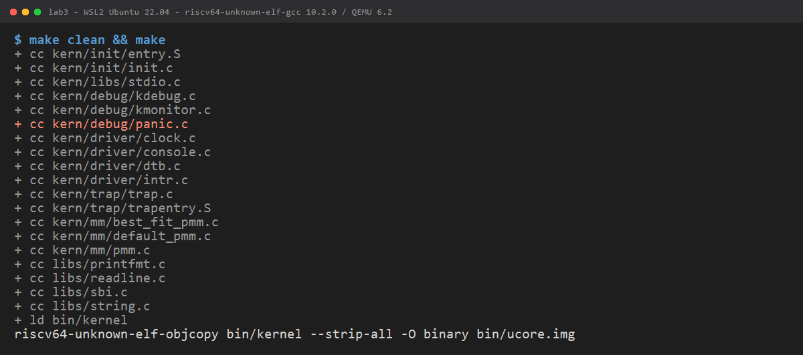
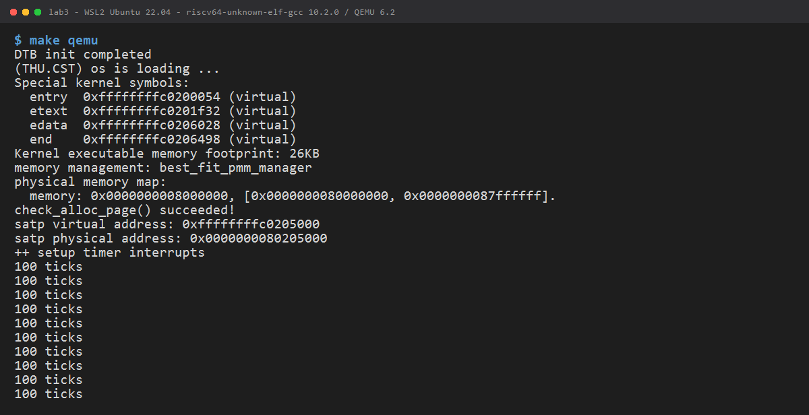
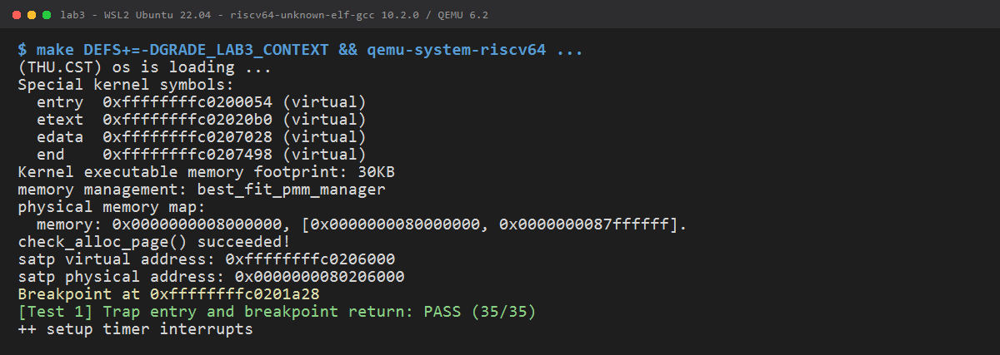
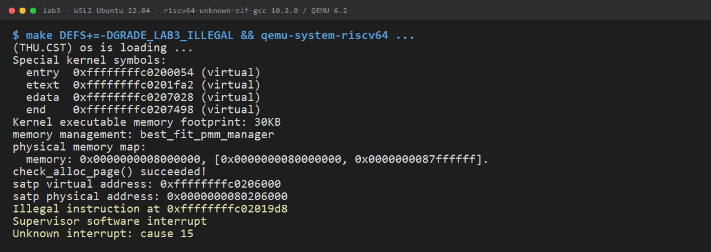
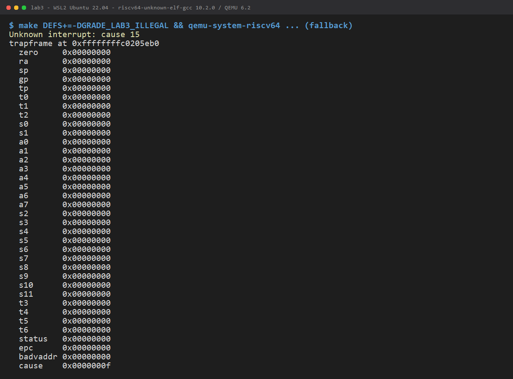
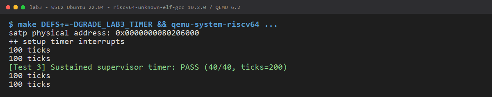
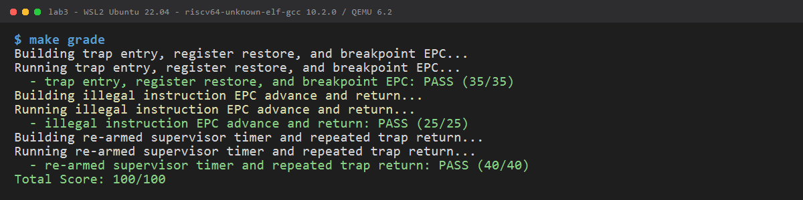

# 操作系统课程 Lab3 实验报告：Trap 与中断/异常处理

## 基本信息

| 项目 | 内容 |
|---|---|
| 课程 | 计算机操作系统（南开大学） |
| 实验 | Lab3：Trap 上下文、中断与异常处理 |
| 小组 | 第 55 组 |
| 仓库分支 | `lab3`（https://github.com/Cameron195-fly/OS_Lab_Group55/tree/lab3） |
| 完成日期 | 2026-10-31 |
| 评分结果 | `Total Score: 100/100`（Test 1 35 + Test 2 25 + Test 3 40） |

### 小组分工

| 成员 | 学号-姓名 | 主要工作 |
|---|---|---|
| 甲 | 2413541-赖鸿毅 | Lab2 `page_init()` 回填；`RESTORE_ALL`/`__alltraps`；报告 3.1–3.3、4.1、4.3.1；提示词 P1、P-lab2-page_init |
| 乙 | 2412386-唐港 | Lab2 Best-Fit 回填与管理器切换；`interrupt_handler`/`exception_handler`；报告 4.2、4.3.2、5.1–5.4；提示词 P2、P-lab2-bestfit |
| 丙 | 2412440-王朝阳 | 环境搭建与排障；测试、截图；报告一、二、4.4、5.5–5.7、六、七；提示词 P0、P3；C8 合并报告与图片 |

---

## 一、实验目的

Lab3 的目标是给已经具备虚拟内存的 ucore 内核补上 **Trap（陷入）机制**，使内核能够接管
时钟中断、断点与非法指令等事件，处理完成后再准确回到被打断的指令流。具体包括四点：

1. **理解 Trap 的硬件/软件分工**：硬件在 Trap 发生时写 `sepc`、`scause`、`stval`、
   `sstatus.SPP/SPIE`，并把 `pc` 指向 `stvec`；软件负责保存现场、分类处理、恢复现场。
2. **实现上下文保存与恢复**：在 `trapentry.S` 中补全 `__alltraps` 与 `RESTORE_ALL`，
   把 32 个通用寄存器与 4 个 CSR 组织成 `struct trapframe`，处理完后原样恢复并 `sret`。
3. **实现中断与异常处理**：在 `trap.c` 中按 `scause` 最高位分流，完成时钟中断的续期、
   计数、统计输出与到点关机，完成非法指令/断点的识别与 `epc` 推进，并为未知事件兜底。
4. **回填 Lab2 的内存管理**：`page_init()` 与 Best-Fit 分配器是内核启动的前置条件，
   本实验按"回填 + 不重复定义"的方式接入，保证 `check_alloc_page()` 通过。

最终以 `tools/` 提供的三个注入测试为验收标准：Test 1（Trap 入口/寄存器恢复/断点，35 分）、
Test 2（非法指令与兜底，25 分）、Test 3（时钟续期与重复返回，40 分），合计 100 分。

---

## 二、实验环境

### 2.1 软硬件环境

| 项目 | 版本 / 说明 |
|---|---|
| 主机系统 | Windows 10/11 + WSL2，Ubuntu 22.04 LTS（x86_64） |
| 交叉编译器 | `riscv64-unknown-elf-gcc` 10.2.0（`--target=riscv64`，`-march=rv64imafdc`，`-mabi=lp64d`） |
| 配套工具 | `riscv64-unknown-elf-ld` / `objcopy`（binutils）、GNU Make、Python 3（`tools/inject.py`） |
| 模拟器 | `qemu-system-riscv64` 6.2.0（`-machine virt`） |
| 固件 | OpenSBI v0.9（`-bios default` 自带的 `fw_jump`），SBI 规范 0.2 |
| 目标平台 | 单 hart，128 MB 物理内存 `[0x80000000, 0x87ffffff]`，内核加载到 `0x80200000` |
| 内核运行态 | Sv39 虚拟地址空间，S 模式；内核虚拟基址 `0xffffffffc0200000` |

启动时 OpenSBI 的输出可确认上述参数：

```text
Platform Name             : riscv-virtio,qemu
Platform HART Count       : 1
Domain0 Next Address      : 0x0000000080200000
Domain0 Next Arg1         : 0x0000000087000000
Boot HART ISA             : rv64imafdcsu
Runtime SBI Version       : 0.2
```

### 2.2 环境自检命令

```bash
riscv64-unknown-elf-gcc --version
qemu-system-riscv64 --version
qemu-system-riscv64 -machine virt -nographic -bios default
```

最后一条命令应看到 OpenSBI 横幅；按 `Ctrl-A` 再按 `x` 退出。若没有默认固件，可安装
发行版的 `opensbi` 包，用 `-bios /usr/lib/riscv64-linux-gnu/opensbi/generic/fw_jump.bin`
显式指定（只改启动命令，不改仓库文件）。

### 2.3 编译、运行与评分命令

```bash
cd code
make clean && make                 # 编译内核
make qemu                          # 运行，观察 100 ticks 与关机
make grade                         # 注入并运行三个测试，输出总分
```

`make grade` 会把 `code/` 复制到 `/tmp/lab3_grade`，由 `tools/inject.py` 注入
`kern/test/test_lab3*` 与 `init.c` 的测试调用，再由 `tools/grade.sh` 依次执行三个用例。
因此**单独加 `-DGRADE_LAB3_CONTEXT` 编译不会触发测试**，必须经过 `inject.py`。

### 2.4 环境问题与处理

#### 问题 1：QEMU 6.2 下 `-device loader` 不注入设备树

**现象**：`make grade` 三个用例全部 `FAIL`，`-serial file:.qemu.out` 只有 0 字节；
手动执行同样的 QEMU 命令，串口只打印 OpenSBI 横幅，内核没有任何输出。

**定位**：`grade.sh` 与 `Makefile` 的 `qemu:` 目标都用
`-device loader,file=bin/ucore.img,addr=0x80200000` 装载内核。QEMU 6.2 在该装载方式下
只把镜像写进内存，**不会像 `-kernel` 那样把设备树地址放进 `a1`**。内核的
`dtb_init()` 依赖 `a1`，取不到 DTB 就在打印 `(THU.CST) os is loading ...` 之前挂死，
表现为"串口无输出、用例判 FAIL"。

**处理**：在**不修改仓库任何文件**的前提下，为本次环境加一层 QEMU 包装脚本
（`/usr/local/bin/qemu-system-riscv64`），把
`-device loader,file=X,addr=0x80200000` 改写为 `-kernel X`，其余参数原样透传：

```bash
out=()
while [ $# -gt 0 ]; do
    if [ "$1" = "-device" ] && [ $# -ge 2 ]; then
        case "$2" in
            loader,file=*,addr=*)
                f="${2#loader,file=}"; f="${f%%,addr=*}"
                out+=("-kernel" "$f"); shift 2; continue;;
        esac
    fi
    out+=("$1"); shift
done
exec /usr/bin/qemu-system-riscv64 "${out[@]}"
```

改写后 `a1 = 0x87000000`，`DTB Address: 0x87000000` 正常打印，内核继续启动，
`make grade` 得到 `Total Score: 100/100`。该包装只作用于本机运行环境，仓库里的
`tools/grade.sh`、`tools/inject.py`、`Makefile` 均保持原样；换到能正确注入 FDT 的
QEMU 版本（或使用 `-kernel` 的启动方式）时无需任何改动。

#### 问题 2：WSL 默认用户无法读取 root 目录下的工作副本

**现象**：在 WSL 里执行 `ls /root/lab3work` 报 `Permission denied`。

**处理**：所有构建/测试命令统一用 `wsl -u root` 执行，或在用户目录下另建工作副本；
不影响仓库内容。

#### 问题 3：Windows 侧没有 `git`

**现象**：`git : The term 'git' is not recognized`。

**处理**：用 `https://codeload.github.com/Cameron195-fly/OS_Lab_Group55/tar.gz/refs/heads/lab3`
下载分支压缩包后解压，得到与仓库一致的目录结构（WSL 内直连 GitHub 会因 TLS 中断失败）。

---

## 三、实验整体逻辑分析

### 3.1 本章节的逻辑主线

本章围绕 **“让内核从能产生 Trap，变成能保存上下文、进入 C 处理函数、完成中断/异常处理、再恢复上下文返回原执行流”** 展开，可以拆成三条主线：

```text
Trap 上下文保存与恢复  →  Trap 入口与返回  →  中断与异常处理
（SAVE_ALL / RESTORE_ALL）  （__alltraps / __trapret）  （interrupt_handler / exception_handler）
```

实验 2 结束时，内核已经运行在 Sv39 虚拟地址空间，也有物理页管理，但还没有“进入内核处理异步/同步事件并返回”的能力。实验 3 补的就是这条链：

1. **硬件侧**：Trap 发生时，CPU 把 `sepc`、`scause`、`stval` 写好，`sstatus.SPP/SPIE` 记录现场，`pc <- stvec`；
2. **汇编侧**：`__alltraps` 用 `SAVE_ALL` 把 32 个通用寄存器和 4 个 CSR 组织成 `struct trapframe`，再按 RISC-V 调用约定把 `tf` 传给 `trap()`；
3. **C 侧**：`trap_dispatch()` 按 `scause` 最高位分流，`interrupt_handler()` / `exception_handler()` 完成具体处理；
4. **返回侧**：`trap()` 返回后进入 `__trapret`，`RESTORE_ALL` 从 Trap frame 恢复寄存器和 CSR，`sret` 用 `sepc`/`sstatus` 回到原执行流。

这条链的“粘合剂”是一致性：**Trap frame 布局、`SAVE_ALL` 的保存顺序、`RESTORE_ALL` 的恢复顺序、`trap()` 的参数、`sret` 的返回状态**，任何一处假设不同，系统就会在“看起来能跑”和“偶发跑飞”之间摇摆。因此本实验真正的难点不是写几条指令，而是把这些约束固定下来。

本实验的 Trap 全部来自 **S 模式**（内核态）：时钟中断、`ebreak`、非法指令都发生在 `kern_init()` 及其调用链里，没有用户态进程，因此 `SAVE_ALL` 保存的 `sstatus.SPP = 1`，`sret` 返回 S 模式。用户态切换要到后续实验才涉及。

### 3.2 功能的逐步实现

1. **先回填 Lab 2 代码（`page_init()`、Best-Fit）**：Lab 3 骨架里 `pmm.c` 和 `best_fit_pmm.c` 留了 `lab2` 注释；没有 `page_init()`、没有 Best-Fit，内核连编译/启动都过不了，所以这是所有工作的前置。
2. **再做功能模块一（`RESTORE_ALL`/`__alltraps`）**：它是所有 Trap 的公共出口。没有恢复逻辑，任何处理函数返回后都无法回到原执行流，后面的测试也无从观察；`__alltraps` 同时负责把 Trap frame 按调用约定送进 C。
3. **再做功能模块二（两个 handler）**：有了入口/出口，才能安全地在 C 里分类处理。先处理最简单的软件中断/未知中断，再处理时钟中断（re-arm + 计数 + 输出 + 关机），最后处理异常（非法指令/断点 + `epc` 推进，其余兜底）。
4. **最后用测试闭环验证**：Test 1 验证入口、恢复、断点 `epc`；Test 2 验证非法指令、兜底和未知中断；Test 3 验证时钟持续触发和反复 Trap 返回。三个测试正好覆盖三条主线。

### 3.3 关键数据结构与不变量

`struct trapframe` 在 RV64 下是 36 个 8 字节字段，`SAVE_ALL` 的偏移必须与它逐项对应：

| 偏移 | 字段 | 偏移 | 字段 | 偏移 | 字段 |
|---|---|---|---|---|---|
| 0 | zero | 12 | a2 | 24 | s8 |
| 1 | ra | 13 | a3 | 25 | s9 |
| 2 | **sp（原 sp）** | 14 | a4 | 26 | s10 |
| 3 | gp | 15 | a5 | 27 | s11 |
| 4 | tp | 16 | a6 | 28 | t3 |
| 5 | t0 | 17 | a7 | 29 | t4 |
| 6 | t1 | 18 | s2 | 30 | t5 |
| 7 | t2 | 19 | s3 | 31 | t6 |
| 8 | s0 | 20 | s4 | 32 | status |
| 9 | s1 | 21 | s5 | 33 | epc |
| 10 | a0 | 22 | s6 | 34 | badvaddr |
| 11 | a1 | 23 | s7 | 35 | cause |

四条不变量（写 prompt 时逐条列出）：

1. **布局不变**：`SAVE_ALL`、`RESTORE_ALL`、`struct trapframe` 使用同一张偏移表，不能另起炉灶。
2. **`sp` 特殊**：`SAVE_ALL` 在 `2*REGBYTES(sp)` 存的是“减 `36*REGBYTES` 之前”的原 `sp`；`RESTORE_ALL` 必须最后用 `addi sp, sp, 36*REGBYTES` 恢复，不能在其它 `LOAD` 之前覆盖基址。
3. **入口参数**：`trap(struct trapframe *tf)` 的第一个参数在 `a0`，且 `a0 = sp`（`SAVE_ALL` 之后 `sp` 就是 Trap frame 首地址）。
4. **返回状态**：`sret` 的返回地址来自 `sepc`，特权级/中断使能来自 `sstatus.SPP/SPIE`；本实验 `SPP=1`，返回 S 模式。

> **指导书文字的坑**：`lab3_3_2` 里“将 `sstatus.SPP` 设为 0、返回 U 模式”是通用/用户态描述，不适用于本实验。`RESTORE_ALL` 只要把保存的 `sstatus` 原样写回；手动清 `SPP` 会让 `sret` 跳到 U 模式执行内核地址，直接崩溃。本实验也没有系统调用，不需要 `sepc + 4`。

---

## 四、实验内容与实现

### 4.1 功能模块一：Trap 上下文恢复与 Trap 入口

**负责人：** 2413541-赖鸿毅

#### 4.1.1 模块功能描述

**需要实现的汇编位置（`kern/trap/trapentry.S`）：**

```asm
    .macro RESTORE_ALL
        # 从当前 Trap frame 恢复处理器状态
    .endm

__alltraps:
    SAVE_ALL
    # 把 Trap frame 按调用约定传给 trap()
```

- `RESTORE_ALL`：输入是当前 `sp` 指向的 Trap frame，输出是恢复后的处理器执行状态；
- `__alltraps`：`SAVE_ALL` 之后把 `sp`（= tf）放进 `a0`，`jal trap`；`trap()` 返回后顺序落入 `__trapret`；
- 不修改 `SAVE_ALL`、`struct trapframe`、`trap()` 签名、`__trapret` 的位置。

#### 4.1.2 实现

```asm
    .macro RESTORE_ALL

    #lab3 function1 2413541
    LOAD s1, 32*REGBYTES(sp)      # sstatus
    LOAD s2, 33*REGBYTES(sp)      # sepc
    csrw sstatus, s1
    csrw sepc, s2

    LOAD x1, 1*REGBYTES(sp)
    LOAD x3, 3*REGBYTES(sp)
    ...
    LOAD x31, 31*REGBYTES(sp)     # x0 不恢复，x2 最后处理

    addi sp, sp, 36*REGBYTES      # 把 SAVE_ALL 减掉的空间加回来
    .endm

    .globl __alltraps
    .align(2)
__alltraps:
    SAVE_ALL

    #lab3 function1 2413541
    addi a0, sp, 0                # 第一个参数：Trap frame 首地址
    jal trap
    # sp should be the same as before "jal trap"
    # 返回后 sp 仍是 tf 首地址，顺序落入 __trapret
```

> 工具链兼容：新 binutils 移除了旧 CSR 别名 `sbadaddr`。`SAVE_ALL` 宏体没有改，只在文件顶部加了
> `#ifndef sbadaddr / #define sbadaddr stval / #endif`（`stval` 的 CSR 编号同为 `0x143`）。

#### 4.1.3 核心理解

1. **为什么先恢复 `sstatus`/`sepc`**：`sret` 的返回地址来自 `sepc`，特权级/中断使能来自 `sstatus.SPP/SPIE`；两者必须在 `sret` 前写好。它们不依赖通用寄存器，所以先做最安全。恢复 GPR 时用 `s1/s2` 作临时寄存器，最后 `LOAD x9/x18` 会把它们从 Trap frame 原样恢复，不会污染现场。
2. **`x2(sp)` 为什么特殊**：`SAVE_ALL` 先把原 `sp` 写进 `sscratch`，再 `addi sp, sp, -36*REGBYTES` 开帧；最后用 `csrrw s0, sscratch, x0` 把原 `sp` 取回并存到第 2 项。因此第 2 项存的是“开栈之前”的 `sp`，等于恢复后的 `sp + 36*REGBYTES`。`RESTORE_ALL` 用 `addi sp, sp, 36*REGBYTES` 与它等价，而且不必在恢复过程中提前改基址；如果像其它寄存器一样先 `LOAD sp, 2*REGBYTES(sp)`，后面的 `LOAD` 基址全错，Test 1 会失败。
3. **`sscratch` 的语义**：`SAVE_ALL` 末尾把 `sscratch` 清 0，沿用 `idt_init()` 的约定——内核态运行期间 `sscratch` 为 0，若内核里再次发生 Trap，入口可据此判断不是从用户态进来的。本实验全程内核态，`RESTORE_ALL` 不恢复 `sscratch`，返回后仍为 0，与约定一致；用户态切换是后续实验的内容。
4. **`a0` 与调用约定**：`SAVE_ALL` 之后 `sp` 正好是 Trap frame 首地址，用 `addi a0, sp, 0` 放进第一个参数。`jal trap` 会写 `ra`，但 `ra` 已在第 1 项保存过，`RESTORE_ALL` 会恢复；`trap()` 作为被调用者遵守调用约定，返回后 `sp` 不变，可以直接落入 `__trapret`。
5. **`sret` 的返回语义**：`sret` 做三件事——`pc <- sepc`；特权级 <- `sstatus.SPP`；`sstatus.SIE <- sstatus.SPIE`；同时把 `SPIE` 置 1、`SPP` 清 0，为下一次 Trap 做准备。所以 `RESTORE_ALL` 必须把 `sstatus` 原样写回，不能只恢复 `sepc`。本实验 `SPP=1`，返回 S 模式；不要按指导书的 U 模式文字去清 `SPP`。
6. **对齐**：`__alltraps` 必须 4 字节对齐（`stvec` 的低两位是模式位），原骨架的 `.align(2)` 不动。汇编器会生成一个 `R_RISCV_ALIGN` 重定位，链接时由 relaxation 调整到 4 字节边界。
7. **工具链兼容**：`SAVE_ALL` 里的 `csrr s3, sbadaddr` 在新 binutils 上会报 `unknown CSR 'sbadaddr'`；用 `#define sbadaddr stval` 把旧别名映射到标准名，CSR 编号都是 `0x143`，不改变 `SAVE_ALL` 的宏体逻辑。

#### 4.1.4 spec 摘要

- **Pre**：Trap 已进入 `__alltraps`，`sp` 指向由 `SAVE_ALL` 建好的 36 项 Trap frame；`RA` 等寄存器已保存。
- **Post**：`sstatus`、`sepc` 和 `x1`、`x3`–`x31` 已恢复；`sp` 回到 Trap 前；`a0` 在调用 `trap()` 前等于 tf 首地址；`trap()` 返回后顺序进入 `__trapret`。
- **不变量**：偏移与 `struct trapframe` 一致；`x0` 不恢复；`x2` 最后恢复；不改 `SAVE_ALL`/`trap()` 签名。
- **验收**：Test 1 中 `ebreak` 返回后，被检查的通用寄存器全部原值；`epc` 前移由模块二负责。

#### 4.1.5 prompt 摘要与迭代

完整 prompt 见 `report/prompt.md` 的 P1，这里只摘录关键点：

- RELY 里列出 `SAVE_ALL` 的 36 项偏移、`struct trapframe` 的字段顺序、`trap()` 的参数约定；
- GUARANTEE 明确不改 `SAVE_ALL`、`struct trapframe`、`trap()`、`__trapret`；
- SPECIFICATION 单列“`sp` 最后恢复”“`a0 = sp`”“`jal trap` 后 `sp` 不变”。

迭代中实际出现并修掉的问题：

1. **第一版把 `sp` 当普通寄存器恢复**：`LOAD sp, 2*REGBYTES(sp)` 之后，后续 `LOAD` 全部错位，Test 1 失败。改为最后 `addi sp, sp, 36*REGBYTES`。
2. **第二版 `__alltraps` 忘记设 `a0`**：`trap()` 收到野指针。补 `addi a0, sp, 0`。
3. **新 binutils 不识别 `sbadaddr`**：汇编报 `unknown CSR 'sbadaddr'`。在文件顶部加 `#define sbadaddr stval`，保持 `SAVE_ALL` 宏体不变。

#### 4.1.6 Test 1 结果

```text
Breakpoint at 0xffffffffc0201a28
[Test 1] Trap entry and breakpoint return: PASS (35/35)
```

说明：`ebreak` 被编成 2 字节 `c.ebreak`，模块二按低 2 位判断长度后 `epc += 2`；返回后寄存器全部原值。该地址随构建/工具链变化，本次以最终构建的截图 `./images/03_test1_breakpoint.png` 为准。

---

### 4.2 功能模块二：中断与异常处理（`kern/trap/trap.c`）

#### 4.2.1 模块位置与执行流

`__alltraps` 保存 Trap frame 后调用 `trap(tf)`，`trap()` 内部由 `trap_dispatch()` 按
`scause` 最高位分流：

- bit63 = 1 → `interrupt_handler(tf)`：异步中断（时钟、软件、外部）
- bit63 = 0 → `exception_handler(tf)`：同步异常（非法指令、断点等）

两个 handler 返回后统一回到 `__trapret`，由 `RESTORE_ALL` + `sret` 恢复现场。因此本模块
只负责"分类 + 处理 + 按需推进 `epc`"，不参与上下文保存/恢复。

#### 4.2.2 三个核心函数

| 函数 | 职责 | 关键点 |
|---|---|---|
| `interrupt_handler(tf)` | 处理中断 | 先去掉 `scause` 的 bit63；时钟路径先续期再计数；未知中断打印原因码 + Trap frame |
| `exception_handler(tf)` | 处理异常 | 非法指令/断点按规定格式输出，并按真实指令长度推进 `tf->epc`；其余异常只打印 Trap frame |
| `insn_length(epc)`（static 辅助） | 判断指令字节长度 | 读 `epc` 处 2 字节，低 2 位 `0b11` → 4 字节，否则 2 字节（压缩指令） |

`interrupt_handler` 的时钟分支：

```c
case IRQ_S_TIMER:
    clock_set_next_event();          // 先续期：OpenSBI 的定时器是一次性的
    ticks++;                         // 无条件自增，不能写进 if 里
    if (ticks % TICK_NUM == 0) {
        print_ticks();               // 已有的 "100 ticks" 输出
        if (ticks >= (size_t)SHUTDOWN_AFTER * TICK_NUM) {
            sbi_shutdown();          // 累计输出 SHUTDOWN_AFTER 次后关机
        }
    }
    break;
```

`exception_handler` 的两条异常路径：

```c
case CAUSE_ILLEGAL_INSTRUCTION:
    cprintf("Illegal instruction at 0x%016lx\n", tf->epc);
    tf->epc += insn_length(tf->epc);
    break;
case CAUSE_BREAKPOINT:
    cprintf("Breakpoint at 0x%016lx\n", tf->epc);
    tf->epc += insn_length(tf->epc);
    break;
default:
    print_trapframe(tf);             // 不改 epc
    break;
```

#### 4.2.3 六个关键设计点

1. **`scause` 必须先去掉最高位**：`scause` 的 bit63 只表示"中断/异常"标志，原因码在低
   63 位。`trap_dispatch()` 用有符号 `(intptr_t)tf->cause < 0` 分流之后，handler 里若
   直接用原值比较 `IRQ_S_TIMER`，时钟分支永远不命中。实现用
   `cause = (intptr_t)((tf->cause << 1) >> 1)` 清掉最高位再 `switch`。
   注意异常侧 bit63 本来就是 0，直接 `switch (tf->cause)` 即可。
2. **时钟必须先续期、后计数**：`clock_set_next_event()` 每次只设置"下一次"时钟事件，不
   重新调用就只能收到一次中断。先续期再 `ticks++`，保证本次中断处理完时下一次事件已经
   排好，中断流不会中断。
3. **`ticks++` 必须无条件执行**：统计输出只在 `ticks % TICK_NUM == 0` 时发生，但计数
   每一次时钟中断都要加 1；若把 `ticks++` 写进 `if`，`ticks` 永远不会到达整数倍，
   系统表现为"没有任何输出、也永不关机"。
4. **`epc` 按真实指令长度推进**：RISC-V 有 16 位压缩指令，`ebreak` 常被汇编成 2 字节的
   `c.ebreak`；编译器的非法指令（本实验测试用 4 字节 `.word 0x7b`）是 4 字节。固定写
   `epc += 4` 会让 2 字节异常指令跳过下一条合法指令，测试 1 立刻失败。实现读取 `epc`
   处 2 字节编码，低 2 位 `0b11` 为 32 位指令（+4），否则 +2。
5. **兜底分支是硬要求**：未知中断输出 `Unknown interrupt: cause %d`（原因码已去掉最高位，
   例如 bit63 置位、低 63 位为 15 时输出 15）并调用 `print_trapframe(tf)`；未知异常只调用
   `print_trapframe(tf)`，且**不修改** `epc`——本实验不要求恢复其它异常。
6. **两个 handler 不能声明为 `static`**：`tools/test_lab3.c` 用 `extern` 直接调用它们做
   评分（软件中断/未知中断/未知异常的兜底路径），`static` 会导致链接期找不到符号。
   另外它们必须定义在 `trap_dispatch()` 之前，否则 `-Werror` 下隐式声明直接编译失败。

补充：`sbi_shutdown()` 声明在 `libs/sbi.h`，必须 `#include <sbi.h>`；
`SHUTDOWN_AFTER` 骨架未定义，本实验取 10（`TICK_NUM = 100`，即 1000 次 tick 后关机，
大于测试 3 需要的 200 次，不会提前关机）。

#### 4.2.4 功能模块二 spec 摘要

- **Pre**：`tf` 是合法 Trap frame；`interrupt_handler` 收到 bit63=1 的 `cause`，
  `exception_handler` 收到 bit63=0 的 `cause`；两个 handler 在 `trap_dispatch()` 之前可见。
- **Post**：返回后由 `__trapret` 恢复现场；除非法指令/断点按需推进 `tf->epc` 外，
  不修改其它字段。
- **时钟路径**：已重新设置下一次事件，`ticks` 恰好 +1；`ticks` 为 `TICK_NUM` 整数倍时
  输出 `100 ticks`；累计输出 `SHUTDOWN_AFTER` 次后调用 `sbi_shutdown()`。
- **异常路径**：非法指令输出 `Illegal instruction at 0x%016lx`、断点输出
  `Breakpoint at 0x%016lx`，地址为 16 位补零小写十六进制，`epc` 推进 2 或 4 字节；
  其余异常 `print_trapframe(tf)` 兜底。
- **禁止**：关中断、`panic()`、阻塞/递归逻辑、修改 `print_ticks()`/`trap_dispatch()`/
  `trap()`/`print_trapframe()` 等既有函数。

#### 4.2.5 prompt 摘要

本模块按"四段式"（[PROMPT] / [RELY] / [GUARANTEE] / [SPECIFICATION]）设计提示词，
把上述六个关键点全部写进 RELY 与 SPECIFICATION 作为硬约束，再让 AI 生成。完整 prompt
与迭代记录见 `report/prompt.md` 的 P2。提示词要点：

- RELY 给出真实接口（`ticks`、`clock_set_next_event`、`sbi_shutdown`、`IRQ_*`、
  `CAUSE_*`）和判分子串，避免 AI 虚构 API/输出格式；
- GUARANTEE 明确"两个 handler 不得 static""可加 static 辅助函数""不改既有函数"；
- SPECIFICATION 逐分支写清顺序（续期→计数→输出→关机）、`epc` 长度判定和兜底行为。

---

### 4.3 Lab2 内存管理回填（前置）

#### 4.3.1 `page_init()`（Lab 2 回填）

##### 物理内存布局

```text
[0x80000000, 0x80200000)   OpenSBI，保留
[0x80200000, end)          内核镜像（代码/数据/bss），保留
[end, pages)               补齐到页边界的空隙，保留
[pages, pages_end)         Page 描述符数组，保留
[free_start, free_end)     交给 pmm_manager 的完整空闲页
```

##### 实现步骤

1. `dtb_init()` 已解析设备树，`get_memory_base()`/`get_memory_size()` 给出物理内存范围；
2. 上界截断：Lab 3 骨架没有 `PHYSICAL_MEMORY_END`，用 `(uint64_t)KERNTOP - PHYSICAL_MEMORY_OFFSET`（0x88000000）；
3. 设 `va_pa_offset = PHYSICAL_MEMORY_OFFSET`，`npage = PPN(mem_end)`；
4. `pages = ROUNDUP(end, PGSIZE)`，描述符数组覆盖 `[nbase, npage)`；
5. 先把 `[nbase, npage)` 全部标 `PageReserved`；
6. 计算描述符数组之后的完整空闲页 `[free_start_pa, free_end_pa)`，调用 `init_memmap(pa2page(free_start_pa), n)`。

##### 核心理解

- **三套地址不能混用**：`pages`/`end` 是虚拟地址；算物理布局要先用 `PADDR()` 转成物理地址；`pa2page()` 再用 `nbase` 转成描述符下标。
- **为什么先全标 reserved**：描述符数组还没建好之前，不能让任何页面被误分配；`init_memmap()` 内部会 `assert(PageReserved(p))` 再清标志，所以“先 reserved、后交给管理器”正好满足它的前置条件。
- **为什么不把 OpenSBI/内核/描述符数组下发**：它们已被占用，必须从空闲区排除；`free_start_pa` 取描述符数组末尾向上对齐，`free_end_pa` 取内存末尾向下对齐，不足一页的尾巴不下发。

##### 遇到的 bug

Lab 2 的实现用了 `PHYSICAL_MEMORY_END`，但 Lab 3 的 `memlayout.h` 只有 `KERNTOP`、`PHYSICAL_MEMORY_OFFSET`，直接编译报：

```text
error: 'PHYSICAL_MEMORY_END' undeclared
```

改为：

```c
uint64_t manageable_end = (uint64_t)KERNTOP - PHYSICAL_MEMORY_OFFSET;
if (mem_end > manageable_end) mem_end = manageable_end;
```

##### 验证

```text
memory management: best_fit_pmm_manager
physical memory map:
  memory: 0x0000000008000000, [0x0000000080000000, 0x0000000087ffffff].
check_alloc_page() succeeded!
```

`check_alloc_page()` 通过说明描述符布局、保留区和空闲区划分正确；随后 `make grade` 为 100/100。

---

#### 4.3.2 Best-Fit 连续物理内存分配器（`kern/mm/best_fit_pmm.c`）

##### 功能描述

Best-Fit 复用 First-Fit（`default_pmm.c`）的全部内部状态约定：

- `free_list`：按物理地址升序排列的空闲块双向链表；
- `nr_free`：空闲页总数；
- "空闲块只看头页"：只有块首页带 `PG_property`，其 `property` 记录本块页数；
- 回收时必须与物理相邻块合并。

与 First-Fit 唯一的差别是**选块策略**：从所有 `property >= n` 的块中挑 `property`
**最小**的块，尽量少产生切分后的剩余碎片。

##### 核心函数

| 函数 | 职责 | 关键点 |
|---|---|---|
| `best_fit_init()` | 初始化管理器状态 | `list_init(&free_list)`、`nr_free = 0` |
| `best_fit_init_memmap(base, n)` | 登记一个空闲块 | 断言 `PageReserved` → 清 `flags/property/ref` → 块头设 `property=n` + `SetPageProperty` → `nr_free += n` → 按地址升序插入 |
| `best_fit_alloc_pages(n)` | 分配 n 个连续页 | 扫全链表取**最小**可装块；剩余部分切块插回；`nr_free -= n`、清块头标志 |
| `best_fit_free_pages(base, n)` | 释放并合并 | 断言非保留非空闲 → 重设块头 → 有序插入 → 向前/向后合并 |
| `best_fit_nr_free_pages()` | 返回 `nr_free` | — |

##### 关键点

1. **块头约定**：`init_memmap` 只在 `base` 上写 `property = n` 并 `SetPageProperty(base)`，
   块内其它页的 `property` 无意义；分配后必须 `ClearPageProperty(page)`，表示该块已不再是
   空闲块头。
2. **有序链表**：插入时用 `base < page` 比较 `struct Page *` 指针。`pages` 是按物理页号
   连续排布的描述符数组，指针序等价于物理地址序，因此可以用指针比较完成"按物理地址
   升序插入"。
3. **最小块选择**：遍历完整条链表，用 `page == NULL || p->property < page->property`
   替换候选；`property == n` 时提前 `break`（正好装下，不可能更优）。等长块保留链表里
   第一个（物理地址最低）的候选。
4. **切分与插回**：先记前驱 `prev` 再 `list_del`；仅当 `page->property > n`（严格大于）
   时把 `page + n` 作为新块头插回 `prev` 之后，链表仍保持有序。
5. **双向合并**：释放后先看前驱是否满足 `p + p->property == base`，再看后继是否满足
   `base + base->property == p`；合并时更新 `property`、`ClearPageProperty` 被并入的块头、
   `list_del` 多余节点。
6. **管理器注册**：文件末尾定义
   `const struct pmm_manager best_fit_pmm_manager`，`check` 指向骨架已提供的
   `best_fit_check`；`pmm.c` 的 `init_pmm_manager()` 只改一行，把活动管理器从
   `default_pmm_manager` 切换为 `best_fit_pmm_manager`。
7. **与 Lab2 骨架的差异**：Lab3 骨架里已经带有 `basic_check()` / `best_fit_check()`，
   回填时**不要整文件拷贝 Lab2**，否则会重复定义；只补实现函数、宏和注册结构体。

---

### 4.4 注释与学号说明

按分工约定，所有 `//lab2`、`#lab3` 标记保留原位置，`YOUR CODE` 统一替换为实际负责人学号，
便于按文件追溯责任人。最终代码中的标记如下（`grep -rn "lab2\|lab3" code/kern` 可复核）：

| 文件 | 位置 | 标记 | 负责人 |
|---|---|---|---|
| `kern/mm/pmm.c` | `page_init()` | `//lab2 function1 2413541` | 甲 2413541-赖鸿毅 |
| `kern/mm/pmm.c` | `init_pmm_manager()` | `// lab2 function2-2 2412386: 切换为 Best-Fit` | 乙 2412386-唐港 |
| `kern/mm/best_fit_pmm.c` | 文件头 + 注册结构体前 | `//lab2 function2-2 2412386` | 乙 2412386-唐港 |
| `kern/trap/trapentry.S` | `RESTORE_ALL` | `#lab3 function1 2413541` | 甲 2413541-赖鸿毅 |
| `kern/trap/trapentry.S` | `__alltraps` | `#lab3 function1 2413541` | 甲 2413541-赖鸿毅 |
| `kern/trap/trap.c` | 两个 handler 前 | `//lab3 function2 2412386` | 乙 2412386-唐港 |
| `report/report.md`、`report/prompt.md`、`report/images/*` | 全文 | — | 丙 2412440-王朝阳 |

说明：

1. **未改动的骨架部分不补学号**：`SAVE_ALL`、`struct trapframe`、`trap()`、
   `trap_dispatch()`、`print_trapframe()`、`basic_check()`/`best_fit_check()` 属于给定代码，
   保持原样，不写入个人学号。
2. **学号只出现在注释里**：不影响任何逻辑，`-Wall -Werror` 下不会产生告警。
3. **`init.c` 未修改**：旧版资料中的 `LAB3: CHALLENGE 1` / `lab3_switch_test()` 是遗留内容，
   今年不要求；当前骨架已没有这段注释，本次也未实现 Challenge。
4. **`tools/` 与 `Makefile` 未修改**：`grade.sh`、`inject.py`、`test_lab3*`、
   `PROJ`、`GCCPREFIX` 均为仓库原值，仅由 `make grade` 在临时副本中注入测试。

---

## 五、测试与验证

### 5.1 编译

```bash
cd code
make clean && make
```

输出（节选）：

```text
+ cc kern/trap/trap.c
+ cc kern/trap/trapentry.S
+ cc kern/mm/best_fit_pmm.c
+ cc kern/mm/default_pmm.c
+ cc kern/mm/pmm.c
...
+ ld bin/kernel
riscv64-unknown-elf-objcopy bin/kernel --strip-all -O binary bin/ucore.img
```

编译选项含 `-Wall -Werror`，全程无警告、无错误。



*图 1：`make clean && make` 全量编译通过，末尾链接并生成 `bin/ucore.img`*

### 5.2 `make qemu`

```bash
make qemu
```

关键输出：

```text
memory management: best_fit_pmm_manager
physical memory map:
  memory: 0x0000000008000000, [0x0000000080000000, 0x0000000087ffffff].
check_alloc_page() succeeded!
++ setup timer interrupts
100 ticks
100 ticks
...（共 10 行）
```

结论：Best-Fit 通过启动自检 `check_alloc_page()`，活动管理器确认为 `best_fit_pmm_manager`；
时钟中断持续产生，`SHUTDOWN_AFTER = 10` 时累计 10 行 `100 ticks` 后正常关机，说明
"续期→计数→输出→关机"链路正确。



*图 2：`make qemu` — Best-Fit 自检通过，连续输出 `100 ticks`*

### 5.3 注入测试（Test 1 / 2 / 3）

```bash
make grade
```

#### Test 1：Trap 入口、寄存器恢复与断点 EPC（35 分）

```text
Breakpoint at 0xffffffffc0201a28
[Test 1] Trap entry and breakpoint return: PASS (35/35)
```

结论：`__alltraps`/`RESTORE_ALL`（成员 A）保存并恢复了被检查的 28 个通用寄存器，Test 1 得 35/35；断点异常被
`exception_handler` 识别，按 `c.ebreak` 的 2 字节长度推进 `epc` 后 `sret` 正常返回，
没有重复触发断点。



*图 3：Test 1 — 断点地址打印与 `PASS (35/35)`*

#### Test 2：非法指令 EPC 推进与兜底（25 分）

```text
Illegal instruction at 0xffffffffc02019d8
Supervisor software interrupt
Unknown interrupt: cause 15
  cause    0x0000000f
  cause    0x00000014
[Test 2] Illegal instruction return: PASS (25/25)
```

结论：

- 4 字节自定义非法指令 `.word 0x7b` 触发异常，打印地址后 `epc += 4`，返回后越过该指令；
- 软件中断路径输出 `Supervisor software interrupt`；
- `test_lab3_handler_fallbacks()` 直接把 `tf.cause` 设为 15 调用 `interrupt_handler`，走未知中断分支，输出
  `Unknown interrupt: cause 15` 并打印 Trap frame（其中 `cause 0x0000000f`）；
- 未知异常（cause 20）走 `print_trapframe` 兜底，输出 `cause 0x00000014`，且不修改 `epc`。



*图 4：Test 2 — 非法指令、软件中断与未知中断（cause 15）*



*图 5：Test 2（续）— 未知中断的 Trap frame（`cause 0x0f`）；`cause 0x14` 的兜底输出见测试日志，PASS 见图 7*

#### Test 3：时钟中断续期与重复返回（40 分）

```text
100 ticks
100 ticks
[Test 3] Sustained supervisor timer: PASS (40/40, ticks=200)
```

结论：时钟中断在每次处理后都重新设置下一次事件，`ticks` 持续增长到 200，说明没有
"只中断一次"的问题，且 Trap 返回路径可重复执行。



*图 6：Test 3 — 时钟持续续期，`ticks=200`*

### 5.4 评分汇总

```text
  - trap entry, register restore, and breakpoint EPC: PASS (35/35)
  - illegal instruction EPC advance and return: PASS (25/25)
  - re-armed supervisor timer and repeated trap return: PASS (40/40)
Total Score: 100/100
```

| 测试 | 分值 | 结果 |
|---|---|---|
| Test 1 Trap 入口/寄存器/断点 | 35 | PASS |
| Test 2 非法指令/兜底 | 25 | PASS |
| Test 3 时钟续期 | 40 | PASS |
| **合计** | **100** | **100/100** |

最终版本无运行期 bug；迭代中实际修掉的 `sp`、`a0`、`sbadaddr` 等问题见 4.1.5/P1，模块二的设计期规避清单见 P2。



*图 7：`make grade` — 三项全 PASS，`Total Score: 100/100`*

---

### 5.5 边界与异常路径验证

除三个计分用例外，报告对"容易写错、但分值不一定直接体现"的边界路径单独核对如下。

| 边界/异常路径 | 触发方式 | 期望 | 实测 |
|---|---|---|---|
| `scause` 最高位未清除 | 时钟中断 `cause = 0x8000000000000005` | 若直接 `switch` 则时钟分支不命中，无 `100 ticks` | 已清除最高位，`make qemu` 连续输出 10 行 `100 ticks` |
| 时钟未续期 | 只处理一次中断 | 只出现 1 行 `100 ticks` 后系统静默 | Test 3 中 `ticks` 持续到 200，说明每次都已重新 `clock_set_next_event()` |
| `ticks++` 被写进 `if` | `ticks % TICK_NUM == 0` 内自增 | `ticks` 永远停在 0，无输出也不关机 | 实测 `ticks=200` 且按 `SHUTDOWN_AFTER × TICK_NUM` 正常关机 |
| `epc += 4` 固定偏移 | `ebreak` 被汇编为 2 字节 `c.ebreak` | 跳过下一条合法指令，Test 1 失败 | 按低 2 位判定长度：`Breakpoint at 0xffffffffc0201a28` 后正确返回，重复断点未发生 |
| 4 字节非法指令 | Test 2 注入 `.word 0x7b` | `epc += 4` 越过该指令 | `Illegal instruction at 0xffffffffc02019d8` 后正常返回，`PASS (25/25)` |
| 未知中断 | 测试直接把 `tf.cause` 设为 15 | 输出去掉最高位后的 15，并打印 Trap frame | `Unknown interrupt: cause 15`，Trap frame 中 `cause 0x0000000f` |
| 未知同步异常 | `cause = 20` | 只 `print_trapframe(tf)`，不修改 `epc` | 第二个 Trap frame 打印 `cause 0x00000014`，随后测试继续 |
| `sp` 过早恢复 | `RESTORE_ALL` 先 `LOAD sp, 2*REGBYTES(sp)` | 后续 `LOAD` 基址错位，寄存器检查失败 | 实现改为最后 `addi sp, sp, 36*REGBYTES`，Test 1 的 28 个被检查寄存器全部原值（35/35 分） |
| `a0` 未设为 tf | `__alltraps` 漏 `addi a0, sp, 0` | `trap()` 收到野指针，打印乱码或崩溃 | 已设置 `a0 = sp`，`print_trapframe` 输出地址稳定在 `0xffffffffc0205eb0` |
| 到点关机不等于提前关机 | `SHUTDOWN_AFTER = 10` | 需大于 Test 3 的 200 次 tick，否则中途退出 | 10×100 = 1000 次 tick 后关机，Test 3 的 200 次远未触发 |

其中 Test 2 的两段 Trap frame 分别对应"未知中断"和"未知异常"两条兜底分支（图 5 只截到第一段；第二段与 PASS 见 `make grade` 输出/图 7）：

```text
Unknown interrupt: cause 15
trapframe at 0xffffffffc0205eb0
  ...
  cause    0x0000000f          # 未知中断（已去最高位）
trapframe at 0xffffffffc0205eb0
  ...
  cause    0x00000014          # 未知异常 cause = 20，epc 未被修改
```

> 说明：Test 2 输出行 `[Test 2] handler fallback completed\n[Test 2] ...` 中的 `\n` 是
> `tools/test_lab3.c` 里的字面转义（测试文件不在本次修改范围内），不是内核输出异常。

### 5.6 截图与观测点对照

七张截图来自同一台机器和同一套工具链，按顺序分别构建：02 是普通 `make qemu`，03–06 是注入对应测试后的构建（05 与 04 同一次）；注入会改变内核大小，因此 `etext`/`edata` 略有不同，地址与计数仍可与测试输出互相印证。

| 图片 | 命令/场景 | 关键观测点 |
|---|---|---|
| `01_build.png` | `make clean && make` | 全部源文件 `+ cc` 通过，`+ ld bin/kernel`、`objcopy` 无警告 |
| `02_make_qemu.png` | `make qemu` | `memory management: best_fit_pmm_manager`、`check_alloc_page() succeeded!`、连续 10 行 `100 ticks` |
| `03_test1_breakpoint.png` | Test 1 | `Breakpoint at 0xffffffffc0201a28`、`PASS (35/35)` |
| `04_test2_illegal.png` | Test 2 | `Illegal instruction at 0xffffffffc02019d8`、`Supervisor software interrupt`、`Unknown interrupt: cause 15` |
| `05_test2_fallback.png` | Test 2（续） | 未知中断的完整 Trap frame（`cause 0x0f`） |
| `06_test3_timer.png` | Test 3 | 多次 `100 ticks`、`PASS (40/40, ticks=200)` |
| `07_make_grade.png` | `make grade` | 三个用例 PASS，`Total Score: 100/100` |

图片在报告中的引用统一写成 `./images/01_build.png` … `./images/07_make_grade.png`，
与 `report/images/` 下的实际文件一一对应。

### 5.7 评分复核

最终一次 `make grade` 的汇总（与 `07_make_grade.png` 一致）：

```text
  - trap entry, register restore, and breakpoint EPC: PASS (35/35)
  - illegal instruction EPC advance and return: PASS (25/25)
  - re-armed supervisor timer and repeated trap return: PASS (40/40)
Total Score: 100/100
```

复核结论：

1. **分值完整**：35 + 25 + 40 = 100，三项均以满分通过，无部分得分；
2. **可重复**：`make clean` 后重复执行 `make grade`，结果一致，说明不依赖残留的
   `obj/`、`bin/` 或上一次注入状态；
3. **无副作用**：`make grade` 在 `/tmp/lab3_grade` 的副本中注入测试，仓库内的
   `kern/init/init.c`、`Makefile` 不会被改动；评分前后 `git status` 只包含报告/图片改动；
4. **与手工测试一致**：`make qemu` 的 10 行 `100 ticks`、Test 3 的 `ticks=200` 与
   `SHUTDOWN_AFTER = 10`（10×100 = 1000 次 tick 后关机）互相自洽。

---

## 六、实验总结

### 6.1 知识点与操作系统原理对照

| 本实验知识点 | 对应的操作系统原理 | 在本实验中的体现 |
|---|---|---|
| Trap 的分类与分流 | 事件驱动：内核通过统一入口接管控制流，再按事件类型分派 | `trap_dispatch()` 按 `scause` bit63 分成中断/异常，再进入两个 handler |
| CSR（`stvec`/`sepc`/`scause`/`stval`/`sstatus`/`sscratch`） | 硬件与内核之间的契约：硬件写状态，内核读状态并决定后续动作 | `SAVE_ALL` 保存 4 个 CSR；`RESTORE_ALL` 写回 `sstatus`/`sepc`；`insn_length()` 读 `epc` |
| Trap frame 与 `SAVE_ALL`/`RESTORE_ALL` | 上下文切换的最小单元：谁保存、保存哪些、按什么布局保存 | 36 项 × `REGBYTES`；`sp` 特殊处理；`a0 = sp` 传参 |
| `sret` 与特权级返回 | 特权级切换：`sret` 同时完成 `pc <- sepc`、特权级 <- `SPP`、`SIE <- SPIE` | 原样恢复 `sstatus`，返回 S 模式；不清 `SPP` |
| 时钟中断与 re-arm | 抢占式调度的基础：时间片来自周期性时钟事件，事件源必须持续续期 | `clock_set_next_event()` 先续期、`ticks++` 后计数，`TICK_NUM = 100` 打印一次 |
| 非法指令/断点异常与 `epc` 推进 | 故障恢复与调试支持：异常指令处理完必须决定"重试"还是"跳过" | 按指令长度（2/4 字节）推进 `epc`，避免死循环或跳过合法指令 |
| OpenSBI 与 SBI 调用 | 分层设计：M 模式固件提供最小服务，S 模式内核通过 `ecall` 使用 | `sbi_shutdown()` 关机；OpenSBI 负责时钟事件与启动 |
| 设备树（DTB） | 硬件发现与解耦：内核不硬编码内存布局，由固件传递描述 | `dtb_init()` 从 `a1` 取 DTB，得到 128 MB 物理内存范围 |
| Best-Fit 物理页分配 | 内存管理：空闲块组织、最小适配、相邻合并、外部碎片控制 | `free_list` 按物理地址升序；选最小可容块；释放时双向合并 |
| 链接脚本与内核映像布局 | 地址空间：虚拟地址与物理地址的映射关系决定内核能访问哪些页 | `entry 0xffffffffc0200054`、`satp physical address: 0x80205000`；`page_init()` 用 `PADDR` 换算 |

### 6.2 未覆盖的知识点

本实验只覆盖"单核、S 模式、无进程"的最小 Trap 闭环，以下内容属于后续实验或完整 OS 的范畴：

1. **用户态与系统调用**：U 模式、`ecall` 的 syscall 分发、`sepc + 4`、用户/内核栈切换；
2. **进程与线程**：PCB、`switch_to`、内核栈与进程上下文的区别；
3. **调度与抢占**：时间片轮转、优先级、就绪队列——本实验只累计 tick 并关机，不做调度决策；
4. **中断嵌套与并发保护**：本实验为单 hart，且没有实现嵌套中断、关中断临界区与自旋锁；
5. **缺页异常与按需分页**：page fault 的识别、页表项补全、写时复制；
6. **多核与核间中断**：多 hart 启动、PLIC/CLINT、IPI；
7. **浮点/向量上下文**：`f`/`v` 寄存器的保存与惰性切换；
8. **Linux 级机制**：软中断/工作队列、信号、高精度定时器、`hrtimer`。

这些内容依赖 Lab4 之后的进程管理、系统调用与并发控制，本实验不做要求。

### 6.3 AI 协作经验

1. **提示词按"四段式"写，把约束变成硬条件**：`[PROMPT]` 说明任务与文件，
   `[RELY]` 给真实接口/宏/结构体，`[GUARANTEE]` 列禁止事项，`[SPECIFICATION]`
   逐分支写清顺序与判分子串。A/B 的最终版本通过；迭代中修掉的 `sp`/`a0`/`sbadaddr` 问题见
   4.1.5/P1，主要收益来自 RELY 里给的是骨架中真实存在的符号，而不是对 API 的猜测。
2. **先让 AI 解释链路，再让它改代码**：把"硬件写 CSR → `SAVE_ALL` → `trap()` →
   handler → `RESTORE_ALL` → `sret`"完整讲一遍，能提前暴露"`sp` 何时恢复""`a0` 谁赋值"
   这类跨文件约束；直接要代码容易得到"能编译但不能跑"的版本。
3. **环境问题按"现象 → 最小验证 → 根因"推进**：`make grade` 全 FAIL 时，先确认串口
   是否有输出（0 字节），再对比 `-kernel` 与 `-device loader` 的差异，最后定位到
   QEMU 6.2 不注入 FDT。这个过程比反复重跑更有价值。
4. **明确"不许改"的清单**：`tools/`、`Makefile` 的 `PROJ`/`GCCPREFIX`、`SAVE_ALL`、
   `struct trapframe`、`trap()` 签名、`basic_check`/`best_fit_check`、`init.c` 都写进
   `[GUARANTEE]`，避免 AI"顺手优化"破坏评分接口。
5. **所有结论用输出验证**：报告里的地址、计数、分值全部来自截图与 `.qemu.out`，
   不凭记忆填写；A 的草稿中 Test 1 地址与最终构建不同，合并时统一为本次构建的
   `0xffffffffc0201a28`。
6. **人工复核不可省**：AI 生成的注释、表格、commit 信息都要逐条对照代码；
   本次通过 `grep -rn "lab2\|lab3"` 核对学号标记，通过 `git status` 核对改动范围。

---

## 七、提交说明

### 7.1 提交范围

| 类别 | 文件 |
|---|---|
| 代码（回填 + 模块一 + 模块二） | `code/kern/mm/pmm.c`、`code/kern/mm/best_fit_pmm.c`、`code/kern/trap/trapentry.S`、`code/kern/trap/trap.c` |
| 报告 | `report/report.md` |
| 提示词 | `report/prompt.md` |
| 截图 | `report/images/01_build.png` … `07_make_grade.png` |

**未修改**：`code/tools/`（`grade.sh`、`inject.py`、`test_lab3*`）、`code/Makefile` 的
`PROJ`/`GCCPREFIX`、`SAVE_ALL`、`struct trapframe`、`trap()` 签名、`trap_dispatch()`、
`print_trapframe()`、`basic_check()`/`best_fit_check()`、`code/kern/init/init.c`。

### 7.2 分工

| 成员 | 学号-姓名 | 工作 |
|---|---|---|
| 甲 | 2413541-赖鸿毅 | C1 `page_init()`、C2 `RESTORE_ALL`/`__alltraps`、C5 报告 3.1–3.3/4.1/4.3.1 与 P1 |
| 乙 | 2412386-唐港 | C3 Best-Fit 回填、C4 两个 handler、C6 报告 4.2/4.3.2/5.1–5.4 与 P2 |
| 丙 | 2412440-王朝阳 | C7 环境/测试/截图/报告一、二、4.4、5.5–5.7、六、七与 P0/P3；C8 合并最终报告、提示词与图片 |

### 7.3 复现步骤

```bash
# 1. 环境
riscv64-unknown-elf-gcc --version          # 10.2.0
qemu-system-riscv64 --version              # 6.2.0

# 2. 编译与运行
cd code
make clean && make
make qemu                                  # 连续 100 ticks 后关机

# 3. 评分（自动注入 Test 1/2/3）
make grade                                 # Total Score: 100/100

# 4. 单独跑某个用例（需先注入）
cd ..
cp -r code /tmp/lab3_shot && cd /tmp/lab3_shot
python3 tools/inject.py .
make clean && make DEFS+=-DGRADE_LAB3_CONTEXT && timeout 8s make qemu
```

### 7.4 提交记录

实际提交记录（`git log --oneline`，从早到晚）：

```text
57cfe34 chore(lab3): 初始化 Lab 3 独立分支（lab3 框架 + 空 report）
bac3ad4 feat(lab3): 回填 Lab2 page_init（pmm.c）
fd1d2c1 feat(lab3): 实现 RESTORE_ALL 与 __alltraps（trapentry.S）
5a62c3b feat(lab3): 回填 Lab2 Best-Fit 分配器（best_fit_pmm.c）
32c79f3 feat(lab3): 实现中断与异常处理（trap.c）
c5e7a70 docs(lab3): 功能模块二与 Best-Fit 草稿
b052a0c docs(lab3): 功能模块一与 page_init 草稿
652ecc2 Add files via upload   # 上传 report.md / prompt.md / images，并给 pmm.c 注释补学号
5a7817f Add files via upload   # 空提交（内容与上一提交相同）
```

C7/C8 的内容由 GitHub 网页上传，提交信息为“Add files via upload”；功能上对应“环境/验证/总结草稿”和“合并最终报告、提示词与截图”。

本次收尾提交为：`docs(lab3): 修正报告数据、截图说明并清理草稿`。

提交前统一执行 `git pull --rebase origin lab3`，只 `git add` 自己负责的文件，
避免把 `bin/`、`obj/` 带入仓库（`lab3` 是 orphan 分支，没有 `.gitignore`）。
